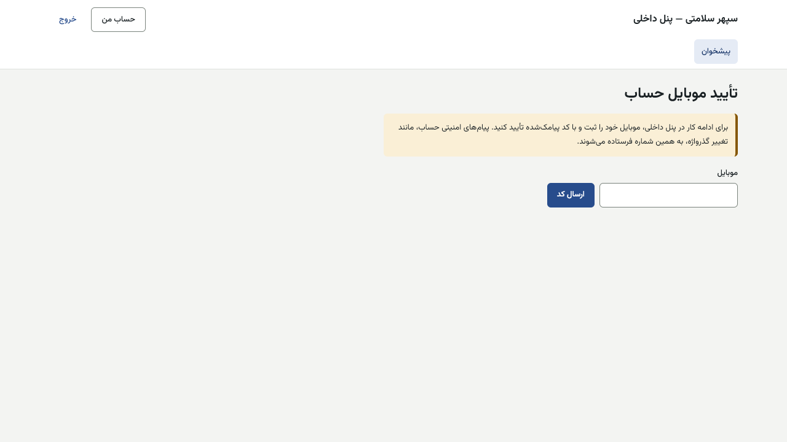

# راهنمای کار با سامانه سپهر سلامتی

نسخه ۱۴۰۵/۰۸/۰۱. این راهنما از روی کد و صفحه‌های واقعی سامانه نوشته شده است، نه از حافظه.
همه نام‌ها، شماره‌ها و مبلغ‌های نمونه **ساختگی**اند. تصویرها از محیط آزمایشی یک‌بارمصرف با داده ساختگی گرفته شده‌اند.

> این مجموعه جای راهنمای کوتاه قبلی (`docs/user-guides/`) را برای آموزش کارکنان می‌گیرد. آن پوشه برای سابقه می‌ماند.

## از کجا شروع کنم؟

1. اول [جریان کامل یک پرونده](case-flow.md) را بخوانید تا ببینید کار شما کجای زنجیره است.
2. بعد راهنمای نقش خودتان را از جدول پایین باز کنید.
3. هر واژه‌ای که روشن نبود در [واژه‌نامه](glossary.md) هست.

## برچسب‌هایی که در متن می‌بینید

| برچسب | یعنی |
|---|---|
| **غیرفعال در پایلوت** | در سامانه ساخته شده، ولی کلید یا پرچمش خاموش است و در پایلوت اصفهان روشن نمی‌شود، مگر مالک دستور دهد. |
| **در دست ساخت** | هنوز ساخته نشده یا فقط بخشی از آن ساخته شده است. |
| **نیازمند تأیید** | نویسنده از روی کد مطمئن نبود. پیش از آموزش، با مالک یا تیم فنی سنجیده شود. |
| **رویه دستی در پایلوت** | صفحه‌اش پس از پایلوت ساخته می‌شود (تصمیم مالک ۱۴۰۵/۰۸/۰۱). تا آن زمان کار با تیکت و کمک مدیر سیستم انجام می‌شود؛ گام‌ها در راهنمای همان نقش آمده است. |
| **فقط از API** | کار در سامانه هست ولی صفحه پنل ندارد. تا ساخت صفحه، مدیر سیستم یا تیم فنی انجامش می‌دهد. |

## سه درگاه سامانه

| درگاه | چه کسانی | ورود |
|---|---|---|
| **اپ بیمار** (وب، روی گوشی و رایانه) | بیمار، وام‌گیرنده، ضامن | شماره موبایل و کد پیامکی؛ رمز ندارد |
| **پنل مرکز** (`/panel`) | پزشک، منشی، مدیر مرکز | نام کاربری، رمز عبور و کد شش‌رقمی برنامه احراز هویت |
| **پنل داخلی** (دامنه جدا، فقط از VPN) | کارکنان سپهر | نام کاربری، رمز عبور و کد شش‌رقمی برنامه احراز هویت |

## فهرست نقش‌ها

نقش‌ها داده‌اند، نه کد. این فهرست از پایگاه داده و مهاجرت‌ها استخراج شده است (`roles` و `role_permissions`). هر کارمند فقط نقشی را می‌گیرد که مالک برایش تعیین کرده است. **منو فقط بخش‌هایی را نشان می‌دهد که نقش شما مجوزشان را دارد.**

### کاربران اپ بیمار

| نقش | کد | راهنما |
|---|---|---|
| بیمار، وام‌گیرنده و ضامن | (بی نقش؛ ورود با موبایل) | [patient.md](roles/patient.md) |

### پنل مرکز

| نقش | کد | راهنما |
|---|---|---|
| پزشک | `doctor` | [doctor.md](roles/doctor.md) |
| منشی | `secretary` | [secretary.md](roles/secretary.md) |
| مدیر مرکز | `center_manager` | [center-manager.md](roles/center-manager.md) |

### پنل داخلی

| نقش | کد | راهنما |
|---|---|---|
| مشاور (حامی) | `advisor` | [advisor.md](roles/advisor.md) |
| پشتیبانی | `support` | [support.md](roles/support.md) |
| کارشناس شبکه درمان | `network_specialist` | [network-specialist.md](roles/network-specialist.md) |
| مدیر شبکه درمان | `network_manager` | [network-manager.md](roles/network-manager.md) |
| کارشناس اعتبار | `credit_specialist` | [credit-specialist.md](roles/credit-specialist.md) |
| مسئول / مدیر اعتبار | `credit_manager` | [credit-manager.md](roles/credit-manager.md) |
| عضو کمیته ریسک و اعتبار | `credit_committee` | [credit-committee.md](roles/credit-committee.md) |
| کارشناس تکمیل پرونده | `case_completion` | [case-completion.md](roles/case-completion.md) |
| مسئول باشگاه مشتریان | `club_officer` | [club-officer.md](roles/club-officer.md) |
| حسابداری و تسویه | `accounting` | [accounting.md](roles/accounting.md) |
| واحد معوقات | `collection` | [collection.md](roles/collection.md) |
| مدیر واحد معوقات | `collection_manager` | [collection-manager.md](roles/collection-manager.md) |
| مدیر استراتژی | `strategy_manager` | [strategy-manager.md](roles/strategy-manager.md) |
| مدیرعامل | `ceo` | [ceo.md](roles/ceo.md) |
| حسابرس | `auditor` | [auditor.md](roles/auditor.md) |
| مدیر سیستم | `system_admin` | [system-admin.md](roles/system-admin.md) |

### دو نقش که روز راه‌اندازی ساخته می‌شوند

این دو مجوز به هیچ نقش آماده‌ای داده نشده‌اند. مدیر سیستم از صفحه «نقش‌ها و دسترسی‌ها» نقش تازه می‌سازد ([system-admin.md](roles/system-admin.md)).

| نقش (نام پیشنهادی) | مجوز | راهنما |
|---|---|---|
| تأییدکننده موبایل افزوده | `lead.approve_person_mobile` | [patient-mobile-approver.md](roles/patient-mobile-approver.md) |
| تغییر شماره بیمار | `identity.change_patient_mobile` | [patient-mobile-changer.md](roles/patient-mobile-changer.md) |

## برای همه کارکنان (پنل مرکز و پنل داخلی)

### ورود اول

1. نام کاربری و رمز موقت را حضوری از مدیر سیستم بگیرید. رمز در پیام‌رسان یا ایمیل فرستاده نمی‌شود.
2. در صفحه ورود، «نام کاربری» و «رمز عبور» را بنویسید و «ادامه» را بزنید.
3. بار اول صفحه «فعال‌سازی ورود دومرحله‌ای» می‌آید:
   - برنامه احراز هویت گوشی (هر برنامه استاندارد TOTP) را باز کنید و کد QR را بخوانید.
   - اگر نمی‌توانید بخوانید، «نمی‌توانید کد را بخوانید؟» را بزنید و کلید را دستی وارد کنید.
   - کد شش‌رقمی برنامه را در «کد تأیید» بنویسید و «ورود» را بزنید.
4. از بار دوم: نام کاربری، رمز، سپس کد شش‌رقمی برنامه.
5. در «حساب من»، رمز موقت را عوض کنید: «گذرواژه فعلی»، «گذرواژه تازه»، «تکرار گذرواژه تازه». **دست‌کم ۱۲ نویسه**؛ یک عبارت بلند و به‌یادماندنی بهتر از رمز کوتاه پیچیده است.

### پیام‌های ورود و رمز

| پیام | دلیل | چه کنم |
|---|---|---|
| «نام کاربری یا رمز عبور درست نیست.» | یکی از دو مورد اشتباه است | دوباره با دقت بنویسید. زبان صفحه‌کلید را ببینید. |
| «به دلیل تلاش‌های نادرست، ورود موقتاً بسته است.» | ۶ تلاش ناموفق | ۱۵ دقیقه صبر کنید (مقدار پیش‌فرض). اگر باز نشد، به مدیر سیستم خبر دهید. |
| «این حساب غیرفعال است.» | خروج کارمند یا غیرفعال شدن | با مدیر سیستم تماس بگیرید. |
| «ورود به پنل از این شبکه مجاز نیست.» | پنل داخلی فقط از VPN باز است | به VPN شرکت وصل شوید. |
| «گذرواژه کوتاه است؛ دست‌کم ۱۲ نویسه بنویسید.» و پیام‌های مشابه | قواعد رمز | رمز دیگری بسازید: نام کاربری در آن نباشد، فقط رقم نباشد، رایج نباشد. |
| «نشست شما پایان یافته است. لطفاً دوباره وارد شوید.» | مدت نشست تمام شده | دوباره وارد شوید. |
| «نشست شما تازه نیست. صفحه را دوباره بارگذاری کنید.» | صفحه مدت زیادی باز مانده | صفحه را تازه کنید. |

### تأیید موبایل حساب

اگر پرچم «موبایل تأییدشده برای کارکنان» روشن باشد، پیش از هر کار صفحه «تأیید موبایل حساب» می‌آید. موبایل را بنویسید، «ارسال کد» را بزنید و کد پیامک‌شده را در «تأیید موبایل با کد» وارد کنید. پیام‌های امنیتی حساب (مثل تغییر گذرواژه) به همین شماره می‌رسد.

### کار حساس و پنجره «تأیید هویت»

اگر پرچم «بازاحراز TOTP پیش از کار حساس» روشن باشد، این کارها کد شش‌رقمی را دوباره می‌خواهند: دادن و لغو نقش، ساخت نقش، پیشنهاد و تأیید تنظیمات، تعطیلات، خروج کارمند، بازنشانی ورود دومرحله‌ای و تغییر شماره بیمار.
پنجره «تأیید هویت» باز می‌شود: «این کار حساس است. کد شش‌رقمی برنامه احراز هویت خود را دوباره وارد کنید.»

- **در دست ساخت:** همین بازاحراز روی تأییدهای دونفره **مالی** (شارژ، تسویه، دستور پرداخت، عملیات ویژه، چک) هنوز ساخته نشده است (مانع راه‌اندازی م۳).

### تأیید دونفره

هر کار پرخطر را یک نفر پیشنهاد یا درخواست می‌دهد و **نفر دیگری** تأیید می‌کند. سامانه اجازه نمی‌دهد یک نفر هر دو امضا را بزند؛ هم در سرور و هم در پایگاه داده بررسی می‌شود. پیام: «این درخواست را باید شخص دیگری جز پیشنهاددهنده تأیید کند.»
**چرا؟** اگر حساب یک نفر دزدیده شود یا اشتباه کند، پول یا قاعده بی‌چشم دوم جابه‌جا نمی‌شود.

### گوشی گم شد یا برنامه احراز هویت پاک شد

به مدیر سیستم خبر دهید. بازنشانی ورود دومرحله‌ای دونفره است و همه نشست‌های شما بسته می‌شود. **فقط از API:** صفحه بازنشانی در پنل نیست ([system-admin.md](roles/system-admin.md)).

### داده بیمار

هیچ نام، کد ملی، موبایل یا شرح درمان بیمار را در پیام‌رسان، ایمیل یا گروه نفرستید. فقط شماره پرونده.

## تصویرها

تصویرها در `img/<نقش>/` هستند. جایی که تصویر نبود، متن «[تصویر: …]» آمده است. فهرست تصویرهای لازم در پایان هر راهنما.
