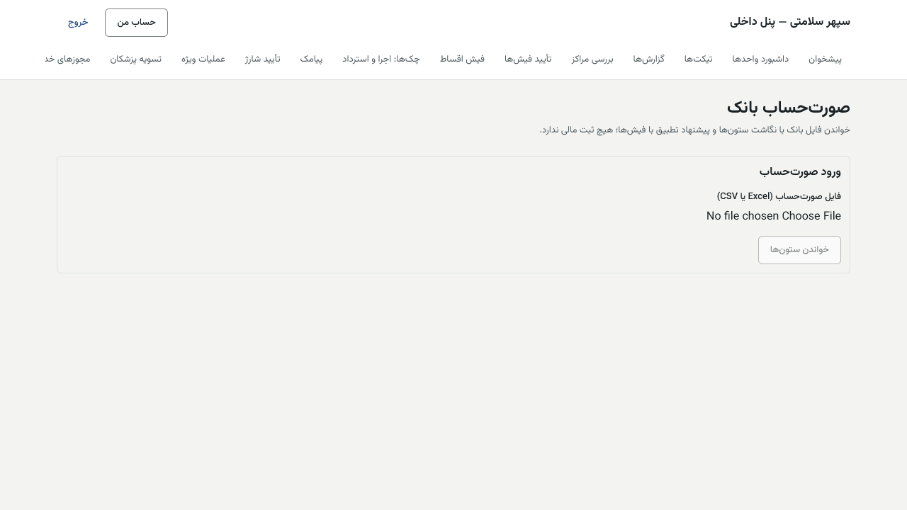
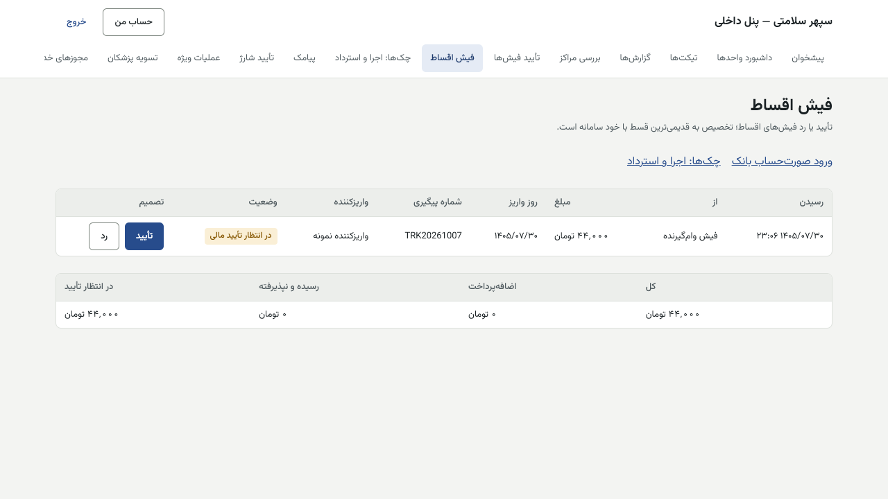
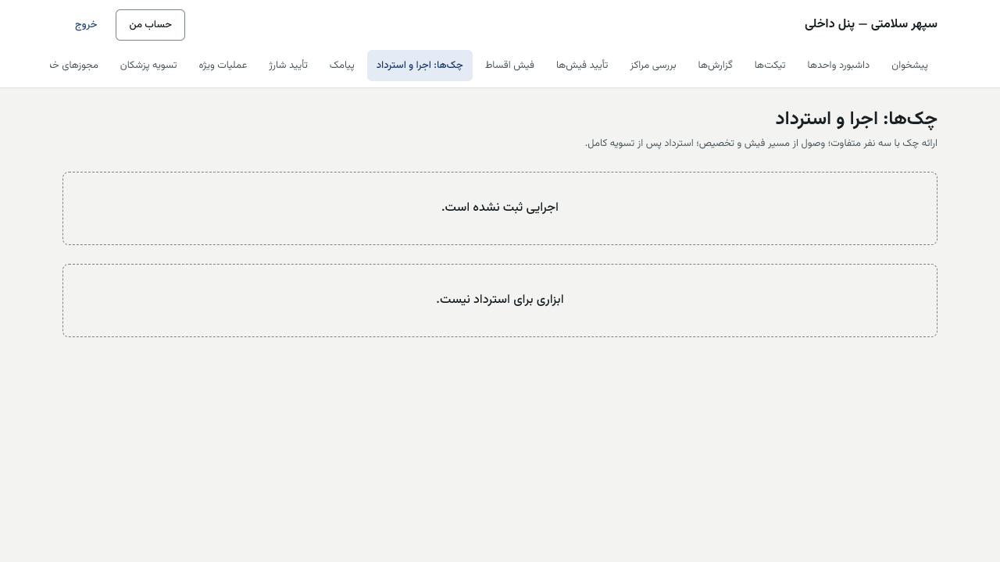
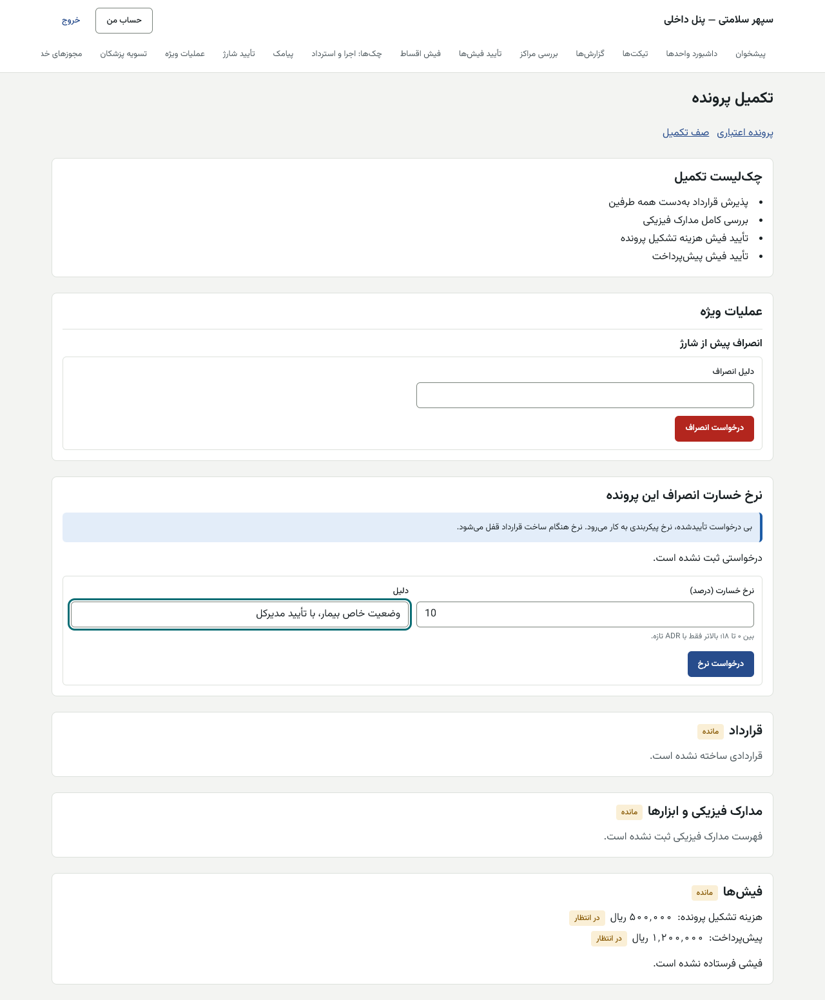
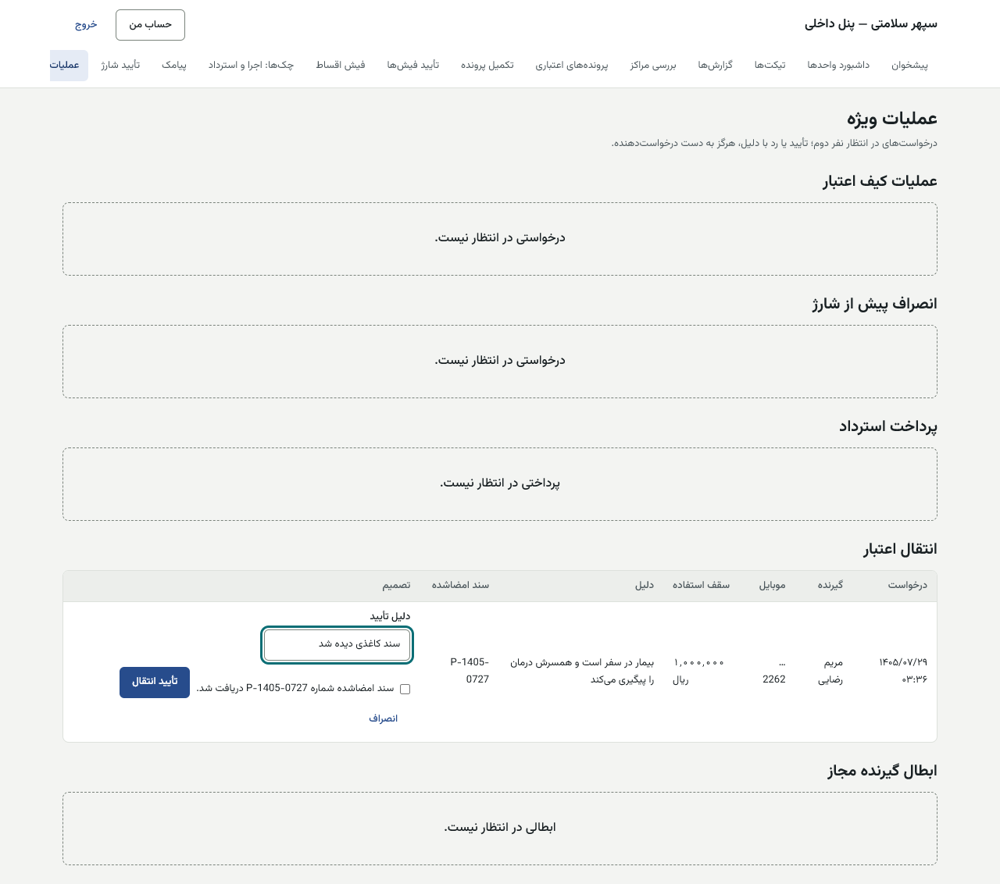
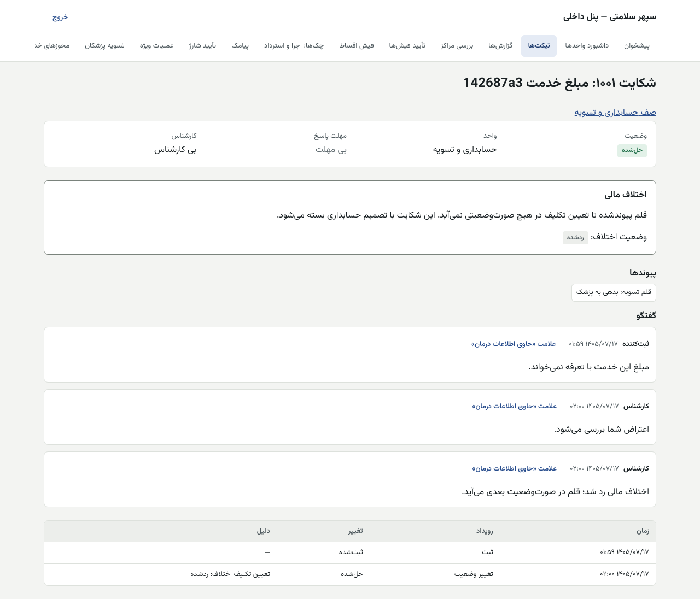

# راهنمای حسابداری و تسویه — پنل داخلی

[فهرست](../README.md) · [جریان پرونده](../case-flow.md) · [واژه‌نامه](../glossary.md)

## ۱. معرفی نقش

نقش `accounting`. حسابداری همه پول‌های سامانه را تأیید می‌کند: فیش‌های تکمیل پرونده و اقساط، شارژ کیف، عملیات ویژه کیف، پرداخت استرداد، صورت‌وضعیت و پرداخت به پزشکان، اجرا و استرداد چک، تغییر شبای مراکز و تصمیم درباره اعتراض‌های مالی.

**مجوزهای اصلی:** تأیید فیش‌ها؛ تأیید شارژ؛ درخواست و تأیید عملیات ویژه؛ درخواست و تأیید انصراف؛ درخواست و تأیید پرداخت استرداد؛ درخواست نرخ خسارت؛ درخواست و تأیید انتقال اعتبار؛ صورت‌وضعیت (بررسی، تأیید، لغو، خروجی پرداخت، نگاشت Odoo، گزارش)؛ ثبت و تأیید خدمت نقدی؛ اعتراض تسویه (ثبت و تصمیم)؛ لغو مجوز خدمت؛ چک (تأیید مالی اجرا، ثبت نتیجه، استرداد)؛ دیدن و تأیید تغییر شبا؛ دیدن دفتر کل، کیف، اقساط و گزارش‌ها؛ گزارش ماهانه تخفیف‌ها؛ تیکت.

**نمی‌تواند:** درخواست یا پیشنهاد **خودش** را تأیید کند (سامانه و پایگاه داده رد می‌کنند)؛ ثبت مالی را ویرایش یا حذف کند (فقط سند معکوس)؛ نرخ خسارت را تأیید کند (مدیرعامل)؛ تصمیم اعتباری بگیرد؛ نرخ کارمزد خدمت را تأیید کند (مجوز پیکربندی کسب‌وکار ندارد).

## ۲. ورود و خروج

پنل داخلی، فقط از VPN. [برای همه کارکنان](../README.md#برای-همه-کارکنان-پنل-مرکز-و-پنل-داخلی).

> **در دست ساخت (م۳):** بازاحراز TOTP پیش از تأییدهای مالی هنوز ساخته نشده است. تا آن زمان، پیش از هر تأیید مالی از جلوی رایانه دور نشوید و صفحه را قفل کنید.

## ۳. نقشه صفحه‌ها

| منو | کار |
|---|---|
| تأیید فیش‌ها (`/receipts`) | فیش هزینه تشکیل، کارمزد طرح و پیش‌پرداخت |
| فیش اقساط (`/repayment`) | فیش اقساط، حساب معلق |
| صورت‌حساب بانک (`/bank-statements`) | ورود فایل بانک و پیشنهاد تطبیق |
| چک‌ها: اجرا و استرداد (`/instruments`) | تأیید مالی اجرا، وصول یا برگشت، استرداد |
| تأیید شارژ (`/funding`) | شارژ کیف |
| عملیات ویژه (`/special-operations`) | ابطال، برگشت ابطال، تغییر پزشک (دیدن)، انصراف، استرداد، انتقال، نرخ خسارت (دیدن) |
| تسویه پزشکان (`/settlement`) | صورت‌وضعیت‌ها، پرداخت، گزارش‌ها، خروجی Odoo |
| مجوزهای خدمت (`/services`) | لغو مجوز پیش از قطعی شدن |
| بررسی مراکز (`/centers`) | تأیید تغییر شبا |
| تخفیف‌های تشکیل پرونده | گزارش ماهانه |
| گزارش‌ها، تیکت‌ها، داشبورد واحدها | — |

## ۴. کارهای روزانه

### ۴.۱ تأیید فیش‌های تکمیل پرونده

1. «تأیید فیش‌ها»: «فیش‌های در انتظار تأیید مالی». ستون‌ها: ارسال، بابت (هزینه تشکیل، کارمزد طرح، پیش‌پرداخت)، «مبلغ فیش»، «مبلغ مورد انتظار»، برچسب «نابرابر»، روز پرداخت، شماره پیگیری، فایل.
2. «مشاهده فیش» و تطبیق با گردش حساب بانک **به ریال و دقیق**.
3. «تأیید فیش»، یا «رد فیش» ← «دلیل رد» ← «رد با دلیل». بیمار دلیل را می‌بیند.

| پیام | دلیل | چه کنم |
|---|---|---|
| «مبلغ فیش با مبلغ مورد انتظار برابر نیست؛ فیش را با دلیل رد کنید.» | فقط مبلغ دقیق | رد با دلیل |
| «فیش را کسی جز بارگذارنده‌اش باید تأیید کند.» | شما بارگذاری کرده‌اید | همکار دیگر |
| «این پرداخت فقط به نام آرامش ثروت ثبت می‌شود.» | — | — |
| «درباره این فیش پیش‌تر تصمیم گرفته شده است.» | — | صفحه را تازه کنید |

**ثبت در دفتر کل:** تأیید فیش پیش‌پرداخت: بدهکار بانک وصول، بستانکار «پیش‌پرداخت نگهداری‌شده» (بدهی به وام‌گیرنده تا شارژ). هزینه تشکیل و کارمزد نقدی: بدهکار بانک وصول، بستانکار درآمد کارمزد آرامش ثروت.

### ۴.۲ تأیید شارژ کیف

1. «تأیید شارژ»: «درخواست‌های شارژ در انتظار تأیید»: درخواست، پرونده («مشاهده»)، وام، پیش‌پرداخت، اقساط.
2. «تأیید شارژ»، یا «رد درخواست» ← «دلیل رد» ← «رد با دلیل».
3. با تأیید، در یک تراکنش: سقف مانده وام‌گیرنده (اگر روشن است) دوباره سنجیده می‌شود، اعتبار تصویب و کیف شارژ می‌شود (مصوب + پیش‌پرداخت)، برنامه اقساط از امروز ساخته می‌شود و پیامک به بیمار و پزشک می‌رود.

| پیام | دلیل |
|---|---|
| «تأییدکننده نمی‌تواند درخواست خودش را تأیید کند.» | — |
| «پیش‌پرداخت این پرونده هنوز تأیید و ثبت نشده است.» | فیش پیش‌پرداخت |
| «پیش‌پرداخت ثبت‌شده با پیش‌پرداخت مورد انتظار برابر نیست.» | — |
| «پیش‌پرداخت این پرونده برگشت خورده است؛ فیش تازه لازم است.» | — |
| «برنامه اقساط با قرارداد یکی نشد؛ شارژ انجام نشد…» | کل شارژ برگشت خورد؛ به تیم فنی |
| «با این وام، مانده فعال وام‌های این وام‌گیرنده از سقف مجاز بیشتر می‌شود؛ تأیید یا شارژ انجام نشد.» | سقف؛ رد جدا ثبت می‌شود |

### ۴.۳ فیش اقساط و حساب معلق

1. «فیش اقساط»: زبانه‌های «ثبت کارکنان»، «فیش وام‌گیرنده»، «صورت‌حساب بانک یا وصول چک».
2. هر فیش: رسیدن، از، مبلغ، روز واریز، شماره پیگیری، واریزکننده، وضعیت، برچسب «شبیه فیش قبلی».
3. «تأیید»، یا «رد» با «نوع رد» («به حساب نرسیده» یا «رسیده، ولی پذیرفته نمی‌شود») و «دلیل رد (برای وام‌گیرنده)».
4. فیش «شبیه فیش قبلی»: «چرا تکراری نیست؟» را بنویسید و «تأیید با این توضیح».
5. **تخصیص خودکار است:** پرداخت تأییدشده به قدیمی‌ترین قسط باز می‌نشیند.
6. «مانده در حساب معلق (فقط خواندنی؛ تعیین تکلیف دستی حسابداری)»: کل، اضافه‌پرداخت، رسیده و نپذیرفته، در انتظار تأیید.

### ۴.۴ صورت‌حساب بانک

1. «صورت‌حساب بانک» ← «ورود صورت‌حساب» ← «فایل صورت‌حساب (Excel یا CSV)» ← «خواندن ستون‌ها».
2. نگاشت: «ستون روز»، «ستون مبلغ»، «ستون شماره پیگیری»، «ستون شرح»، «واحد مبلغ در فایل» (ریال یا تومان)، «ردیف اول» (عنوان ستون‌هاست یا تراکنش است).
3. «پیش‌نمایش با این نگاشت»: «… ردیف معتبر، … ردیف نامعتبر؛ جمع …».
4. «ثبت صورت‌حساب و پیشنهاد تطبیق». **هیچ ثبت مالی ندارد**؛ فقط پیشنهاد «تطبیق دقیق»، «تطبیق احتمالی»، «واریز ناشناس»، «ردیف نامعتبر»، «مربوط به چک».
5. برای هر ردیف «یادداشت بررسی» ← «ثبت بررسی». تأیید فیش‌ها همچنان در «فیش اقساط» است.

### ۴.۵ چک: اجرا، نتیجه، استرداد

«ارائه چک با سه نفر متفاوت؛ وصول از مسیر فیش و تخصیص؛ استرداد پس از تسویه کامل.»
1. «اجرای چک‌ها»: پیشنهاد (از واحد معوقات)، چک، مبلغ، دلیل، وضعیت، «مدیر وصول: تأیید کرد / منتظر»، «مالی».
2. پس از تأیید مدیر وصول: «تأیید مالی».
3. پس از ارائه به بانک: «وصول شد» («روز وصول»، «شماره پیگیری بانک») یا «برگشت خورد» («روز برگشت»، «دلیل برگشت»: «کسری موجودی»، «مغایرت امضا»، «حساب بسته»، «دیگر»؛ «توضیح») ← «ثبت».
4. «استرداد: ابزارهای وام‌های تسویه‌شده» ← «استرداد».

> «مبلغ چک از مانده بدهی بیشتر است؛ هیچ مبلغی در حساب معلق ثبت نمی‌شود (پرسش باز ۶.۱۰).» در این حالت «چک ارائه‌شده رد می‌شود» و چک «ارائه‌شده» می‌ماند تا تصمیم.

### ۴.۶ عملیات ویژه

«عملیات ویژه»: «درخواست‌های در انتظار نفر دوم؛ تأیید یا رد با دلیل، هرگز به دست درخواست‌دهنده.»

| بخش | درخواست | تأیید | شما |
|---|---|---|---|
| عملیات کیف: ابطال مانده، برگشت ابطال، انصراف پس از شارژ | حسابداری | حسابداری دیگر | هر دو، نه هم‌زمان |
| تغییر پزشک | تکمیل پرونده یا مدیر اعتبار | مدیر اعتبار | دیدن |
| انصراف پیش از شارژ | تکمیل پرونده یا حسابداری | حسابداری | «تأیید انصراف و استرداد» |
| پرداخت استرداد | حسابداری | حسابداری دیگر | «تأیید پرداخت» |
| انتقال اعتبار | تکمیل پرونده یا حسابداری | حسابداری | **غیرفعال در پایلوت** |
| نرخ خسارت انصراف | حسابداری | مدیرعامل | درخواست |

**درخواست ابطال مانده** (از صفحه تکمیل پرونده، بخش عملیات کیف): «مبلغ ابطال (خالی: همه مانده)» به ریال، «دلیل». «از آخرین اقساط دست‌نخورده کم می‌شود.» یک‌بار قابل برگشت تا کیف باز است («درخواست برگشت ابطال»).

**درخواست انصراف پس از شارژ:** «مانده مصرف‌نشده باطل، کارمزد اقساط سررسیدنشده بخشوده و خسارت قرارداد یکجا با سررسید جدا ثبت می‌شود؛ کیف بسته می‌شود.» در همان تأیید، بخش کسب‌نشده کارمزد نقدی هم به حساب «قابل استرداد» وام‌گیرنده می‌رود.

**ثبت پرداخت استرداد:** «بابت» («پیش‌پرداخت (مانده …)» یا «هزینه‌های پرونده (مانده …)»)، «مبلغ» (ریال، همان‌طور که در حواله آمده)، «روز پرداخت»، «شماره پیگیری بانک»، «توضیح» ← «ثبت پرداخت». نفر دوم «تأیید پرداخت».

**درخواست نرخ خسارت این پرونده:** «نرخ خسارت (درصد)»: «بین ۰ تا ۱۸؛ بالاتر فقط با ADR تازه.» و دلیل. فقط پیش از ساخت قرارداد. مدیرعامل تأیید می‌کند.

| پیام | دلیل |
|---|---|
| «مبلغ از مانده مصرف‌نشده کیف اعتبار بیشتر است.» | — |
| «روی کیف مانده یا رزرو باز هست؛ بسته نمی‌شود.» | مجوز خدمت باز |
| «پیش‌پرداخت این ابطال به وام‌گیرنده پرداخت شده است؛ ابطال برگشت داده نمی‌شود.» | — |
| «این شماره پیگیری بانک پیش‌تر ثبت شده است.» | — |
| «مبلغ از مانده قابل استرداد بیشتر است.» | — |
| «نرخ خسارت باید بین ۰ تا ۱۸ درصد باشد.» | — |
| «برای این پرونده پیش‌تر قرارداد ساخته شده است.» | نرخ دیگر عوض نمی‌شود |
| «پیش از تأیید انتقال، دریافت سند امضاشده انتقال‌دهنده را تأیید کنید.» | تیک دریافت سند |

### ۴.۷ تسویه پزشکان

1. «تسویه پزشکان» (صورت‌وضعیت پزشکان): فیلتر «وضعیت صورت‌وضعیت»؛ ستون‌ها: دوره، خدمات، قابل پرداخت، ساخت، «مشاهده».
2. صورت‌وضعیت: «خدمت اعتباری»، «کارمزد خدمت اعتباری»، «کارمزد خدمت نقدی»، «مانده دوره قبل»، «سایر کسورات»، «تهاتر (بدهی به پزشک)»، «تهاتر (کارمزد)»، «منتقل به دوره بعد»، «قابل پرداخت»؛ «ردیف‌های صورت‌وضعیت»؛ «دستورهای پرداخت».
3. «کارهای صورت‌وضعیت»:
   - نفر اول: «بررسی شد».
   - نفر دوم: «تأیید دوم و صدور دستور پرداخت».
   - «فایل بانک» را بگیرید (CSV عمومی: شبا، مبلغ، نام، شناسه) و در بانک بارگذاری کنید.
   - پس از پرداخت: «کد رهگیری بانک»، «روز پرداخت (از فیش بانک)» ← «ثبت کد رهگیری»؛ نفر دوم «تأیید دوم پرداخت».
   - پرداخت ناموفق: «دلیل ناموفق بودن» ← «اعلام یا تأیید ناموفق» (دونفره)، سپس «صدور دوباره».
   - لغو صورت‌وضعیت: «دلیل لغو (با تأیید نفر دوم)» ← «درخواست یا تأیید لغو».
4. «گزارش‌های تسویه»: «اقلام معلق» (به‌دلیل اعتراض) و «مانده منفی» با «هشدار» پس از ۲ دوره پیاپی.
5. «خروجی Odoo»: «ثبت نگاشت حساب» («حساب داخلی (مثل doctor.payable)»، «کد حساب در Odoo»، «دلیل») و «ساخت خروجی Odoo» (سال، ماه) ← «ساخت و دریافت فایل». شناسه هر سند در هر بار خروجی یکسان است؛ تاریخ ستون ماشینی ISO و ستون خواندنی شمسی.

روز هدف پرداخت: **۱۰ هر ماه شمسی**. صورت‌وضعیت‌ها با کار زمان‌بندی‌شده ساخته می‌شوند.

### ۴.۸ اعتراض مالی پزشک

1. «تیکت‌ها»: تیکت با «اختلاف مالی». «قلم پیوندشده تا تعیین تکلیف در هیچ صورت‌وضعیتی نمی‌آید.»
2. «تعیین تکلیف» ← «یادداشت تصمیم» ← «پذیرش اعتراض» یا «رد اعتراض».
3. با پذیرش: «پذیرفته شد؛ اصلاح دفتر کل هنوز ثبت نشده است.» ← «ثبت اصلاح» (سند معکوس؛ اگر بیمار طلبکار شود، بازگشت مبلغ به بیمار طبق ADR-038). شکایت با همین تصمیم بسته می‌شود.

### ۴.۹ لغو مجوز خدمت

«مجوزهای خدمت» ← «لغو با دلیل» ← «دلیل لغو» ← «لغو مجوز». فقط پیش از قطعی شدن: «این خدمت قطعی شده است و در این مرحله لغو نمی‌شود؛ اعتراض به آن در تسویه بررسی می‌شود.»

### ۴.۱۰ تأیید تغییر شبای مرکز

«بررسی مراکز» ← مرکز ← «درخواست‌ها» ← «تغییر حساب بانکی» ← «تأیید درخواست» یا «رد درخواست». شماره کامل شبا فقط با مجوز دیدن است.

### ۴.۱۱ خدمت نقدی

ثبت و تأیید خدمت نقدی (برای کارمزد خدمت نقدی پزشک): **فقط از API**، صفحه ندارد.

## ۵. قواعد مالی (از ADRها)

همه مبالغ `bigint` ریال است.

| قاعده | مقدار و منبع |
|---|---|
| پیش‌پرداخت | درون کیف؛ شارژ = مصوب (A) + پیش‌پرداخت (D)؛ مصرف اول از D (ADR-034) |
| بدهی وام‌گیرنده | A + کارمزد طرح سرشکن؛ پیش‌پرداخت بدهی نیست |
| گرد کردن | مبالغ درصدی طرح‌های تازه رو به پایین تا مضرب ۱۰ ریال؛ وام گرد نمی‌شود (ADR-035)؛ واحد قسط از نسخه قفل‌شده پرونده (ADR-039) |
| هزینه تشکیل | طرح‌های الحاقیه ۳٪ کل صورت‌حساب؛ بخشودگی ۲٪ با ۵ چک بررسی‌شده؛ تخفیف تا ۱٪؛ جمع حداکثر ۳٪؛ قفل هنگام بارگذاری فیش (ADR-048) |
| طرح فقط‌دستمزد | D = ۱۸٪ کل؛ وام = W − D؛ مواد نقد به پزشک، بیرون از دفتر کل؛ پزشک از کیف فقط دستمزد (ADR-050) |
| سقف مانده وام‌گیرنده | پیشنهادی ۱٬۵۰۰٬۰۰۰٬۰۰۰، مبنای «بدهی باقی»، با تأییدشده‌های شارژنشده؛ سنجش در تصمیم و شارژ (ADR-051) |
| انصراف پیش از شارژ | همه فیش‌های تأییدشده بی خسارت به «قابل استرداد» (ADR-036) |
| انصراف پس از شارژ | ابطال مانده، بخشودن کارمزد اقساط سررسیدنشده، برگشت بخش کسب‌نشده کارمزد نقدی (ADR-045)، خسارت، بستن کیف |
| خسارت انصراف | `floor(مصوب × نرخ / ۱۰۰۰۰)`؛ پیش‌فرض ۱۸۰۰ واحد پایه (۱۸٪)؛ سررسید ۳۰ روز؛ بی تهاتر خودکار با استرداد (ADR-044) |
| کارمزد خدمت | از قرارداد پزشک یا مرکز، گرد به پایین تا ریال، قفل روی هر خدمت (ADR-037)؛ پیش‌فرض ۰ |
| مدت قرارداد پزشک یا مرکز | پس از پایان، خدمت تازه رد (ADR-046) |
| انتقال اعتبار | سقف = موجودی کیف؛ سند کاغذی با تأیید دریافت (ADR-047)؛ **غیرفعال در پایلوت** |

**هرگز:** ویرایش یا حذف ثبت مالی. اصلاح فقط با سند معکوس. اگر عددی با دفتر کل نمی‌خواند: `docs/runbooks/ledger-mismatch.md`.

## ۶. تأییدهای دونفره

هر جدول بالا. قاعده: **درخواست‌دهنده هرگز تأییدکننده نیست**، در سرور و با CHECK پایگاه داده. دلیل: یک حساب دزدیده یا یک اشتباه نباید پول جابه‌جا کند.

## ۷. پرسش‌های متداول

- **فیش با مبلغ کمی بیشتر رسیده.** رد با دلیل؛ بیمار فیش درست را می‌فرستد. اضافه‌پرداخت در اقساط به حساب معلق می‌رود.
- **چک بزرگ‌تر از بدهی است.** وصول رد می‌شود؛ تا تصمیم (پرسش ۶.۱۰) چک «ارائه‌شده» می‌ماند.
- **تهاتر خالص استرداد با بدهی؟** **در دست ساخت** (توقف مالک؛ ADR-045 «باز»). فعلاً پرداخت استرداد جدا و دریافت قسط جدا.

## ۸. چک‌لیست

**روزانه:** فیش‌های تکمیل؛ شارژها؛ فیش اقساط؛ عملیات ویژه؛ تیکت‌های اختلاف مالی.
**هفتگی:** صورت‌حساب بانک و تطبیق؛ حساب معلق؛ چک‌های سررسید.
**ماهانه:** صورت‌وضعیت‌ها تا ۱۰ هر ماه؛ خروجی Odoo؛ گزارش تخفیف‌ها؛ مانده منفی پزشکان.

## ۹. سناریوی نمونه (ساختگی)

صبح دو فیش سارا رسیده است: هزینه تشکیل ۱٬۲۰۰٬۰۰۰، پیش‌پرداخت ۲۴٬۰۰۰٬۰۰۰. حسابدار «الف» هر دو را با گردش حساب می‌سنجد و تأیید می‌کند. ظهر درخواست شارژ می‌رسد؛ «الف» آن را تأیید می‌کند (درخواست‌دهنده کارشناس تکمیل بود). کیف ۱۲۰٬۰۰۰٬۰۰۰ ریال شارژ می‌شود. اول ماه بعد، صورت‌وضعیت «دکتر نمونه» با خدمت ۱۰۰٬۰۰۰٬۰۰۰ ساخته می‌شود؛ «الف» «بررسی شد»، «ب» «تأیید دوم و صدور دستور پرداخت». پس از واریز، «الف» کد رهگیری را ثبت و «ب» «تأیید دوم پرداخت» را می‌زند.

## ۱۰. ویژگی‌های غیرفعال یا منتظر ورودی

| ویژگی | وضعیت |
|---|---|
| بازاحراز TOTP روی تأییدهای مالی | **در دست ساخت** (م۳، مانع راه‌اندازی) |
| تهاتر خالص استرداد با بدهی | **در دست ساخت** (منتظر تصمیم مالک) |
| بیعانه در دفتر کل (`deposit.held`) | **در دست ساخت**؛ پایلوت فقط ثبت مشخصات |
| سوخت اقساط | ساخته نمی‌شود تا ADR جدا |
| ثبت مازاد چک در معلق | ممنوع تا ADR جدا |
| انتقال اعتبار | **غیرفعال در پایلوت** |
| خدمت نقدی | **فقط از API** |
| نرخ‌های کارمزد خدمت | پیش‌فرض ۰ تا عدد قرارداد |

## تصویرهای لازم

- [تصویر: تأیید فیش‌ها]
- [تصویر: تأیید شارژ]
- [تصویر: صورت‌وضعیت و کارهای آن]
- [تصویر: عملیات ویژه]
