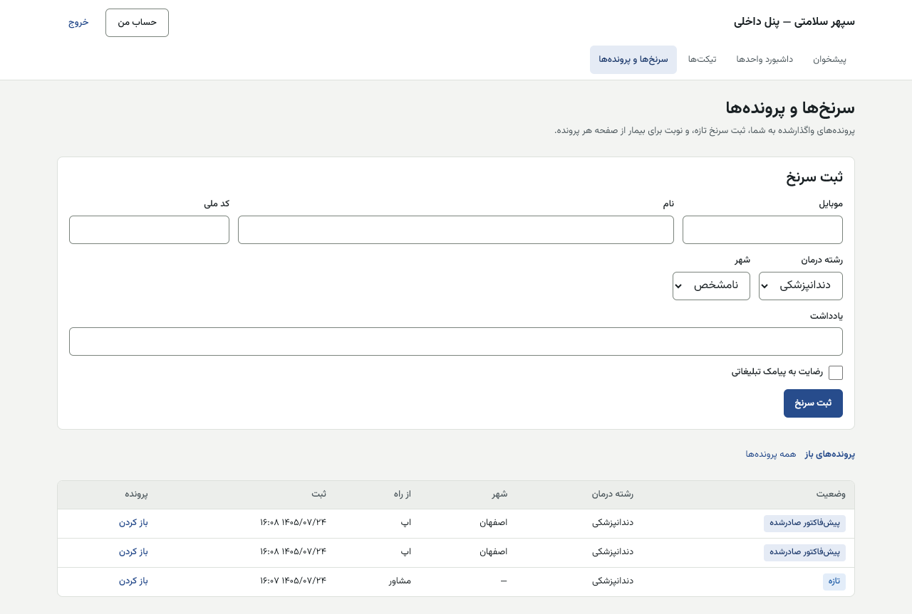
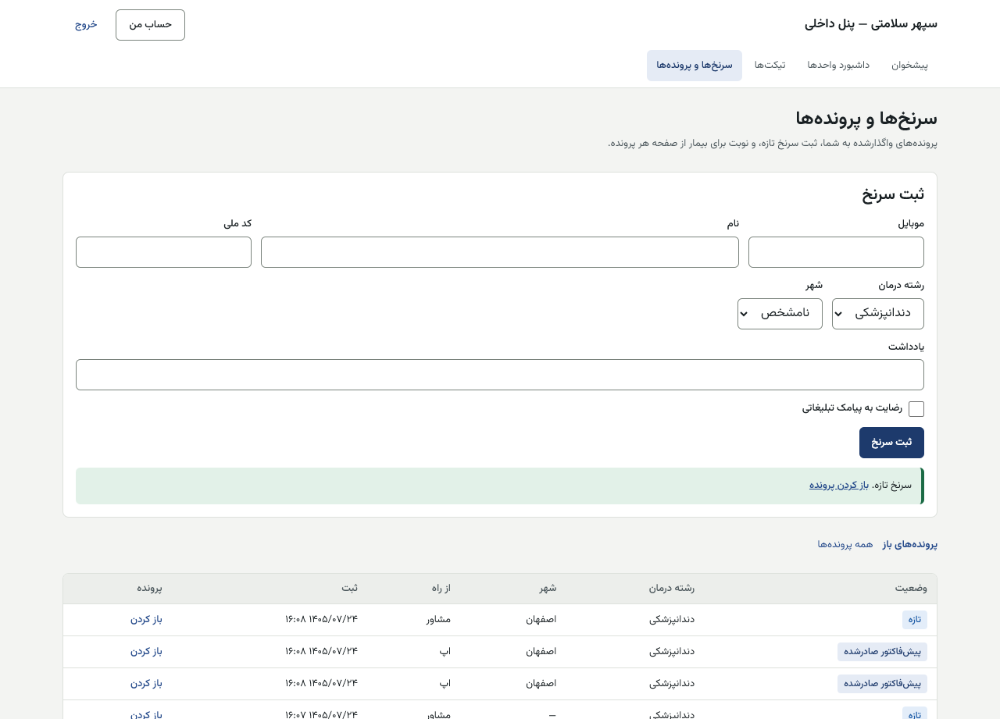
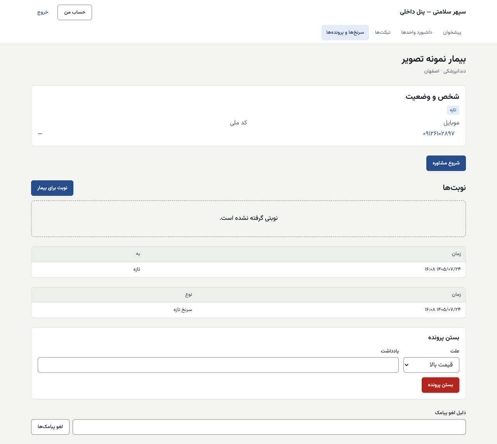
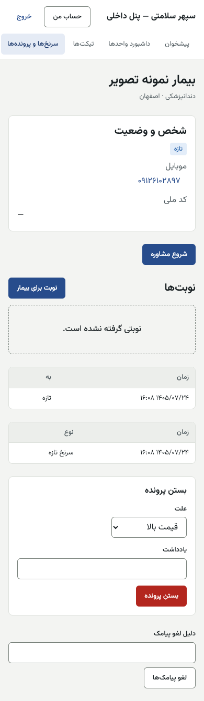

# راهنمای مشاور (حامی) — پنل داخلی

[فهرست](../README.md) · [جریان پرونده](../case-flow.md) · [واژه‌نامه](../glossary.md)

## ۱. معرفی نقش

نقش `advisor`. مشاور سرنخ‌ها را می‌گیرد یا ثبت می‌کند، با بیمار مشاوره می‌کند، پرونده را می‌بندد یا برایش نوبت می‌گیرد و وضعیت اعتباری بیمار خودش را پیگیری می‌کند.

**مجوزها:** دیدن و به‌روز کردن پرونده‌ها، ثبت دستی سرنخ، نوبت برای بیمار، دیدن وضعیت اعتباری (فقط «در بررسی، تأیید، رد»)، ثبت تیکت از طرف تماس‌گیرنده و کار روی تیکت، ثبت خدمت نقدی.

**دامنه همیشه «فقط رکوردهای خودش» است.** سامانه نقش مشاور را با دامنه دیگری نمی‌پذیرد. پس فقط پرونده‌هایی را می‌بینید که الان به شما سپرده شده است.

**نمی‌تواند:** پرونده را به مشاور دیگری منتقل کند (فقط مدیر استراتژی)؛ شخص را مسدود یا ادغام کند؛ امتیاز، دلیل رد یا مبالغ اعتباری بیمار را ببیند؛ پرونده‌ای را که از او منتقل شده دیگر ببیند؛ کار مالی کند.

## ۲. ورود و خروج

پنل داخلی، فقط از VPN. نام کاربری، رمز، کد شش‌رقمی. [برای همه کارکنان](../README.md#برای-همه-کارکنان-پنل-مرکز-و-پنل-داخلی).

## ۳. نقشه صفحه‌ها

| منو | نشانی | کار |
|---|---|---|
| سرنخ‌ها و پرونده‌ها | `/leads` | پرونده‌های شما، ثبت سرنخ |
| پرونده | `/leads/<شناسه>` | شخص، وضعیت، مشاوره، بستن، نوبت‌ها، سابقه |
| نوبت برای بیمار | `/leads/<شناسه>/book` | جست‌وجوی پزشک و ثبت نوبت |
| تیکت‌ها | `/tickets` | صف تیکت واحد و «ثبت از طرف تماس‌گیرنده» |
| داشبورد واحدها | `/dashboard/units` | صف و بار واحد |

## ۴. کارهای روزانه

### ۴.۱ پرونده‌های من

«سرنخ‌ها و پرونده‌ها»: زبانه «پرونده‌های باز» و «همه پرونده‌ها». ستون‌ها: وضعیت، رشته درمان، شهر، «از راه» (منبع: فرم سایت، تماس، ورود دستی…)، «بازگشتی»، ثبت. «باز کردن».

سرنخ‌های تازه به‌طور خودکار و طبق سهم هر مشاور تقسیم می‌شوند (مدیر استراتژی سهم‌ها را تعیین می‌کند). بیمار بازگشتی پیش‌فرض به مشاور قبلی‌اش برمی‌گردد.

### ۴.۲ ثبت سرنخ تازه

1. «ثبت سرنخ»: «موبایل» (الزامی)، «نام»، «کد ملی»، «رشته درمان»، «شهر» (یا «نامشخص»)، «یادداشت»، تیک «رضایت به پیامک تبلیغاتی» فقط اگر خود شخص گفته است.
2. ثبت. اگر همان موبایل در ۷ روز گذشته پرونده داشته باشد، تکراری شناخته می‌شود (پیش‌فرض).
3. پیام «… کد ملی به شخص دیگری تعلق دارد و ثبت نشد»: کد ملی مال شخص دیگری با موبایل دیگر است. شماره افزوده‌شده تا تأیید دونفره به اطلاعات آن شخص دسترسی ندارد ([patient-mobile-approver.md](patient-mobile-approver.md)).

### ۴.۳ مشاوره و بستن پرونده

1. در صفحه پرونده: «شخص و وضعیت» (برچسب‌های «بازگشتی»، «مسدود»، «بی پیامک»)، موبایل، کد ملی.
2. «شروع مشاوره». اگر کس دیگری زودتر شروع کرده: «مشاوره این پرونده پیش‌تر شروع شده است؛ صفحه را تازه کنید.»
3. بستن: «بستن پرونده» ← «علت» از فهرست (مثل «پرداخت نقدی»، «دیگر تماس نگیرید») ← ثبت.
4. لغو پیامک‌ها به درخواست شخص: «دلیل لغو پیامک» ← «لغو پیامک‌ها».
5. «سابقه وضعیت» و «ورودی‌ها» پایین صفحه.

> اگر روی پرونده نوشته است «موبایل افزوده‌شده هنوز تأیید نشده است و تا تأیید از آن استفاده نکنید.»، با آن شماره تماس نگیرید و نوبت نگیرید.

### ۴.۴ گرفتن نوبت برای بیمار

1. در پرونده، «نوبت برای بیمار».
2. «نام پزشک یا مرکز» ← «جست‌وجو». فهرست به رشته و شهر پرونده محدود است.
3. پزشک را «انتخاب» و روز و ساعت را از تقویم برگزینید.
4. «بررسی و ثبت نوبت» ← «ثبت درخواست نوبت». «پیامک برای بیمار فرستاده می‌شود.»

| پیام | دلیل |
|---|---|
| «این پرونده موبایل تأییدشده ندارد یا شخص مسدود است؛ نوبت گرفته نمی‌شود.» | — |
| «پزشکی با این رشته و شهر پیدا نشد.» | رشته یا شهر پرونده را بسنجید |
| «در روزهای پیش رو زمان آزادی برای این پزشک نیست.» | پزشک دیگر |

### ۴.۵ پیگیری وضعیت اعتباری

در پرونده فقط یکی از «در بررسی»، «تأیید»، «رد» دیده می‌شود. عدد، دلیل یا امتیاز نمی‌بینید. اگر بیمار علت رد را پرسید، او را به پشتیبانی بفرستید.

### ۴.۶ تیکت از طرف تماس‌گیرنده

«تیکت‌ها» ← «ثبت از طرف تماس‌گیرنده»: «موبایل تماس‌گیرنده»، «موضوع»، «عنوان»، «شرح گفته‌های تماس‌گیرنده»، «ثبت». تیکت به نام تماس‌گیرنده ثبت می‌شود و او آن را در اپ خود می‌بیند.

### ۴.۷ خدمت نقدی

مشاور مجوز «ثبت خدمت نقدی» دارد (خدمتی که بیمار معرفی‌شده نقد پرداخته، برای کارمزد خدمت نقدی پزشک). **فقط از API:** صفحه پنل ندارد.

## ۵. قواعد مالی مرتبط

مشاور عدد مالی نمی‌بیند و ثبت مالی نمی‌کند. به بیمار فقط بگویید: پیش‌پرداخت و هزینه‌ها به حساب آرامش ثروت با فیش است؛ مبالغ دقیق پس از ثبت درخواست در اپ دیده می‌شود.

## ۶. تأییدهای دونفره

مشاور در هیچ تأیید دونفره‌ای امضا نمی‌زند. شماره‌ای که با کد ملی به شخص موجود افزوده شود دونفره تأیید می‌شود و شما (افزاینده) نمی‌توانید آن را تأیید کنید.

## ۷. خطاهای رایج

| پیام | دلیل |
|---|---|
| «این پرونده پیدا نشد یا در دسترس شما نیست.» | پرونده به مشاور دیگری منتقل شده |
| «این پرونده بسته است.» | — |
| «این علت دیگر در فهرست نیست؛ علت دیگری انتخاب کنید.» | علت کنار گذاشته شده |

## ۸. پرسش‌های متداول

- **پرونده‌ای که دیروز داشتم ناپدید شد.** مدیر استراتژی آن را منتقل کرده است. مشاور قبلی پس از انتقال پرونده را نمی‌بیند.
- **چرا نمی‌توانم پرونده را به همکارم بدهم؟** انتقال فقط با مدیر استراتژی است.

## ۹. چک‌لیست روزانه

- [ ] پرونده‌های تازه «باز» و شروع مشاوره در همان روز.
- [ ] پرونده‌های بی‌نتیجه: بستن با علت درست.
- [ ] تیکت‌های سپرده به شما.

## ۱۰. سناریوی نمونه (ساختگی)

سرنخ «۰۹۱۲۰۰۰۰۰۰۲» از فرم سایت می‌رسد و به مشاور «مشاور۱» سپرده می‌شود. مشاور «شروع مشاوره» را می‌زند، تماس می‌گیرد، نام «رضا نمونه» و رشته «دندان» را ثبت می‌کند و «نوبت برای بیمار» را نزد «دکتر نمونه»، شنبه ساعت ۱۰، ثبت می‌کند. بیمار پیامک می‌گیرد. دو هفته بعد وضعیت اعتباری «تأیید» دیده می‌شود.

## ۱۱. ویژگی‌های غیرفعال یا منتظر ورودی

| ویژگی | وضعیت |
|---|---|
| ورود سرنخ از اکسل | پرچم `lead.excel_import_enabled` خاموش |
| ثبت خدمت نقدی | **فقط از API** |
| پیامک تبلیغاتی گروهی | **غیرفعال در پایلوت** |

## تصویرهای لازم

- [تصویر: نوبت برای بیمار]
- [تصویر: بستن پرونده با علت]
