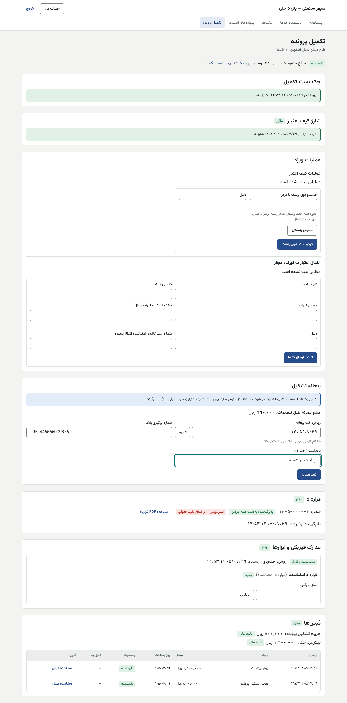
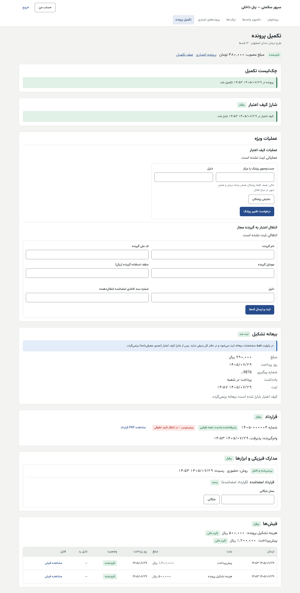
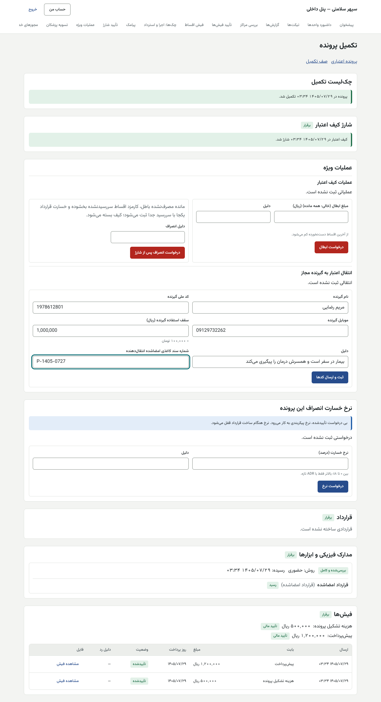

# راهنمای کارشناس تکمیل پرونده — پنل داخلی

[فهرست](../README.md) · [جریان پرونده](../case-flow.md) · [واژه‌نامه](../glossary.md)

## ۱. معرفی نقش

نقش `case_completion`. کارشناس تکمیل پرونده پس از تأیید اعتبار، قرارداد را می‌سازد، مدارک فیزیکی و چک‌ها را دریافت و ثبت می‌کند، بیعانه و تخفیف تشکیل را ثبت می‌کند، تکمیل پرونده را ثبت و شارژ کیف را درخواست می‌کند. پیش از تصمیم هم پرونده را به بررسی اعتبار می‌فرستد و تفکیک دستمزد و مواد را بررسی می‌کند.

**مجوزها:** ساخت قرارداد و ثبت تکمیل؛ دیدن قرارداد؛ بررسی شرط‌ها؛ تکمیل درخواست اعتبار؛ ثبت بیعانه تشکیل؛ تخفیف هزینه تشکیل؛ بررسی تفکیک دستمزد و مواد؛ مدیریت ابزار (چک و سفته) و دیدن شماره کامل آن؛ درخواست شارژ؛ درخواست تغییر پزشک؛ درخواست انتقال اعتبار؛ درخواست انصراف پیش از شارژ؛ دیدن خدمات؛ تیکت.

**نمی‌تواند:** تصمیم اعتباری بگیرد یا عوض کند؛ فیش را تأیید کند؛ شارژ را تأیید کند؛ نرخ خسارت را درخواست یا تأیید کند؛ تفکیک پیش‌فاکتوری را که خودش ساخته یا صادر کرده بررسی کند؛ هیچ درخواست خودش را تأیید کند.

## ۲. ورود و خروج

پنل داخلی، فقط از VPN. [برای همه کارکنان](../README.md#برای-همه-کارکنان-پنل-مرکز-و-پنل-داخلی).

## ۳. نقشه صفحه‌ها

| منو | کار |
|---|---|
| تکمیل پرونده (`/completion`) | صف پرونده‌ها با «وضعیت تصمیم» و «چک‌لیست» |
| پرونده تکمیل (`/completion/<شناسه>`) | چک‌لیست، شرط‌ها، شارژ، عملیات ویژه، بیعانه، نرخ خسارت، قرارداد، مدارک، فیش‌ها، هزینه تشکیل |
| پرونده‌های اعتباری | دیدن؛ «ارسال به بررسی اعتبار»؛ بررسی تفکیک |
| عملیات ویژه | دیدن وضعیت درخواست‌های خودتان |

## ۴. کارهای روزانه

### ۴.۱ پیش از تصمیم: ارسال به بررسی اعتبار

در «پرونده‌های اعتباری» صف تکمیل: وقتی بیمار مدارک را فرستاد و درخواست کامل است، «ارسال به بررسی اعتبار» را **شما** (تکمیل پرونده) می‌زنید، نه کارشناس اعتبار (تصمیم مالک ۱۴۰۵/۰۸/۰۱). بررسی تفکیک طرح فقط‌دستمزد: [credit-specialist.md §۴.۴](credit-specialist.md).

### ۴.۲ صف تکمیل

«تکمیل پرونده»: فیلتر «وضعیت تصمیم»؛ ستون‌ها: ثبت، طرح، قسط، مبلغ مصوب، وضعیت، «چک‌لیست». پیوند «صف تأیید فیش‌ها (مالی)».

### ۴.۳ قرارداد

1. پرونده ← «قرارداد» ← «ساخت قرارداد». شماره قرارداد و برچسب «پیش‌نویس — در انتظار تأیید حقوقی» (تا تأیید مشاور حقوقی).
2. «مشاهده PDF قرارداد».
3. «پذیرش طرفین»: وام‌گیرنده و هر ضامن «پذیرفت، …» یا «هنوز نپذیرفته». پذیرش با کد در اپ خود آن‌هاست.
4. «ساخت قبلی ناموفق بود؛ دوباره بسازید.»: «ساخت قرارداد» را دوباره بزنید.

**نرخ خسارت با ساخت قرارداد قفل می‌شود.** اگر حسابداری نرخ ویژه‌ای برای این پرونده خواسته است، پیش از ساخت قرارداد منتظر تأیید مدیرعامل بمانید (بخش «نرخ خسارت انصراف این پرونده»).

| پیام | دلیل |
|---|---|
| «پرونده اعتباری هنوز تأیید نشده است.» | — |
| «برای این پرونده پیش‌تر قرارداد ساخته شده است.» | — |
| «قالب قرارداد کامل نیست؛ فیلد درصد خسارت انصراف لازم است.» | قالب پیکربندی ناقص؛ به مدیر سیستم |

### ۴.۴ مدارک فیزیکی و چک

1. «فهرست مدارک فیزیکی»: تیک «قرارداد امضاشده»، «تعداد چک»، «تعداد سفته» (**غیرفعال در پایلوت**؛ صفر بگذارید)، «سایر مدارک (با ویرگول)» ← «ثبت فهرست مدارک فیزیکی». «دست‌کم یک قلم لازم است.» بیمار پیامک فهرست را می‌گیرد.
2. وقتی بسته رسید: «روش رسیدن»، «کد رهگیری (اختیاری)»، برای هر قلم «رسید» یا «نرسید» ← «ثبت دریافت مدارک». اگر ناقص است، پیامک «مدارک … کامل نرسیده است. موارد کم: …» می‌رود.
3. برای هر چک: «صادرکننده» («وام‌گیرنده» یا ضامن)، «مبلغ» (ریال)، «شماره صیادی»، «سررسید»، «بانک (اختیاری)»، «یادداشت (اختیاری)» ← «ثبت».
4. چک را در سامانه صیاد بسنجید و «تأیید ثبت در سامانه صیاد» را بزنید؛ سپس «بررسی‌شده».
5. «نمایش شماره کامل»: شماره کامل فقط با این دکمه دیده می‌شود و **هر دیدن ثبت می‌شود**.
6. «بررسی تحویل»، سپس «محل بایگانی» ← «بایگانی».
7. برگشت مدارک به فرستنده: «دلیل برگشت» ← «برگشت مدارک».

| پیام | دلیل |
|---|---|
| «ابزاری با همین شماره پیش‌تر ثبت شده است.» | شماره تکراری |
| «ثبت چک در سامانه صیاد هنوز تأیید نشده است.» | — |
| «همه چک‌ها و سفته‌های رسیده باید ثبت شوند.» / «… باید بررسی شده باشند.» | پیش از تکمیل |
| «سفته دریافت نمی‌شود؛ ضمانت با چک صیادی یا ضامن است.» | سفته خاموش |
| «نوع ابزار با قلم تحویل یکی نیست.» | — |

### ۴.۵ هزینه تشکیل پرونده و تخفیف

بخش «هزینه تشکیل پرونده»:
- «هزینه تشکیل»، «مبنا»، «چک‌های بررسی‌شده وام‌گیرنده … از … لازم برای بخشودگی» (یا «این طرح بخشودگی با چک ندارد»)، «بخشودگی»، «تخفیف مسئول»، «قابل پرداخت».
- برچسب «تا بارگذاری فیش تغییرپذیر» یا «مبلغ قفل شد».

**ثبت تخفیف مسئول:**
1. «ثبت تخفیف مسئول»: «درصد تخفیف» (بیشتر از صفر و حداکثر سقف طرح؛ طرح‌های الحاقیه ۱٪)، «دلیل»، «فایل امضاشده» (تخفیف با امضای خود شما).
2. «ثبت تخفیف». **بی نفر دوم**؛ ولی در گزارش ماهانه «تخفیف‌های تشکیل پرونده» به نام شما می‌آید.
3. یک تخفیف برای هر پرونده.

| پیام | دلیل |
|---|---|
| «طرح این پرونده چنین تخفیفی ندارد (حداکثر تخفیف طرح را ببینید).» | درصد بیش از سقف یا طرح بی تخفیف |
| «تخفیف این پرونده پیش‌تر ثبت شده است.» | — |
| «رسید هزینه تشکیل پرونده بارگذاری شده و مبلغ آن قفل است؛ تخفیف دیگر ثبت نمی‌شود.» | فیش رسیده |
| «فایل امضاشده تخفیف را انتخاب کنید.» | — |

### ۴.۶ بیعانه تشکیل

> در پایلوت **فقط مشخصات بیعانه ثبت می‌شود و در دفتر کل ردیفی ندارد.** پس از شارژ کیف برنمی‌گردد. اگر مبلغ بیعانه در تنظیمات ۰ باشد (پیش‌فرض)، ثبت خاموش است.

1. «ثبت بیعانه تشکیل»: «روز پرداخت بیعانه»، «شماره پیگیری بانک»، «یادداشت (اختیاری)» ← «ثبت بیعانه». مبلغ از تنظیمات است («مبلغ بیعانه طبق تنظیمات: …»).
2. برگشت (فقط پیش از شارژ): «ثبت برگشت بیعانه»: «روز برگشت»، «شماره پیگیری برگشت»، «دلیل برگشت» ← «ثبت برگشت».

| پیام | دلیل |
|---|---|
| «مبلغ بیعانه تشکیل در تنظیمات صفر است؛ ثبت بیعانه خاموش است.» | کلید `credit.formation_deposit_rial` هنوز ۹۹۰٬۰۰۰ نشده |
| «کیف اعتبار این پرونده شارژ شده است؛ بیعانه پس از معرفی‌نامه برنمی‌گردد.» | — |
| «روز برگشت نمی‌تواند پیش از روز پرداخت بیعانه باشد.» | — |

### ۴.۷ فیش‌ها و شرط‌ها

- «فیش‌ها»: «پرداخت‌های لازم» با «تأیید مالی» یا «در انتظار»؛ «فیش‌های فرستاده» با بابت، مبلغ، روز پرداخت، وضعیت، «دلیل رد»، «مشاهده فیش». تأیید با حسابداری است.
- «شرط‌های تأیید»: شرط‌های تصمیم شرطی، «برقرار» یا «مانده».

### ۴.۸ ثبت تکمیل و درخواست شارژ

1. «چک‌لیست تکمیل»: وقتی «همه شرط‌ها برقرار است»، «ثبت تکمیل پرونده».
2. بخش «شارژ کیف اعتبار» ← «درخواست شارژ کیف اعتبار». پیام: «درخواست شارژ در … ثبت شد و در انتظار تأیید مالی است.»
3. اگر رد شد: «درخواست قبلی رد شد: <دلیل>». ایراد را رفع و دوباره درخواست کنید.

| پیام | دلیل |
|---|---|
| «هنوز همه شرط‌های تکمیل برقرار نیست.» | قرارداد، مدارک، فیش یا شرطی مانده |
| «برای این پرونده پیش‌تر درخواست شارژ ثبت شده است.» | — |
| «پیش‌پرداخت این پرونده هنوز تأیید و ثبت نشده است.» | فیش پیش‌پرداخت |

### ۴.۹ عملیات ویژه که درخواست می‌دهید

بخش «عملیات ویژه» در صفحه پرونده:
- **انصراف پیش از شارژ:** «درخواست انصراف» ← «دلیل انصراف». حسابداری تأیید می‌کند؛ همه فیش‌های تأییدشده **بدون خسارت** به وام‌گیرنده بدهکار (قابل استرداد) می‌شوند.
- **تغییر پزشک:** «درخواست تغییر پزشک» ← «جست‌وجوی پزشک یا مرکز» (خالی: همه؛ فقط همان رشته و شهر در مرکز فعال) ← «نمایش پزشکان» ← «پزشک تازه» ← «دلیل». مدیر اعتبار تأیید می‌کند.
- **انتقال اعتبار:** **غیرفعال در پایلوت** (پرچم خاموش). وقتی روشن شود: «نام گیرنده»، «کد ملی گیرنده»، «موبایل گیرنده»، «سقف استفاده گیرنده»، «شماره سند کاغذی امضاشده انتقال‌دهنده» ← «ثبت و ارسال کدها»؛ سپس دو کد پیامکی گیرنده و وام‌گیرنده. حسابداری با تأیید دریافت سند کاغذی تأیید می‌کند.

## ۵. قواعد مالی مرتبط

- **هزینه تشکیل:** طرح‌های الحاقیه ۳٪ کل صورت‌حساب؛ با دست‌کم ۵ چک قسط **بررسی‌شده** وام‌گیرنده ۲٪ بخشیده می‌شود (نه طرح‌های ۶ ماهه)؛ تخفیف مسئول تا ۱٪؛ جمع حداکثر ۳٪ و هرگز منفی نیست. مبلغ هنگام **بارگذاری فیش** قفل می‌شود؛ چکی که بعداً بررسی یا برگشت بخورد اثری ندارد. چک ضامن شمرده نمی‌شود.
- **پیش‌پرداخت** به حساب آرامش ثروت؛ شارژ = مصوب + پیش‌پرداخت.
- **خسارت انصراف:** پیش‌فرض ۱۸٪ مبلغ مصوب، با ساخت قرارداد قفل.
- **سقف مانده** هنگام تأیید شارژ دوباره سنجیده می‌شود.
- **قاعده چک:** اگر کلید `instrument.borrower_cheque_min_count` (عدد پیشنهادی ۱) روشن شود، شمار چک وام‌گیرنده شرط تکمیل است؛ با `instrument.guarantee_cheque_min_bps` (پیشنهادی ۱۱۰۰۰، یعنی ۱۱۰٪) چک ضمانت هم. **امروز هر دو ۰ (خاموش).**

## ۶. تأییدهای دونفره

| کار | شما | نفر دوم | چرا |
|---|---|---|---|
| شارژ کیف | درخواست | حسابداری (کسی جز شما) | پول بی چشم دوم آزاد نشود |
| فیش‌ها | — (بیمار بارگذاری می‌کند) | حسابداری | — |
| انصراف پیش از شارژ | درخواست | حسابداری | — |
| تغییر پزشک | درخواست | مدیر اعتبار | — |
| تخفیف مسئول | **یک‌نفره** با امضای شما | — | تصمیم مالک؛ در گزارش ماهانه |

## ۷. پرسش‌های متداول

- **هزینه تشکیل بالاتر از انتظار است.** شمار چک‌های «بررسی‌شده» را ببینید؛ چک ثبت‌شده ولی بررسی‌نشده شمرده نمی‌شود.
- **دکمه «ثبت تکمیل پرونده» نیست.** «شرط‌های مانده» را ببینید.

## ۸. چک‌لیست روزانه

- [ ] صف تکمیل و پرونده‌های بی قرارداد.
- [ ] بسته‌های رسیده: ثبت دریافت، چک‌ها، صیاد، بایگانی.
- [ ] پرونده‌های کامل: ثبت تکمیل و درخواست شارژ.
- [ ] شارژهای ردشده.

## ۹. سناریوی نمونه (ساختگی)

پرونده سارا تأیید شد. کارشناس «ساخت قرارداد» را می‌زند. «فهرست مدارک فیزیکی»: قرارداد امضاشده، ۱۲ چک. بسته با پست می‌رسد؛ «ثبت دریافت مدارک». ۱۲ چک صیادی هر کدام ۸٬۸۰۰٬۰۰۰ ریال ثبت، در صیاد سنجیده و «بررسی‌شده» می‌شوند. «هزینه تشکیل پرونده» حالا ۱٬۲۰۰٬۰۰۰ است (۳٪ − ۲٪ بخشودگی). سارا فیش‌ها را می‌فرستد و حسابداری تأیید می‌کند. کارشناس «بایگانی» و «ثبت تکمیل پرونده» و «درخواست شارژ کیف اعتبار» را می‌زند.

## ۱۰. ویژگی‌های غیرفعال یا منتظر ورودی

| ویژگی | وضعیت |
|---|---|
| سفته | **غیرفعال در پایلوت** |
| انتقال اعتبار | **غیرفعال در پایلوت** |
| بیعانه در دفتر کل (حساب نگهداری) | **در دست ساخت**؛ پایلوت فقط ثبت مشخصات |
| مبلغ بیعانه ۹۹۰٬۰۰۰ ریال | منتظر تنظیم دونفره در «تنظیمات راه‌اندازی» (مدیر استراتژی) |
| قاعده چک (۱ و ۱۱۰۰۰) | منتظر تنظیم دونفره در «تنظیمات راه‌اندازی» |
| متن قطعی قرارداد | منتظر مشاور حقوقی |
| بازاحراز TOTP روی کار مالی | **در دست ساخت** (م۳) |

## تصویرهای لازم

- [تصویر: چک‌لیست تکمیل]
- [تصویر: ثبت چک و صیاد]
- [تصویر: هزینه تشکیل با بخشودگی و تخفیف]
