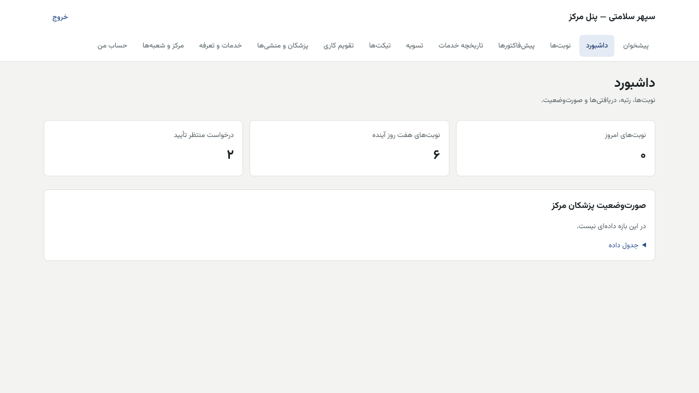

# راهنمای مدیر مرکز (پنل مرکز)

[فهرست](../README.md) · [جریان پرونده](../case-flow.md) · [واژه‌نامه](../glossary.md)

## ۱. معرفی نقش

نقش `center_manager`. مدیر مرکز اطلاعات مرکز و شعبه‌ها، پزشکان و تعرفه‌های مرکز، تقویم پزشکان و نوبت‌ها را اداره می‌کند و خلاصه تسویه پزشکان مرکز را می‌بیند.

**مجوزها:** دیدن ساختار؛ مدیریت نوبت‌ها و حالت تأیید؛ تقویم پزشکان در دامنه خودش؛ مدیریت مرکز، پزشکان و تعرفه‌ها؛ دیدن پیش‌فاکتور و خدمات؛ دیدن وضعیت اعتباری؛ خلاصه تسویه مرکز؛ ثبت تیکت مرکز.

**نمی‌تواند:** پیش‌فاکتور صادر کند (فقط پزشک)؛ مجوز خدمت بدهد؛ به شکایت بیمار پاسخ دهد (پزشک و منشی)؛ شبای حساب را بی تأیید حسابداری عوض کند؛ مرکز را فعال کند (دونفره در شبکه درمان)؛ صورت‌وضعیت تک‌تک پزشکان را تأیید کند.

**دامنه:** نقش به یک «گره» مرکز داده می‌شود و فقط همان مرکز و شعبه‌ها و پزشکانش را می‌بیند. اگر پیام «مرکزی در دسترس شما نیست.» دیدید، دامنه نقش درست نیست.

## ۲. ورود و خروج

`/panel/login`، با رمز و کد شش‌رقمی. ورود اول: [برای همه کارکنان](../README.md#برای-همه-کارکنان-پنل-مرکز-و-پنل-داخلی).

## ۳. نقشه صفحه‌ها

داشبورد، نوبت‌ها، پیش‌فاکتورها (فقط دیدن)، تاریخچه خدمات (فقط دیدن)، تسویه (مجموع مرکز)، تیکت‌ها، تقویم کاری، پزشکان و منشی‌ها، خدمات و تعرفه، مرکز و شعبه‌ها، حساب من.

## ۴. کارهای روزانه

### ۴.۱ داشبورد

«نوبت‌های امروز»، «نوبت‌های هفت روز آینده»، «درخواست منتظر تأیید»، «رتبه شما در فیلد درمان (بیماران تکمیل‌شده در ۹۰ روز اخیر)»، «دریافتی‌های آینده» و «صورت‌وضعیت پزشکان مرکز» (دوره و جمع ناخالص).

### ۴.۲ نوبت‌ها

همان کارهای پزشک: «تأیید»، «رد» با دلیل، «پذیرش» با «کد پذیرش بیمار»، «معاینه شد»، «عدم حضور»، «لغو». جزئیات: [doctor.md §۴.۱–۴.۲](doctor.md). صدور پیش‌فاکتور فقط کار پزشک است و مدیر مرکز صادر نمی‌کند (تصمیم مالک ۱۴۰۵/۰۸/۰۱). اگر دکمه «صدور پیش‌فاکتور» را دیدید، آن را نزنید؛ رد صریح آن برای مدیر مرکز با پیام فارسی **در دست ساخت** است.

### ۴.۳ تقویم پزشکان

«تقویم کاری» ← «انتخاب پزشک و محل»: حالت تأیید، ساعت‌های کاری هفته و استثناها. جزئیات: [doctor.md §۴.۹](doctor.md).

### ۴.۴ خدمات و تعرفه

1. «خدمات و تعرفه» ← «انتخاب پزشک و محل» ← «نمایش».
2. جدول «تعرفه‌های …»: «خدمت»، «تعرفه فعلی»، «تغییر بعدی».
3. «تعرفه تازه»: خدمت، از، تا، یا «رایگان (فقط ویزیت)»، دلیل، «ثبت تعرفه». مبلغ به ریال.
4. «تعرفه‌های پیشنهادی ورود از اکسل»: اگر کارشناس شبکه تعرفه‌ها را از اکسل آورده، «کل مرکز» یا «این پزشک» ← «اعمال همه».
5. تغییر تعرفه فقط روی نوبت‌ها و پیش‌فاکتورهای بعدی اثر دارد.

### ۴.۵ مرکز و شعبه‌ها

1. «مرکز و شعبه‌ها» ← «انتخاب مرکز» ← «نمایش».
2. «اطلاعات مرکز»: شهر، شناسه یا کد ملی، حساب بانکی (شبا)، «فعال از»، مدارک و وضعیت هر مدرک («دریافت‌شده»، «تأییدشده»، «ناقص»، «ارسال‌نشده»).
3. **ویرایش شعبه:** «نشانی»، «تلفن»، «پارکینگ» («دارد»، «محدود»، «ندارد»، «نامشخص»)، «نزدیک‌ترین ایستگاه مترو»، «نزدیک‌ترین ایستگاه BRT»، «راهنمای رسیدن»، «دلیل تغییر»، «ذخیره شعبه».
4. **تغییر حساب بانکی:** «درخواست تغییر حساب بانکی» ← «شماره شبا»، «نام صاحب حساب»، «دلیل»، «ثبت درخواست». پیام: «درخواست ثبت شد و پس از تأیید نفر دوم اعمال می‌شود.» نفر دوم حسابداری است. **تا تأیید، تسویه به شبای قبلی است.**
5. «درخواست‌ها»: فعال‌سازی، فعال‌سازی دوباره، تغییر حساب بانکی، با وضعیت «در انتظار تأیید نفر دوم»، «تأییدشده»، «ردشده»، «پس‌گرفته».

### ۴.۶ پزشکان و منشی‌ها

فهرست پزشکان مرکز با «نظام پزشکی»، «حساب کاربری دارد / بدون حساب کاربری» و محل‌های کار. هر پزشک منشی‌های خودش را مدیریت می‌کند؛ مدیر مرکز نقش منشی نمی‌دهد (مجوز `access.manage_secretaries` با پزشک است).

### ۴.۷ تسویه مرکز

«تسویه» ← «مجموع پزشکان مرکز»: برای هر پزشک «خدمات»، «کارمزدها»، «قابل پرداخت»، «پرداخت‌شده». اعتراض به قلم تسویه با خود پزشک است.

### ۴.۸ تیکت

«تیکت‌ها» ← «تیکت تازه». جزئیات: [secretary.md §۴.۱](secretary.md).

## ۵. قواعد مالی مرتبط

- کارمزد خدمت اعتباری و نقدی از قرارداد مرکز یا پزشک است؛ دقیق‌ترین سطح برنده است (پزشک، سپس مرکز، سپس سراسری). پیش‌فرض ۰.
- **مدت قرارداد مرکز:** ۳، ۶ یا ۱۲ ماه. پس از پایان، هیچ پزشکی از مرکز مجوز خدمت تازه نمی‌دهد. ۳۰ روز پیش از پایان هشدار به سپهر می‌رود.
- تغییر شبا دونفره است؛ دلیلش جلوگیری از فرستادن پول به حساب اشتباه یا جعلی است.
- مرکز معلق یا غیرفعال مجوز خدمت تازه نمی‌گیرد.

## ۶. تأییدهای دونفره

| کار | نفر اول | نفر دوم | چرا |
|---|---|---|---|
| تغییر شبا | مدیر مرکز | حسابداری | پول به حساب درست برود |
| فعال‌سازی مرکز | کارشناس شبکه | مدیر شبکه | مرکز بی مدارک فعال نشود |
| مدت قرارداد | کارشناس یا مدیر (کسب‌وکار) | نفر دوم | نرخ و مدت از قرارداد واقعی |

## ۷. خطاهای رایج

| پیام | دلیل | چه کنم |
|---|---|---|
| «محل کاری در دسترس شما نیست.» | دامنه نقش | با مدیر سیستم |
| «همه مدارک باید پیش از فعال‌سازی تأیید شده باشند.» | مدرک ناقص | مدارک را به شبکه درمان برسانید |
| «برای این محل کار پیشنهاد بازی در انتظار تأیید است.» | تعرفه ویزیت پیشنهادشده | منتظر تصمیم شبکه |

## ۸. پرسش‌های متداول

- **چرا شبای تازه هنوز اعمال نشده؟** منتظر تأیید حسابداری است.
- **چطور پزشک تازه اضافه کنم؟** ثبت پزشک با کارشناس شبکه در پنل داخلی است («ثبت پزشک تازه»).

## ۹. چک‌لیست

**روزانه:** درخواست‌های نوبت منتظر؛ داشبورد. **هفتگی:** تقویم و استثناهای هفته بعد؛ تعرفه‌های تغییرکرده. **ماهانه:** مجموع تسویه مرکز؛ هشدار پایان قرارداد.

## ۱۰. سناریوی نمونه (ساختگی)

مدیر «کلینیک نمونه» شماره حساب تازه دارد. در «مرکز و شعبه‌ها» ← «درخواست تغییر حساب بانکی»، شبای IR000000000000000000000001 و نام «کلینیک نمونه» را با دلیل «تغییر بانک» ثبت می‌کند. وضعیت «در انتظار تأیید نفر دوم» می‌شود. فردا حسابداری تأیید می‌کند و صورت‌وضعیت بعدی به حساب تازه پرداخت می‌شود.

## ۱۱. ویژگی‌های غیرفعال یا منتظر ورودی

| ویژگی | وضعیت |
|---|---|
| ورود گروهی از اکسل | پرچم `catalog.bulk_import_enabled` خاموش (کارفرما: ثبت دستی) |
| ساخت حساب‌های مرکز از پنل | **فقط از API** |
| نرخ کارمزد خدمت | پیش‌فرض ۰ تا ثبت عدد قرارداد |

## تصویرهای لازم

- [تصویر: مرکز و شعبه‌ها]
- [تصویر: درخواست تغییر حساب بانکی]
- [تصویر: تعرفه‌ها]
