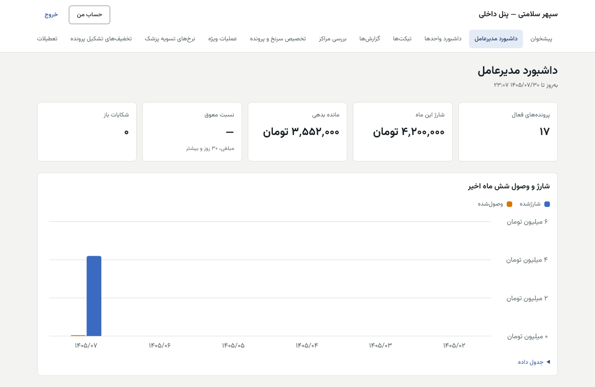
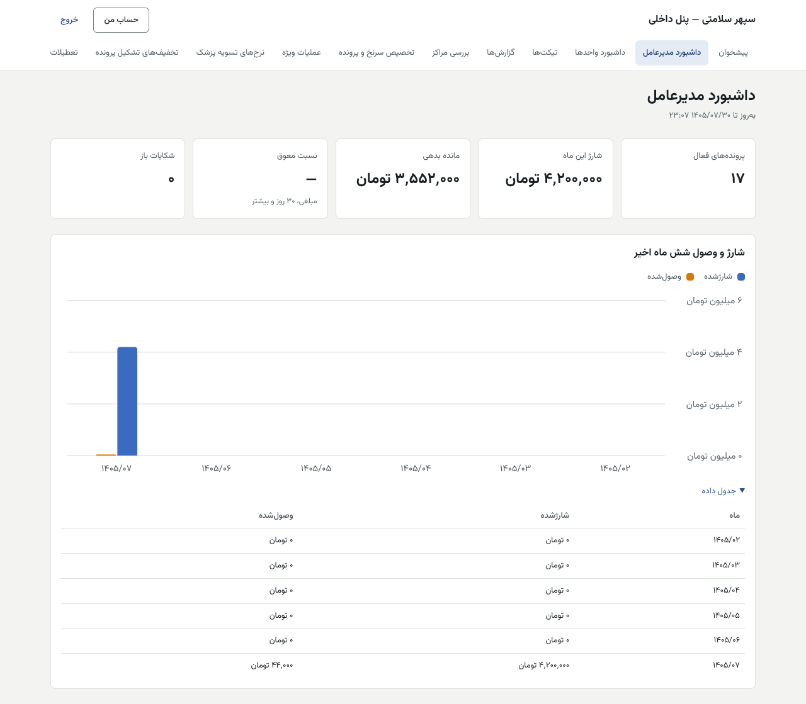
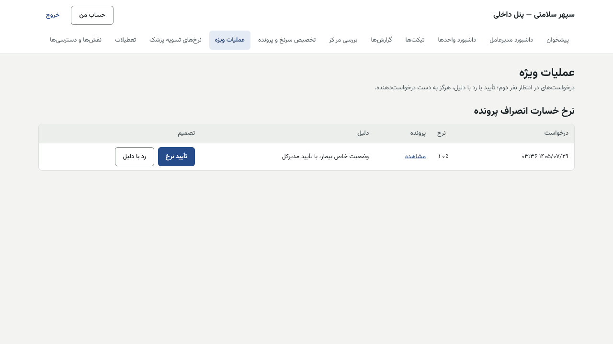
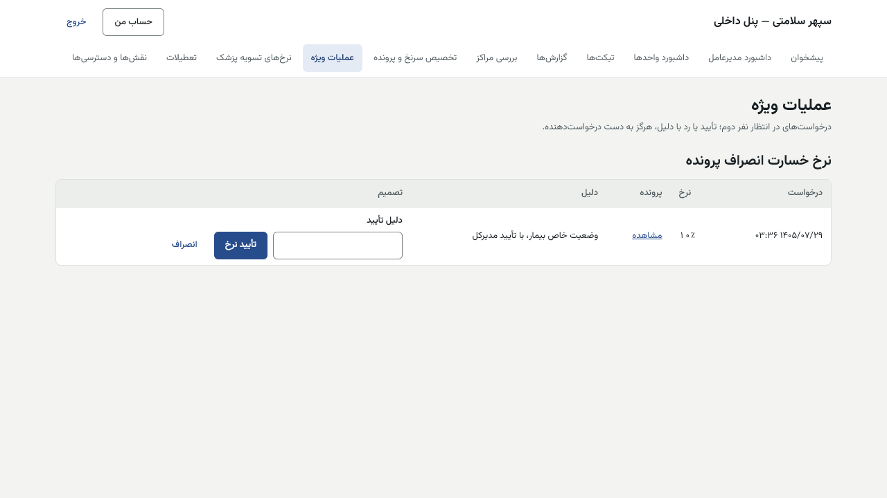

# راهنمای مدیرعامل — پنل داخلی

[فهرست](../README.md) · [جریان پرونده](../case-flow.md) · [واژه‌نامه](../glossary.md)

## ۱. معرفی نقش

نقش `ceo` (نزدیک‌ترین نقش به «مدیرکل»). مدیرعامل داشبورد و گزارش‌ها را می‌بیند، نرخ خسارت انصراف هر پرونده را تأیید می‌کند، تعطیلات رسمی را ثبت و تأیید می‌کند و در خروج کارمند یکی از دو امضاست.

**مجوزها:** داشبورد مدیرعامل؛ همه گزارش‌ها (فروش، اعتبار، کارشناسان، مطالبات، تسویه، کیف) و اشتراک فیلتر؛ **تأیید نرخ خسارت**؛ مدیریت تعطیلات؛ درخواست و تأیید خروج کارمند؛ گزارش ماهانه تخفیف‌ها؛ دیدن همه تیکت‌ها، نوبت‌ها، مراکز، پزشکان، تعرفه‌ها، پیش‌فاکتورها و پیکربندی.

**نمی‌تواند:** نرخ خسارت را درخواست کند (حسابداری)؛ درخواست خودش را تأیید کند؛ ثبت مالی کند؛ پرونده اعتباری را باز کند.

«معاون» نقش آماده ندارد؛ مالک از «نقش‌ها و دسترسی‌ها» نقش سفارشی می‌دهد.

## ۲. ورود و خروج

پنل داخلی، فقط از VPN. [برای همه کارکنان](../README.md#برای-همه-کارکنان-پنل-مرکز-و-پنل-داخلی).

## ۳. نقشه صفحه‌ها

| منو | کار |
|---|---|
| داشبورد مدیرعامل (`/dashboard`) | شاخص‌ها و روند شش ماه |
| داشبورد واحدها | صف تیکت هر واحد |
| گزارش‌ها | همه گزارش‌های مجاز |
| تیکت‌ها | دیدن همه |
| عملیات ویژه | «نرخ‌های خسارت در انتظار تأیید» |
| تعطیلات | ثبت و تأیید |
| نقش‌ها و دسترسی‌ها | فقط خروج کارمند |
| تخفیف‌های تشکیل پرونده | گزارش ماهانه |

## ۴. کارها

### ۴.۱ داشبورد

«به‌روز تا …» (هر ۱۵ دقیقه). کارت‌ها: «پرونده‌های فعال»، «شارژ این ماه»، «مانده بدهی»، «نسبت معوق» («مبلغی، ۳۰ روز و بیشتر»)، «شکایات باز». نمودار «شارژ و وصول شش ماه اخیر» با «جدول داده».

### ۴.۲ تأیید نرخ خسارت انصراف

1. «عملیات ویژه» ← «نرخ خسارت انصراف پرونده» ← «نرخ‌های خسارت در انتظار تأیید»: درخواست، نرخ، دلیل.
2. «تأیید نرخ» یا رد، با دلیل.
3. فقط پیش از ساخت قرارداد؛ پس از آن: «برای این پرونده پیش‌تر قرارداد ساخته شده است.»

### ۴.۳ تعطیلات

**تعطیلات فقط با مدیرعامل است** (تصمیم مالک ۱۴۰۵/۰۸/۰۱؛ مهاجرت 0105، ۱۴۰۵/۰۸/۰۲). مدیرعامل پیشنهاد می‌دهد؛ نفر دوم **«قائم‌مقام مدیرعامل (فقط تعطیلات)»** است که فقط تأیید یا رد می‌کند و هیچ درخواستی نمی‌دهد. پیشنهاددهنده هرگز تأییدکننده نیست. مدیر سیستم دیگر مجوز تعطیلات ندارد. نقش قائم‌مقام آماده است؛ مدیر سیستم آن را روز راه‌اندازی به یک نفر می‌دهد. گام‌ها: [system-admin.md §۴.۴](system-admin.md).

### ۴.۴ خروج کارمند

«نقش‌ها و دسترسی‌ها» ← «دسترسی یک حساب» ← «خروج کارمند» ← «دلیل خروج» ← «درخواست خروج». نفر دوم (مدیر سیستم یا مدیرعامل دیگر) «تأیید خروج» می‌زند. حساب غیرفعال، همه نقش‌ها لغو و همه نشست‌ها بسته می‌شود؛ حساب حذف نمی‌شود.

### ۴.۵ گزارش ماهانه تخفیف‌ها

«تخفیف‌های تشکیل پرونده» ← «ماه (سال-ماه)» ← «نمایش»: ثبت، مسئول، پرونده، درصد، مبلغ کاهش (یا «هنوز قفل نشده»)، دلیل.

## ۵. قواعد مالی مرتبط

- خسارت انصراف: `floor(مصوب × نرخ / ۱۰۰۰۰)`، بازه ۰ تا ۱۸٪، پیش‌فرض ۱۸٪، سررسید ۳۰ روز؛ بالاتر از ۱۸٪ فقط با ADR تازه.
- تخفیف مسئول یک‌نفره است و تنها کنترلش همین گزارش ماهانه است.

## ۶. تأییدهای دونفره

| کار | نفر اول | شما |
|---|---|---|
| نرخ خسارت | حسابداری | تأییدکننده |
| تعطیلات دسته‌ای | مدیرعامل | جانشین مدیرعامل در تعطیلات (نفر دوم، نه همان شخص) |
| خروج کارمند | یکی | دیگری؛ هیچ‌کدام خود کارمند نیست |

## ۷. پرسش‌های متداول

- **عددهای داشبورد با گزارش فرق دارد.** داشبورد هر ۱۵ دقیقه به‌روز می‌شود؛ زمان «به‌روز تا» را ببینید.

## ۸. چک‌لیست

**روزانه:** داشبورد و شکایات باز. **هفتگی:** نرخ‌های خسارت منتظر. **ماهانه:** گزارش تخفیف‌ها؛ گزارش مطالبات.

## ۹. سناریوی نمونه (ساختگی)

حسابداری برای یک بیمار با شرایط خاص نرخ ۵٪ پیشنهاد داده است. مدیرعامل در «عملیات ویژه» دلیل را می‌خواند و «تأیید نرخ» می‌زند. قرارداد این پرونده با ۵٪ ساخته و قفل می‌شود.

## ۱۰. ویژگی‌های غیرفعال یا منتظر ورودی

| ویژگی | وضعیت |
|---|---|
| نقش «معاون» | نقش سفارشی به دستور مالک |
| تعطیلات قمری ۱۴۰۵ و ۱۴۰۶ | پس از اعلام رسمی، پیش از ۱ بهمن ۱۴۰۵ |

## تصویرهای لازم

- [تصویر: گزارش‌ها]
