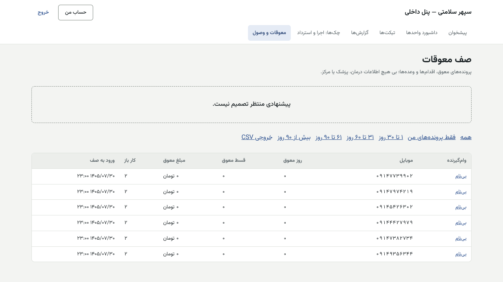

# راهنمای مدیر واحد معوقات — پنل داخلی

[فهرست](../README.md) · [جریان پرونده](../case-flow.md) · [واژه‌نامه](../glossary.md)

## ۱. معرفی نقش

نقش `collection_manager`. مدیر وصول پیشنهادهای مرحله ۳ و ۴ کارشناسان را تصمیم می‌گیرد، وضعیت وام‌گیرنده (فوت یا ازکارافتادگی) را تأیید می‌کند و اجرای چک را به‌عنوان نفر دوم تأیید می‌کند.

**مجوزها:** تأیید وضعیت وام‌گیرنده؛ تصمیم تشدید؛ دیدن صف؛ تأیید مدیر وصول برای اجرای چک؛ گزارش کارشناسان و معوقات؛ فیلتر مشترک؛ سپردن تیکت.

**نمی‌تواند:** پیشنهادی را که خودش داده تأیید کند؛ نتیجه وصول یا برگشت چک را ثبت کند (حسابداری)؛ قسط را ببخشد؛ اطلاعات درمان را ببیند.

## ۲. ورود و خروج

پنل داخلی، فقط از VPN. [برای همه کارکنان](../README.md#برای-همه-کارکنان-پنل-مرکز-و-پنل-داخلی).

## ۳. نقشه صفحه‌ها

«معوقات و وصول» (بخش «پیشنهادهای منتظر تصمیم شما (مرحله ۳ و ۴)»)، «چک‌ها: اجرا و استرداد»، «گزارش‌ها»، «تیکت‌ها».

## ۴. کارهای روزانه

### ۴.۱ تصمیم درباره پیشنهاد تشدید

1. «معوقات و وصول» ← «پیشنهادهای منتظر تصمیم شما (مرحله ۳ و ۴)»: پیشنهاد، کار، «توضیح کارشناس»، پرونده («باز کردن»).
2. «تصمیم» ← «توضیح تصمیم» ← «تأیید و اجرا» یا «رد پیشنهاد» ← «ثبت تصمیم».

### ۴.۲ تأیید اجرای چک

«چک‌ها: اجرا و استرداد» ← «اجرای چک‌ها» ← پیشنهاد ← «تأیید مدیر وصول». سپس حسابداری «تأیید مالی» می‌زند. سه نفر متفاوت لازم است.

### ۴.۳ وضعیت وام‌گیرنده

پیشنهاد «فوت یا ازکارافتادگی» کارشناس را بررسی و تأیید کنید. **رویه دستی در پایلوت (تصمیم مالک ۱۴۰۵/۰۸/۰۱؛ صفحه پس از پایلوت):** کارشناس وصول پیشنهاد را با مدرک (گواهی فوت یا رأی ازکارافتادگی) در یک تیکت داخلی به شما می‌دهد. شما مدرک را می‌سنجید، تصمیم و دلیل را در تیکت می‌نویسید و ثبتش در سامانه را از مدیر سیستم می‌خواهید (از API). تا ثبت، پیگیری وصول آن پرونده را متوقف کنید.

### ۴.۴ گزارش‌ها

گزارش معوقات و بار کارشناسان، با فیلتر ذخیره‌شده و اشتراک با واحد.

## ۵. قواعد مالی مرتبط

همان [collection.md §۵](collection.md). تأیید اجرای چک پول جابه‌جا نمی‌کند؛ پول فقط با ثبت «وصول شد» حسابداری و مسیر فیش وارد می‌شود.

## ۶. تأییدهای دونفره

| کار | شما |
|---|---|
| اجرای چک | نفر دوم از سه نفر |
| تشدید مرحله ۳ و ۴ | تصمیم‌گیر |
| وضعیت وام‌گیرنده | تأییدکننده |

## ۷. پرسش‌های متداول

- **پیشنهاد خودم را نمی‌توانم تأیید کنم؟** نه؛ پیشنهاددهنده هرگز تأییدکننده نیست.

## ۸. چک‌لیست

**روزانه:** پیشنهادهای مرحله ۳ و ۴؛ اجراهای منتظر. **هفتگی:** گزارش بار کارشناسان؛ بازه «بیش از ۹۰ روز».

## ۹. سناریوی نمونه (ساختگی)

کارشناس برای وامی با ۳ قسط و ۶۵ روز معوق «پیشنهاد اجرای چک» ثبت کرده است. مدیر وصول پرونده را باز می‌کند، اقدام‌ها و وعده‌های شکسته را می‌بیند و «تأیید مدیر وصول» را می‌زند. حسابداری «تأیید مالی» و پس از ارائه، «وصول شد» را ثبت می‌کند.

## ۱۰. ویژگی‌های غیرفعال یا منتظر ورودی

| ویژگی | وضعیت |
|---|---|
| فرم تأیید وضعیت وام‌گیرنده | **رویه دستی در پایلوت**؛ صفحه پس از پایلوت |
| اجرای سفته | **غیرفعال در پایلوت** |

## تصویرهای لازم

- [تصویر: تأیید مدیر وصول روی چک]
