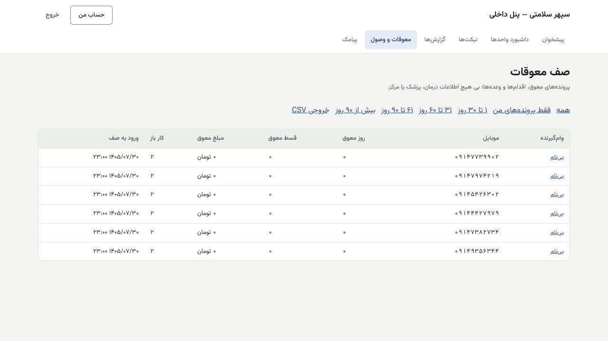
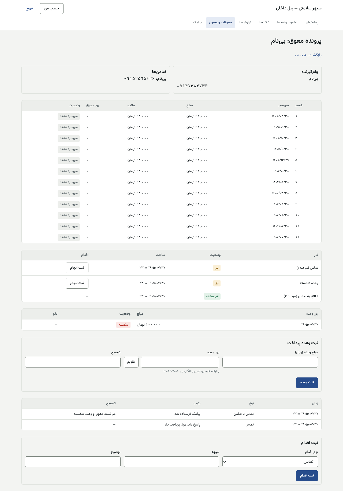

# راهنمای واحد معوقات — پنل داخلی

[فهرست](../README.md) · [جریان پرونده](../case-flow.md) · [واژه‌نامه](../glossary.md)

## ۱. معرفی نقش

نقش `collection`. کارشناس معوقات با وام‌گیرندگانی که قسطشان عقب افتاده تماس می‌گیرد، اقدام و وعده ثبت می‌کند، به ضامن پیامک می‌دهد و برای مراحل سخت‌تر (اجرای چک، ارجاع حقوقی) به مدیر وصول پیشنهاد می‌دهد.

**مجوزها:** دیدن صف؛ کار روی کارها؛ ثبت اقدام؛ مدیریت وعده؛ پیشنهاد وضعیت وام‌گیرنده (مثل فوت یا ازکارافتادگی)؛ پیشنهاد اجرای چک؛ زمان‌بندی پیامک؛ گزارش معوقات؛ تیکت. عضو «واحد وصول» کمیته اعتبار.

**نمی‌تواند:** هیچ اطلاعات درمان، پزشک یا مرکز را ببیند (صف عمداً بی آن است)؛ پیشنهاد خودش را تأیید کند؛ چک را اجرا کند (سه نفر)؛ فیش را تأیید کند؛ قسط را ببخشد یا بسوزاند.

## ۲. ورود و خروج

پنل داخلی، فقط از VPN. [برای همه کارکنان](../README.md#برای-همه-کارکنان-پنل-مرکز-و-پنل-داخلی).

## ۳. نقشه صفحه‌ها

| منو | کار |
|---|---|
| معوقات و وصول (`/collection`) | صف پرونده‌های معوق |
| پرونده معوق (`/collection/<شناسه>`) | اشخاص، اقساط معوق، کارها، چک‌ها، وعده‌ها، اقدام‌ها |
| پیامک، گزارش‌ها، تیکت‌ها، داشبورد واحدها | — |

## ۴. کارهای روزانه

### ۴.۱ صف

1. «صف معوقات»: «پرونده‌های معوق، اقدام‌ها و وعده‌ها؛ بی هیچ اطلاعات درمان، پزشک یا مرکز.»
2. «فیلتر صف»: بازه معوق («۱ تا ۳۰ روز»، «۳۱ تا ۶۰ روز»، «۶۱ تا ۹۰ روز»، «بیش از ۹۰ روز»)، «همه» یا «فقط پرونده‌های من». «خروجی CSV».
3. ستون‌ها: وام‌گیرنده (یا «بی‌نام»)، برچسب «فوت یا ازکارافتادگی»، موبایل، روز معوق، قسط معوق، مبلغ معوق، کار باز، «ورود به صف».

### ۴.۲ کار روی پرونده

1. پرونده: «اشخاص» (وام‌گیرنده و ضامن‌ها با موبایل)، «اقساط معوق» (قسط، سررسید، مبلغ، مانده، روز معوق، وضعیت).
2. **کارها:** سامانه کار می‌سازد (مثل «تماس (مرحله ۱)»، «اطلاع به ضامن (مرحله ۲)»، «وعده شکسته»). «ثبت انجام» ← «نتیجه کار» («انجام شد» یا «کنار گذاشته شد») ← «دلیل» ← «ثبت».
3. **اقدام:** «ثبت اقدام»: «نوع اقدام» («تماس»، «پیامک»، «مراجعه»، «نامه»، «تماس با ضامن»)، «نتیجه»، «توضیح» ← «ثبت اقدام».
4. **وعده پرداخت:** «ثبت وعده پرداخت»: «مبلغ وعده (ریال)»، «روز وعده»، «توضیح» ← «ثبت وعده». وعده‌ای که روزش بگذرد و پول نرسد «شکسته» می‌شود و کار تازه می‌سازد. «لغو وعده» با دلیل.
5. **پیامک ضامن:** «ارسال پیامک ضامن» ← «ارسال».
6. **پیشنهاد به مدیر وصول** (مرحله ۳ و ۴): «پیشنهاد به مدیر وصول» ← «ثبت پیشنهاد» با توضیح.
7. **پیشنهاد اجرای چک:** در «چک‌های نزد سپهر» ← «پیشنهاد اجرای چک» با دلیل. سپس مدیر وصول و مالی تأیید می‌کنند. «سفته فقط از ارجاع حقوقی (مرحله ۴)»؛ و سفته در پایلوت دریافت نمی‌شود.

| پیام | دلیل |
|---|---|
| «مبلغ وعده را وارد کنید.» / «روز وعده را انتخاب کنید.» | — |
| «این پرونده از صف بیرون رفته است.» | بدهی معوق پرداخت شد |

### ۴.۳ مراحل تشدید (پیش‌فرض)

| مرحله | شرط | کار |
|---|---|---|
| ۱ | دست‌کم ۱ روز معوق | تماس |
| ۲ | دست‌کم ۳۰ روز و ۲ قسط | اطلاع به ضامن |
| ۳ | دست‌کم ۶۰ روز و ۳ قسط | پیشنهاد به مدیر وصول (مثل اجرای چک) |
| ۴ | تصمیم مدیر | ارجاع حقوقی |

یادآوری خودکار به وام‌گیرنده: ۱، ۷ و ۱۵ روز پس از سررسید. مهلت ارفاق پیش‌فرض ۰ روز.

## ۵. قواعد مالی مرتبط

- پول فقط با فیش و تأیید حسابداری وارد می‌شود و به قدیمی‌ترین قسط می‌نشیند. کارشناس معوقات پول نمی‌گیرد.
- **سوخت قسط** ساخته نشده است.
- چکی که از بدهی باقی بزرگ‌تر است وصول نمی‌شود تا تصمیم.

## ۶. تأییدهای دونفره

| کار | نفر اول | نفر دوم | نفر سوم |
|---|---|---|---|
| اجرای چک | کارشناس معوقات | مدیر وصول | حسابداری |
| وضعیت وام‌گیرنده (فوت، ازکارافتادگی) | کارشناس | مدیر وصول | — |
| تشدید مرحله ۳ و ۴ | کارشناس | مدیر وصول | — |

## ۷. پرسش‌های متداول

- **چرا نام پزشک را نمی‌بینم؟** عمداً؛ اطلاعات درمان برای واحد معوقات پنهان است.
- **وام‌گیرنده می‌گوید پرداخته.** از او بخواهید فیش را در اپ بفرستد؛ حسابداری تأیید می‌کند.

## ۸. چک‌لیست روزانه

- [ ] کارهای باز خودتان.
- [ ] وعده‌های امروز.
- [ ] پرونده‌های تازه در بازه ۱ تا ۳۰ روز.

## ۹. سناریوی نمونه (ساختگی)

وام‌گیرنده «بی‌نام» (۰۹۱۴۰۰۰۰۰۰۴) دو قسط ۴۴۰٬۰۰۰ ریالی عقب است. کارشناس زنگ می‌زند: «اقدام: تماس، نتیجه: قول پرداخت داد». «وعده پرداخت» ۱٬۰۰۰٬۰۰۰ ریال برای پنجشنبه. پنجشنبه پول نمی‌رسد؛ وعده «شکسته» و کار «وعده شکسته» ساخته می‌شود. کارشناس «ارسال پیامک ضامن» را می‌زند.

## ۱۰. ویژگی‌های غیرفعال یا منتظر ورودی

| ویژگی | وضعیت |
|---|---|
| سفته | **غیرفعال در پایلوت** |
| سوخت قسط | ساخته نمی‌شود تا ADR جدا |
| مشاور ثابت برای بازگشتی معوق | `collection.same_agent_for_returning` خاموش |

## تصویرهای لازم

- [تصویر: ثبت وعده]
