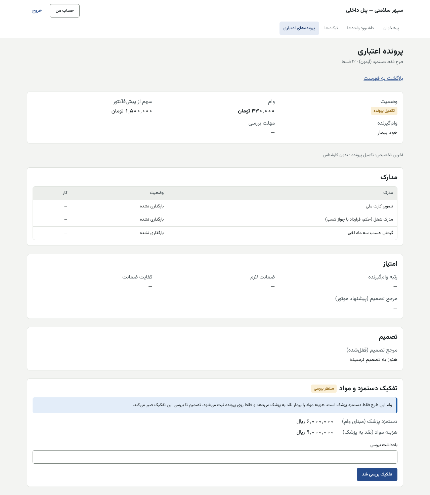
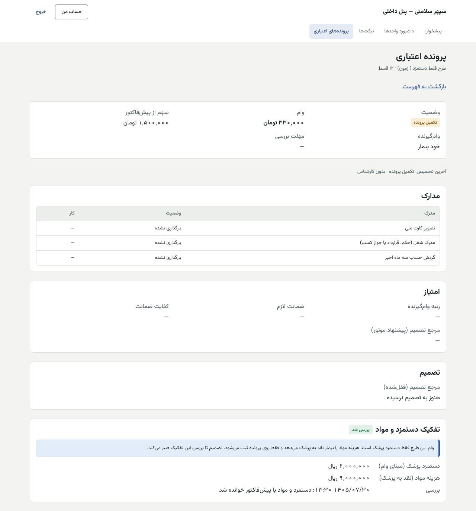

# راهنمای کارشناس اعتبار — پنل داخلی

[فهرست](../README.md) · [جریان پرونده](../case-flow.md) · [واژه‌نامه](../glossary.md)

## ۱. معرفی نقش

نقش `credit_specialist`. کارشناس اعتبار مدارک درخواست را می‌سنجد، داده خام را از روی مدارک ثبت و موتور امتیاز را اجرا می‌کند، تفکیک دستمزد و مواد را بررسی می‌کند و تصمیم را **پیشنهاد** می‌دهد.

**مجوزها:** دیدن درخواست‌ها، امتیاز، دلایل تصمیم و اطلاعات مالی بیمار؛ ثبت برگه امتیاز؛ پیشنهاد تصمیم؛ بررسی تفکیک دستمزد و مواد؛ دیدن قرارداد؛ تیکت.

**نمی‌تواند:** تصمیم را نهایی کند (کنترل دوم با مدیر اعتبار؛ یا مدیر؛ یا کمیته)؛ مرجع تصمیم را انتخاب کند (موتور تعیین می‌کند)؛ نرخ خسارت را تغییر دهد؛ تفکیک پیش‌فاکتوری را که خودش ساخته یا صادر کرده بررسی کند؛ پیکربندی طرح‌ها را تأیید کند.

## ۲. ورود و خروج

پنل داخلی، فقط از VPN. [برای همه کارکنان](../README.md#برای-همه-کارکنان-پنل-مرکز-و-پنل-داخلی).

## ۳. نقشه صفحه‌ها

| منو | کار |
|---|---|
| پرونده‌های اعتباری (`/credit`) | «صف من»، «همه پرونده‌ها»، فیلتر وضعیت |
| پرونده اعتباری (`/credit/<شناسه>`) | مدارک، امتیاز، داده خام، تفکیک، تصمیم، نرخ خسارت (دیدن) |
| گروه‌های پرونده (`/credit/groups`) | پرونده‌های گروهی و کسری |
| طرح‌ها و قواعد (`/credit/rules`) | دیدن نسخه‌های طرح و قواعد (تأیید با دارندگان مجوز پیکربندی) |
| تیکت‌ها | صف واحد |

## ۴. کارهای روزانه

### ۴.۱ صف

«پرونده‌های اعتباری» ← «صف من»: ستون‌های ثبت، طرح، قسط، وام، «مهلت بررسی» (پیش‌فرض ۲۴ ساعت، شبانه‌روزی)، «باز کردن». وضعیت‌ها: پیش‌نویس، ناقص، آماده بررسی، امتیازدهی، بررسی دستی، تأییدشده، شرطی، ردشده، منقضی.

### ۴.۲ بررسی مدارک

1. پرونده ← «مدارک»: برای وام‌گیرنده و هر ضامن.
2. «مشاهده فایل» (پیوند امضاشده و کوتاه‌مدت).
3. «پذیرش»، یا «رد مدرک» با «دلیل رد». بیمار پیامک رد می‌گیرد و دوباره بارگذاری می‌کند.

### ۴.۳ داده خام و امتیاز

1. «ثبت داده خام وام‌گیرنده» (و «ثبت داده خام ضامن» اگر ضامن رضایت داده است):
   - «شغل» (انتخاب کنید)، «شروع اشتغال» (از روی مدرک شغل)، «پوشش حقوق»؛
   - «قسط تعهدات قبلی» (از گردش حساب و استعلام)، «قسط تازه» (از پیش‌نمایش طرح)؛
   - «میانگین مانده حساب» (از گردش حساب)؛ برای ضامن «قسط مورد ضمانت»، «بدهی و ضمانت قبلی»، «استقلال مالی».
   - مبلغ‌ها به ریال و عدد کامل.
2. «ثبت داده خام و اجرای موتور».
3. نتیجه: «رتبه وام‌گیرنده»، «ضمانت لازم»، «کفایت ضمانت»، «مرجع تصمیم (پیشنهاد موتور)»، برگه وام‌گیرنده و ضامن با جمع و رتبه و «شرط توقف»، و «خروجی موتور برای هر معیار».
4. داده‌ای که بی‌مدرک وارد شده با برچسب «ادعایی، بی‌مدرک پذیرفته» دیده می‌شود.

| پیام | دلیل |
|---|---|
| «ضامن هنوز رضایت نداده است.» | برگه ضامن بی رضایت ثبت نمی‌شود |
| «ضامن سوم ثبت می‌شود ولی امتیاز نمی‌گیرد…» | فقط دو ضامن اول |
| «مبلغ‌ها را به ریال و به‌صورت عدد کامل بنویسید.» | — |

### ۴.۴ بررسی تفکیک دستمزد و مواد (فقط طرح فقط‌دستمزد)

1. بخش «تفکیک دستمزد و مواد» با برچسب «منتظر بررسی». «تصمیم تا بررسی این تفکیک صبر می‌کند.»
2. «دستمزد پزشک (مبنای وام)» و «هزینه مواد (نقد به پزشک)» را با ردیف‌های پیش‌فاکتور بسنجید: آیا هر ردیف درست «دستمزد» یا «مواد» است؟
3. «یادداشت بررسی» ← «بررسی تفکیک». برچسب «بررسی شد» با زمان و یادداشت.

| پیام | دلیل | چه کنم |
|---|---|---|
| «سازنده یا صادرکننده پیش‌فاکتور نمی‌تواند تفکیک آن را بررسی کند؛ نفر دیگری بررسی کند.» | حساب شما پیش‌فاکتور را ساخته یا صادر کرده | همکار دیگر |
| «تفکیک این پرونده پیش‌تر بررسی شده است.» | — | — |
| «این پرونده طرح فقط دستمزد ندارد؛ تفکیکی برای بررسی نیست.» | — | — |

### ۴.۵ ارسال به تصمیم و پیشنهاد

1. «ارسال به تصمیم».
2. «تصمیم پیشنهادی»: «تأیید»، «تأیید شرطی»، «نیاز به ضامن بیشتر» یا رد.
3. «مبلغ مصوب، اختیاری»: «خالی یعنی همه مبلغ وام؛ کاهش مبلغ، سطح و مرجع را دوباره حساب می‌کند.»
4. «شرط‌ها (هر خط یک شرط)»، «کمبودها (هر خط یکی)»، «کد دلیل رد» (برای رد)، **«دلیل (الزامی)»**.
5. اگر مرجع کمیته است: «صورت‌جلسه کمیته»: «شماره صورت‌جلسه»، «روز جلسه»، «شناسه حساب حاضران (با فاصله یا ویرگول)».
6. «ثبت پیشنهاد». پیشنهاد در «پیشنهادهای تصمیم» می‌آید تا مرجع تصمیم آن را تأیید کند.
7. پس گرفتن: «دلیل بستن پیشنهاد» ← «پس گرفتن یا رد پیشنهاد».

| پیام | دلیل |
|---|---|
| «هنوز همه شرط‌های تکمیل برقرار نیست.» | مدارک یا برگه امتیاز یا بررسی تفکیک مانده |
| «درباره این پرونده تصمیم گرفته شده است.» | — |
| «با این وام، مانده فعال وام‌های این وام‌گیرنده از سقف مجاز بیشتر می‌شود؛ تأیید یا شارژ انجام نشد.» | سقف مانده (هنگام تأیید نهایی) |

### ۴.۶ گروه‌ها و کسری

«گروه‌های پرونده»: پرونده‌های یک درمان مشترک با سهم، وام، مصوب و «کسری» («بی‌کسری»، «کسری کم (نقدی)»، «کسری زیاد»). کسری کم (پیش‌فرض تا ۱۰٪ مصوب) را بیمار نقد به پزشک می‌دهد؛ کسری زیاد درخواست جدا می‌خواهد. طرح فقط‌دستمزد برای پرونده گروهی پذیرفته نیست.

## ۵. قواعد مالی مرتبط

- مبالغ پرونده با پیکربندی لحظه ثبت قفل است؛ تغییر طرح امروز روی آن اثر ندارد.
- **طرح فقط‌دستمزد:** پیش‌پرداخت ۱۸٪ از کل؛ وام = دستمزد − پیش‌پرداخت؛ اگر پیش‌پرداخت ≥ دستمزد، طرح رد می‌شود.
- **سقف مانده فعال وام‌گیرنده:** هنگام تأیید و هنگام شارژ، جمع «آنچه هنوز بدهکار است» در وام‌های شارژشده باز به‌علاوه تأییدشده‌های شارژنشده به‌علاوه همین وام با سقف سنجیده می‌شود. عدد پیشنهادی ۱٬۵۰۰٬۰۰۰٬۰۰۰ ریال؛ «۰» یعنی خاموش. هر سنجش ثبت می‌شود.
- **نرخ خسارت انصراف** را در بخش «نرخ خسارت انصراف این پرونده» می‌بینید (پیش‌فرض ۱۸٪ مبلغ مصوب). درخواست تغییر با حسابداری و تأیید با مدیرعامل است، فقط پیش از ساخت قرارداد.

## ۶. تأییدهای دونفره

| کار | نفر اول | نفر دوم |
|---|---|---|
| تصمیم با مرجع «کارشناس و کنترل دوم» | کارشناس اعتبار (پیشنهاد) | مدیر اعتبار (`credit.decide_second_check`)، هرگز همان شخص |
| تصمیم با مرجع «مدیر اعتبار» | کارشناس | مدیر اعتبار |
| تصمیم با مرجع «کمیته» | کارشناس | رأی موافق اعضای دست‌کم ۲ واحد از ۳ (استراتژی، وصول، مالی)، هر کدام شخص جدا؛ یک رأی مخالف پیشنهاد را رد می‌کند. جلوگیری از رأی پیشنهاددهنده **در دست ساخت** است |
| خارج از ماتریس | دارنده مجوز خارج از ماتریس | نفر دوم با همان مجوز و کمیته |
| بررسی تفکیک | — | هر کسی جز سازنده و صادرکننده پیش‌فاکتور |

## ۷. پرسش‌های متداول

- **چرا نمی‌توانم مرجع تصمیم را عوض کنم؟** موتور تعیین می‌کند و روی پرونده قفل است. کاهش مبلغ مصوب سطح را دوباره حساب می‌کند.
- **رتبه رد است و تأیید نمی‌شود.** «رد بی امکان تأیید»؛ فقط رد، یا استثنای خارج از ماتریس.

## ۸. چک‌لیست روزانه

- [ ] «صف من» و پرونده‌های نزدیک به پایان «مهلت بررسی».
- [ ] تفکیک‌های منتظر بررسی.
- [ ] مدارک ردشده‌ای که دوباره رسیده‌اند.

## ۹. سناریوی نمونه (ساختگی)

پرونده سارا نمونه با طرح ۱۲ قسطی، وام ۹۶٬۰۰۰٬۰۰۰ ریال. کارشناس چهار مدرک را می‌پذیرد. داده خام: شغل «رسمی»، شروع اشتغال ۱۳۹۸/۰۱/۰۱، پوشش کامل، قسط تعهدات قبلی ۱٬۰۰۰٬۰۰۰، قسط تازه ۸٬۸۰۰٬۰۰۰. موتور رتبه «الف» و مرجع «کارشناس و کنترل دوم» می‌دهد. «ارسال به تصمیم» ← «تأیید» با دلیل «رتبه الف، مدارک کامل» ← «ثبت پیشنهاد». مدیر اعتبار «تأیید پیشنهاد» را می‌زند.

## ۱۰. ویژگی‌های غیرفعال یا منتظر ورودی

| ویژگی | وضعیت |
|---|---|
| نسخه ۱ واقعی قواعد امتیاز | منتظر کارفرما (EXCEL-BUG ۱ تا ۸) |
| طرح‌های واقعی پایلوت | منتظر کارفرما؛ ثبت دونفره در «طرح‌ها و قواعد» |
| سقف مانده وام‌گیرنده | ساخته شده؛ تا تنظیم دونفره ۱٬۵۰۰٬۰۰۰٬۰۰۰ ریال خاموش |
| استعلام خودکار اعتبار | ساخته نشده؛ داده خام دستی از مدارک |

## تصویرهای لازم

- [تصویر: صف پرونده‌های اعتباری]
- [تصویر: برگه امتیاز و خروجی موتور]
- [تصویر: فرم پیشنهاد تصمیم]
