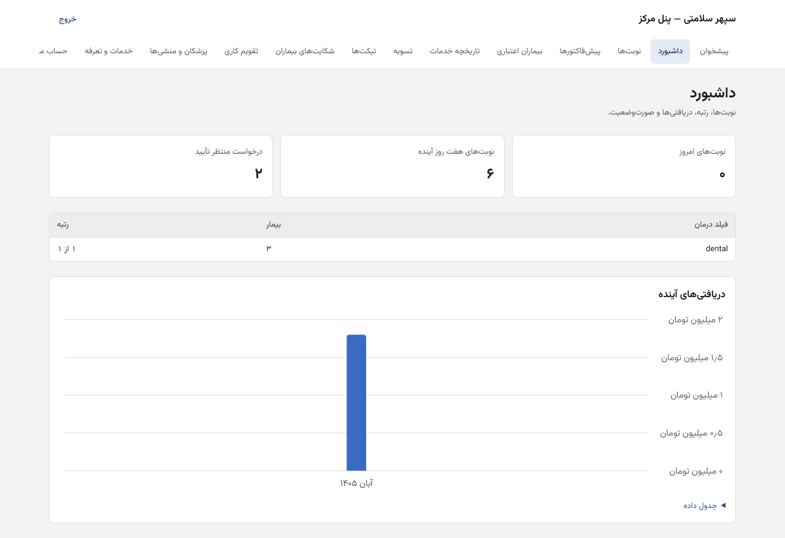
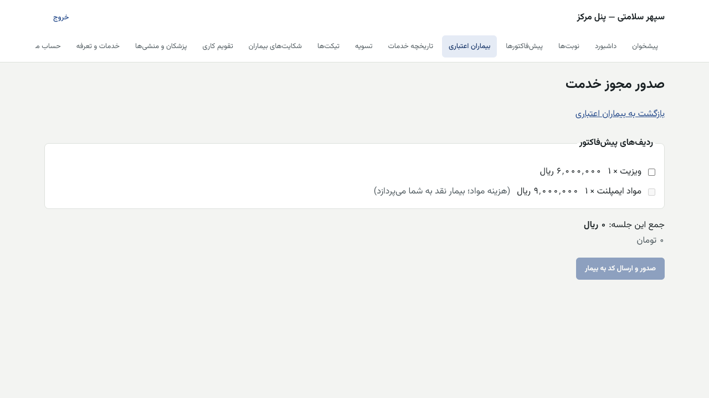
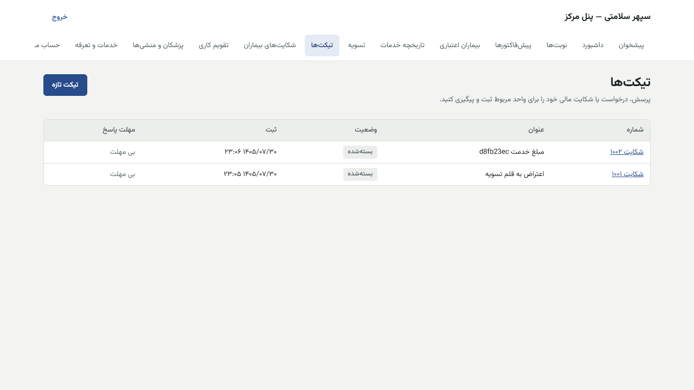
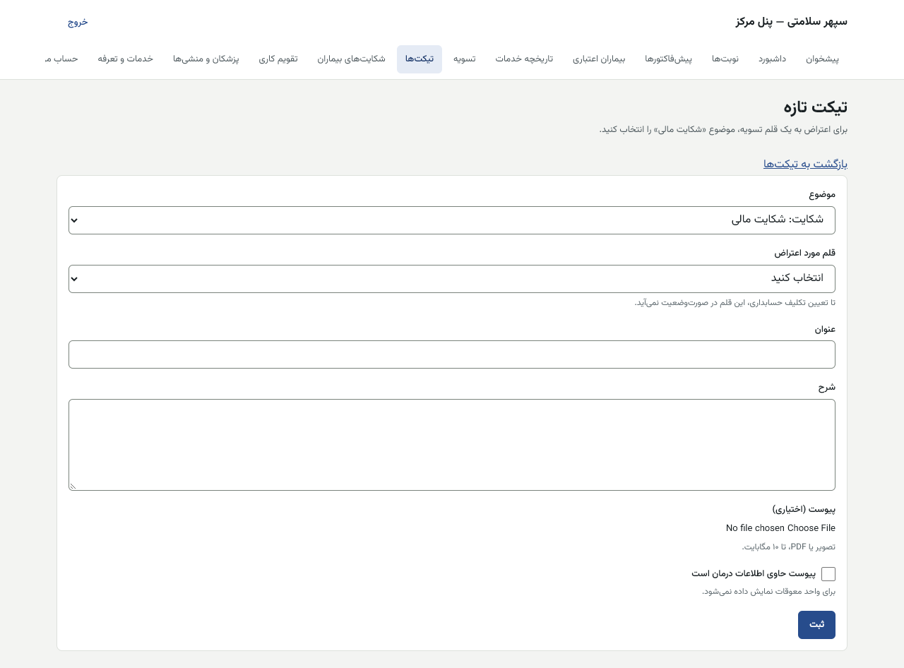
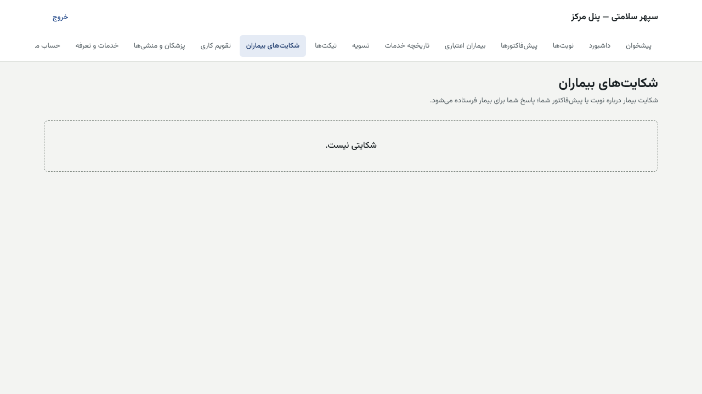

# راهنمای پزشک (پنل مرکز)

[فهرست](../README.md) · [جریان پرونده](../case-flow.md) · [واژه‌نامه](../glossary.md)

## ۱. معرفی نقش

نقش `doctor`. پزشک نوبت‌های خودش را مدیریت می‌کند، پس از معاینه پیش‌فاکتور صادر می‌کند، برای بیمار اعتباری مجوز خدمت می‌دهد و صورت‌وضعیت تسویه خودش را می‌بیند.

**دسترسی‌ها (مجوزها):** نوبت‌ها و تقویم خودش، حالت تأیید نوبت، پروفایل و تعرفه‌های خودش، صدور و دیدن پیش‌فاکتور، صدور مجوز خدمت، دیدن خدمات، دیدن تسویه خودش و اعتراض به قلم تسویه، تیکت مرکز و پاسخ به شکایت بیمار، دادن نقش منشی به منشی‌های خودش، دیدن وضعیت اعتباری بیمار (فقط «در بررسی، تأیید، رد»).

**نمی‌تواند:** امتیاز، دلیل رد یا اطلاعات مالی بیمار را ببیند؛ قیمت پیش‌فاکتور صادرشده را عوض کند (فقط نسخه تازه)؛ کیف بیمار را بی کد بیمار مصرف کند؛ ردیف «مواد» را از کیف پرداخت کند؛ صورت‌وضعیت را تأیید یا پرداخت کند؛ تعرفه ویزیت را از پنل داخلی ثبت کند.

## ۲. ورود، خروج، ورود دومرحله‌ای

نشانی: `/panel/login`. نام کاربری، رمز عبور، سپس کد شش‌رقمی برنامه احراز هویت. ورود اول و تغییر رمز: [بخش «برای همه کارکنان»](../README.md#برای-همه-کارکنان-پنل-مرکز-و-پنل-داخلی).

- **حساب من:** موبایل حساب باید با کد تأیید شده باشد تا پیامک «بیمار آماده دریافت خدمت است» به شما برسد. صفحه «حساب من» نشان می‌دهد «موبایل به‌پایان‌رسیده به … در … تأیید شده است» یا «موبایل این حساب هنوز تأیید نشده است».
- خروج: «خروج» بالای صفحه.
- **فقط از API:** ساخت حساب پزشک و پیوند آن به پرونده پزشک در کاتالوگ صفحه ندارد. مدیر سیستم با فرمان `pnpm account:create` حساب می‌سازد و پیوند با API انجام می‌شود ([system-admin.md](system-admin.md)).

## ۳. نقشه صفحه‌ها

| منو | نشانی | کار |
|---|---|---|
| پیشخوان | `/panel` | فهرست بخش‌های در دسترس |
| داشبورد | `/panel/dashboard` | نوبت‌های امروز و هفته، درخواست منتظر تأیید، رتبه، دریافتی‌های آینده |
| نوبت‌ها | `/panel/appointments` | تأیید، رد، پذیرش، معاینه، عدم حضور، لغو، صدور پیش‌فاکتور |
| پیش‌فاکتورها | `/panel/proformas` | فهرست، جزئیات، اصلاح با نسخه تازه |
| بیماران اعتباری | `/panel/patients` | بیماران شارژشده، «صدور مجوز خدمت» |
| تاریخچه خدمات | `/panel/authorizations` | مجوزها، ثبت خدمت با کد بیمار |
| تسویه | `/panel/settlement` | صورت‌وضعیت، دریافتی‌های آینده، اقلام معلق، اعتراض |
| تیکت‌ها | `/panel/tickets` | پرسش و شکایت مالی به سپهر |
| شکایت‌های بیماران | `/panel/complaints` | پاسخ به شکایت بیمار |
| تقویم کاری | `/panel/calendar` | ساعت‌های کاری، استثناها، حالت تأیید |
| پزشکان و منشی‌ها | `/panel/staff` | منشی‌های شما و دادن نقش منشی |
| خدمات و تعرفه | `/panel/services` | تعرفه‌های شما |
| حساب من | `/panel/account` | موبایل حساب |

## ۴. کارهای روزانه

### ۴.۱ تأیید یا رد درخواست نوبت

اگر «حالت تأیید» شما «دستی» است، هر درخواست نوبت منتظر شماست (بالای صفحه: «درخواست منتظر تأیید شماست»). مهلت پاسخ مرکز پیش‌فرض ۱۵ دقیقه است؛ پس از آن پیامک یادآوری می‌رود.

1. «نوبت‌ها» ← در «فیلتر نوبت‌ها»: «پزشک و محل»، «بازه روزها» (حداکثر ۶۲ روز)، «وضعیت».
2. در ستون «کار»: «تأیید»، یا «رد» با «دلیل رد».
3. با تأیید، بیمار پیامک تأیید و کد پذیرش می‌گیرد.

### ۴.۲ پذیرش، معاینه، عدم حضور، لغو

1. بیمار می‌رسد و کد پذیرش را می‌گوید: «پذیرش» ← «کد پذیرش بیمار» ← تأیید. کد اشتباه: «کد پذیرش درست نیست.»
2. پس از معاینه: «معاینه شد». **بی این گام پیش‌فاکتور صادر نمی‌شود.**
3. بیمار نیامد: «عدم حضور» با «توضیح عدم حضور». بیمار می‌تواند اعتراض کند و کارشناس شبکه بررسی می‌کند.
4. لغو از طرف مرکز: «لغو» با «دلیل لغو».

| پیام | دلیل | چه کنم |
|---|---|---|
| «این کار با وضعیت فعلی نوبت ممکن نیست. صفحه را تازه کنید.» | وضعیت نوبت پیش‌تر عوض شده | صفحه را تازه کنید |
| «محل کاری در دسترس شما نیست.» | حساب شما به محل کاری وصل نیست | با کارشناس شبکه |

### ۴.۳ صدور پیش‌فاکتور

1. در «نوبت‌ها»، کنار نوبتی که «معاینه شد» دارد، «صدور پیش‌فاکتور».
2. «ردیف‌های پیش‌فاکتور»، برای هر ردیف:
   - «خدمت» (از تعرفه‌های همین محل کار؛ کنارش «تعرفه:» نشان داده می‌شود)؛
   - «تعداد» (۱ تا ۹۹)؛
   - «قیمت واحد» به ریال. خالی یعنی قیمت تعرفه، اگر تعرفه یک مبلغ است؛
   - اگر قیمت خارج از تعرفه است، «دلیل قیمت خارج از تعرفه» الزامی است؛
   - «دندان یا محل (اختیاری)»، «یادداشت (اختیاری)».
3. «افزودن ردیف» یا «حذف ردیف».
4. «ذخیره پیش‌نویس» (بیمار نمی‌بیند) یا «ذخیره و صدور برای بیمار».
5. پیش‌نویس ذخیره‌شده را از جزئیات پیش‌فاکتور با «صدور برای بیمار» صادر کنید، یا با «دور انداختن پیش‌نویس» و «دلیل دور انداختن» کنار بگذارید.
6. پس از صدور، تغییر فقط با «اصلاح با نسخه تازه» است. نسخه قبلی می‌ماند.

| پیام | دلیل | چه کنم |
|---|---|---|
| «پیش‌فاکتور فقط پس از ثبت معاینه همین نوبت صادر می‌شود…» | «معاینه شد» ثبت نشده | اول در نوبت «معاینه شد» |
| «برای این محل کار هنوز تعرفه‌ای ثبت نشده است.» | تعرفه نیست | در «خدمات و تعرفه» تعرفه ثبت کنید |
| «برای قیمت خارج از تعرفه دلیل بنویسید.» | قیمت بیرون از بازه | دلیل بنویسید؛ کارشناس شبکه بررسی می‌کند |
| «تعداد هر ردیف عددی از ۱ تا ۹۹ است.» | تعداد | — |

**دستمزد و مواد (طرح فقط‌دستمزد):** هر ردیف نوع «دستمزد» یا «مواد» دارد که از نوع خدمت در کاتالوگ کپی می‌شود. صدور پیش‌فاکتور یعنی شما این تفکیک را تأیید کرده‌اید.
- **در دست ساخت:** فرم پیش‌فاکتور امروز ستون نوع هزینه را نشان نمی‌دهد و تغییرش برای یک ردیف (با دلیل) فقط از API ممکن است. نوع هر خدمت در کاتالوگ هم صفحه ندارد.

### ۴.۴ پاسخ بیمار به پیش‌فاکتور

در جزئیات پیش‌فاکتور، «پاسخ بیمار» را ببینید. اگر اعتراض کرده است، با «اصلاح با نسخه تازه» نسخه درست را صادر کنید.

### ۴.۵ صدور مجوز خدمت برای بیمار اعتباری

پس از شارژ کیف بیمار، پیامک «یک بیمار معرفی‌شده به شما در سپهر سلامتی آماده دریافت خدمت است» می‌رسد.

1. «بیماران اعتباری»: بیمارانی که کیفشان شارژ شده و به شما معرفی شده‌اند. ستون «وضعیت»: «مجاز» یا «غیرمجاز».
2. «صدور مجوز خدمت».
3. در «ردیف‌های این جلسه» ردیف‌هایی از پیش‌فاکتور را که امروز انجام می‌دهید علامت بزنید. «جمع این جلسه» نشان داده می‌شود.
   - ردیفی که «در مجوز دیگری» آمده، دوباره انتخاب نمی‌شود.
   - ردیف «هزینه مواد؛ بیمار نقد به شما می‌پردازد» خاکستری است و از کیف پرداخت نمی‌شود.
4. «صدور و ارسال کد به بیمار». مجوز پیش‌فرض ۲۴ ساعت اعتبار دارد.

| پیام | دلیل |
|---|---|
| «مبلغ ردیف‌های انتخاب‌شده از اعتبار قابل استفاده بیمار بیشتر است…» | ردیف کمتر انتخاب کنید |
| «این ردیف هزینه مواد است و از کیف اعتبار پرداخت نمی‌شود…» | ردیف مواد |
| «یکی از ردیف‌ها پیش‌تر در مجوز دیگری آمده است.» | — |
| «مرکز معلق است…» یا «مرکز فعال نیست…» | مجوز تازه صادر نمی‌شود |
| «مدت قرارداد این پزشک یا مرکز پایان یافته است؛ تا تمدید قرارداد، خدمت تازه ثبت نمی‌شود.» | قرارداد شما با سپهر تمام شده؛ با شبکه درمان تماس بگیرید |
| «کیف اعتبار این بیمار هنوز شارژ نشده است.» | — |

### ۴.۶ ثبت خدمت با کد بیمار

1. پس از انجام خدمت، از بیمار کد پیامک‌شده را بپرسید.
2. «تاریخچه خدمات» ← «مشاهده» مجوز ← «ثبت خدمت با کد بیمار» ← «کد پیامک‌شده به بیمار» ← «ثبت خدمت».
3. «خدمت ثبت و قطعی شد.» یا «خدمت ثبت شد و پس از مهلت اعتراض قطعی می‌شود.» (مهلت پیش‌فرض ۰ ساعت).
4. کد نرسید: «ارسال دوباره کد» (پس از ۶۰ ثانیه؛ حداکثر ۳ ارسال). «تلاش مانده» و «ارسال مانده» روی صفحه است.

| پیام | دلیل | چه کنم |
|---|---|---|
| «کد واردشده درست نیست.» | — | دوباره بپرسید (حداکثر ۵ تلاش) |
| «مهلت این مجوز تمام شده یا تلاش‌ها به پایان رسیده است؛ مبلغ آن آزاد شد. مجوز تازه صادر کنید.» | ۱۰ دقیقه کد یا ۲۴ ساعت مجوز گذشته | مجوز تازه |
| «سقف ارسال کد برای این مجوز پر شده است.» | ۳ ارسال | مجوز تازه |

**لغو مجوز:** پزشک لغو نمی‌کند؛ حسابداری از پنل داخلی، پیش از قطعی شدن، با دلیل.

### ۴.۷ تسویه و اعتراض

1. «تسویه»: «صورت‌وضعیت جاری» با «خدمات اعتباری»، «کارمزد اعتباری»، «کارمزد نقدی»، «مانده دوره قبل»، «قابل پرداخت»، «منتقل به دوره بعد».
2. «دریافتی‌های آینده»: خدماتی که در صورت‌وضعیت بعدی می‌آیند.
3. «اقلام معلق به‌دلیل اعتراض».
4. «دریافت PDF» برای صورت‌وضعیت.
5. اعتراض به یک قلم: «اعتراض» ← «اعتراض به قلم تسویه» ← «دلیل اعتراض» ← «ثبت اعتراض». یک تیکت شکایت مالی ساخته می‌شود و قلم تا تصمیم حسابداری در صورت‌وضعیت نمی‌آید.
6. روز هدف پرداخت: ۱۰ هر ماه شمسی.

| پیام | دلیل |
|---|---|
| «برای این قلم اعتراضی باز است…» | یک اعتراض کافی است |
| «این قلم دیگر قابل اعتراض نیست؛ در صورت‌وضعیت آمده یا پرداخت شده است.» | — |

### ۴.۸ تیکت و شکایت بیمار

- «تیکت‌ها» ← «تیکت تازه»: موضوع، عنوان، شرح، پیوست. برای اعتراض مالی موضوع «شکایت مالی» و «قلم مورد اعتراض».
- «شکایت‌های بیماران»: شکایت بیمار درباره نوبت یا پیش‌فاکتور شما. «پاسخ به شکایت» ← «پاسخ شما» ← «ارسال پاسخ». پاسخ برای بیمار فرستاده می‌شود.

### ۴.۹ تقویم کاری و حالت تأیید

1. «تقویم کاری» ← «انتخاب پزشک و محل» ← «نمایش».
2. **حالت تأیید نوبت:** «دستی، با تأیید مرکز» یا «خودکار، بی‌تأیید مرکز»؛ «دلیل تغییر»؛ «ذخیره». «تغییر فقط روی درخواست‌های تازه اثر دارد.»
3. **ساعت‌های کاری هفته:** برای هر بازه «روز»، «شروع بازه»، «پایان بازه»، «مدت هر نوبت» (دقیقه)، «خدمت»؛ «افزودن بازه» یا «حذف بازه»؛ «ذخیره ساعت‌های کاری».
4. **استثناهای روزها:** «نوع» («تعطیل»، «ساعت اضافه»، «باز در روز تعطیل»)، «از (خالی: کل روز)»، «دلیل»، «ثبت استثنا». برداشتن: «برداشتن».

### ۴.۱۰ تعرفه‌های من

«خدمات و تعرفه» ← «انتخاب پزشک و محل»:
- «تعرفه تازه»: «خدمت»، «از»، «تا» (خالی: همان «از»)، یا «رایگان (فقط ویزیت)»، «دلیل»، «ثبت تعرفه». مبلغ به ریال.
- «توقف ارائه» یا «لغو این تغییر» برای تغییر زمان‌بندی‌شده.
- تعرفه تازه فقط روی نوبت‌ها و پیش‌فاکتورهای بعدی اثر دارد.
- **تعرفه ویزیت:** اگر پرچم `catalog.visit_tariff_internal_only` روشن شود، ویزیت فقط از پنل داخلی و دونفره ثبت می‌شود و شما پیام «تعرفه ویزیت فقط از پنل داخلی و با تأیید دونفره ثبت می‌شود» را می‌بینید. امروز خاموش است.

### ۴.۱۱ منشی‌ها

«پزشکان و منشی‌ها» ← بخش «منشی‌ها» ← «دادن نقش منشی» ← «دلیل» ← «ثبت». منشی باید از پیش حساب پنل مرکز داشته باشد (فقط از API یا فرمان مدیر سیستم ساخته می‌شود). منشی فقط تیکت می‌بیند و پاسخ می‌دهد.

## ۵. قواعد مالی مرتبط

- کیف بیمار «وام + پیش‌پرداخت» است و شما کل آن را برای خدمت می‌گیرید، منهای **کارمزد خدمت اعتباری** در صورت‌وضعیت.
- نرخ کارمزد خدمت (اعتباری و نقدی) از قرارداد شما با سپهر می‌آید و روی هر خدمت در لحظه قطعی شدن قفل می‌شود. پیش‌فرض سامانه ۰ است تا عدد واقعی دونفره ثبت شود.
- **طرح فقط‌دستمزد:** مواد را بیمار نقد به شما می‌دهد؛ در تسویه نمی‌آید و کارمزد خدمت ندارد.
- **کسری کم:** بیمار نقد به شما می‌دهد؛ فقط ثبت می‌شود.
- **مدت قرارداد** ۳، ۶ یا ۱۲ ماه. پس از پایان، مجوز خدمت تازه صادر نمی‌شود. ۳۰ روز پیش از پایان به شبکه درمان هشدار می‌رود.
- پرداخت به شما با تأیید دو نفر حسابداری و کد رهگیری بانک است. **تهاتر خالص** (کم کردن بدهی شما از طلب) **در دست ساخت**؛ فعلاً دستی نیست.

## ۶. تأییدهای دونفره که به شما مربوط است

| کار | نفر اول | نفر دوم |
|---|---|---|
| تغییر شبای حساب مرکز | مدیر مرکز | حسابداری |
| تعرفه ویزیت (اگر پرچم روشن شود) | کارشناس شبکه | مدیر یا کارشناس شبکه دیگر |
| پرداخت صورت‌وضعیت | حسابداری | حسابداری دیگر |
| تصمیم درباره اعتراض مالی | — | حسابداری |

## ۷. پرسش‌های متداول

- **چرا دکمه «صدور پیش‌فاکتور» نیست؟** «معاینه شد» ثبت نشده است.
- **بیمار کد را ندارد.** «ارسال دوباره کد»؛ اگر موبایل بیمار عوض شده، بیمار با پشتیبانی تماس بگیرد.
- **چرا یک ردیف خاکستری است؟** ردیف مواد در طرح فقط‌دستمزد، یا ردیفی که در مجوز دیگری آمده.
- **چرا پیامک «بیمار آماده است» نمی‌رسد؟** موبایل حساب شما تأیید نشده است («حساب من»).

## ۸. چک‌لیست

**روزانه:** درخواست‌های منتظر تأیید؛ پذیرش و «معاینه شد» برای هر بیمار؛ پیش‌فاکتورهای اعتراض‌شده؛ شکایت‌های بیماران.
**هفتگی:** تقویم هفته بعد و استثناها؛ «دریافتی‌های آینده».
**ماهانه:** صورت‌وضعیت پس از ساخت؛ اعتراض به هر قلم نادرست پیش از پرداخت.

## ۹. سناریوی نمونه (ساختگی)

دکتر نمونه ساعت ۹ درخواست نوبت سارا را «تأیید» می‌کند. ساعت ۱۰ سارا کد پذیرش «۴۸۲۱» را می‌گوید؛ «پذیرش»، سپس «معاینه شد». «صدور پیش‌فاکتور»: ردیف ۱ «ایمپلنت» تعداد ۲، قیمت ۵۰٬۰۰۰٬۰۰۰ ریال؛ ردیف ۲ «روکش» تعداد ۲، قیمت ۱۰٬۰۰۰٬۰۰۰. جمع ۱۲۰٬۰۰۰٬۰۰۰. «ذخیره و صدور برای بیمار». دو هفته بعد پیامک «بیمار آماده دریافت خدمت است» می‌رسد. در «بیماران اعتباری» برای جلسه اول ردیف ایمپلنت را انتخاب می‌کند (۱۰۰٬۰۰۰٬۰۰۰)، «صدور و ارسال کد به بیمار». پس از جراحی کد ۶ رقمی سارا را در «ثبت خدمت با کد بیمار» وارد می‌کند. ماه بعد در «تسویه» این خدمت را با کارمزد خدمت اعتباری می‌بیند.

## ۱۰. ویژگی‌های غیرفعال یا منتظر ورودی

| ویژگی | وضعیت |
|---|---|
| ستون دستمزد یا مواد در فرم پیش‌فاکتور | **در دست ساخت** (فقط از API) |
| ساخت حساب پزشک و پیوند به کاتالوگ | **فقط از API** و فرمان سرور |
| ثبت تعرفه ویزیت فقط از پنل داخلی | پرچم خاموش |
| نرخ کارمزد خدمت | پیش‌فرض ۰ تا ثبت عدد قرارداد |
| تهاتر خالص در تسویه | **در دست ساخت** |
| بازاحراز TOTP روی کارهای مالی | **در دست ساخت** (م۳) |

## تصویرهای لازم که هنوز نیست

- [تصویر: نوبت‌ها با دکمه‌های پذیرش و معاینه]
- [تصویر: فرم پیش‌فاکتور]
- [تصویر: ثبت خدمت با کد بیمار]
- [تصویر: صفحه تسویه]
- [تصویر: تقویم کاری]
