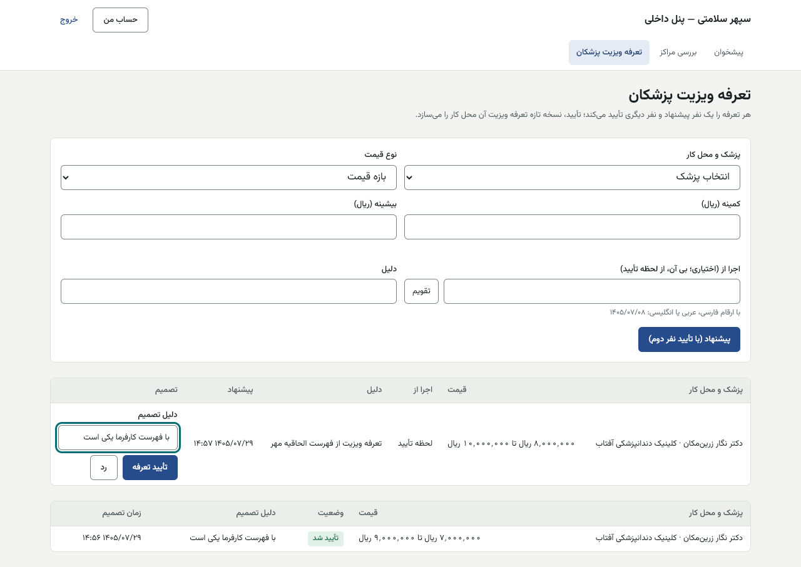
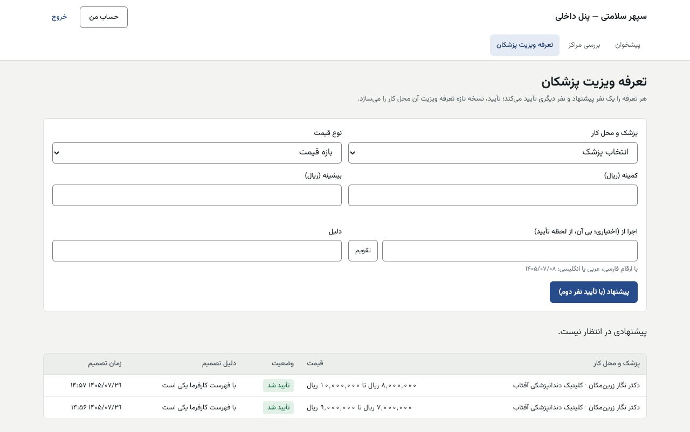

# راهنمای مدیر شبکه درمان — پنل داخلی

[فهرست](../README.md) · [جریان پرونده](../case-flow.md) · [واژه‌نامه](../glossary.md)

## ۱. معرفی نقش

نقش `network_manager`. مدیر شبکه نفر دوم فعال‌سازی مرکز و تعرفه ویزیت است، مرکز را تعلیق می‌کند و کاتالوگ سراسری خدمات را اداره می‌کند.

**مجوزها:** دیدن ساختار، نوبت‌ها، تقویم و معرفی‌ها؛ **تأیید فعال‌سازی مرکز**؛ مدیریت کاتالوگ؛ تعرفه ویزیت؛ دیدن مراکز، پزشکان و تعرفه‌ها؛ بررسی مراکز؛ تعلیق مرکز؛ دیدن پیش‌فاکتور.

**نمی‌تواند:** مرکز یا پزشک ثبت کند (کارشناس شبکه)؛ پروفایل منتشر کند؛ پیشنهاد خودش را تأیید کند؛ کار اعتباری یا مالی کند.

## ۲. ورود و خروج

پنل داخلی، فقط از VPN. [برای همه کارکنان](../README.md#برای-همه-کارکنان-پنل-مرکز-و-پنل-داخلی).

## ۳. نقشه صفحه‌ها

«بررسی مراکز» و «تعرفه ویزیت پزشکان».

## ۴. کارهای روزانه

### ۴.۱ تأیید فعال‌سازی مرکز

1. «بررسی مراکز» ← فیلتر «وضعیت» ← مرکز.
2. «درخواست‌ها»: درخواست «فعال‌سازی» با وضعیت «در انتظار نفر دوم».
3. مدارک را ببینید (همه باید «تأییدشده» باشند).
4. «یادداشت (اختیاری)» ← «تأیید درخواست»، یا «رد درخواست».
5. مرکز از روز تأیید «فعال از» می‌گیرد.

### ۴.۲ تعلیق و پایان همکاری

در پرونده مرکز ← «گام بعد» ← «تعلیق» یا «پایان همکاری» با «دلیل». مرکز معلق مجوز خدمت تازه نمی‌گیرد؛ مجوزهای صادرشده دست نمی‌خورند.

### ۴.۳ تصمیم درباره تعرفه ویزیت

1. «تعرفه ویزیت پزشکان»: «در انتظار تأیید (…)» با پزشک و محل کار، قیمت، «اجرا از» و دلیل.
2. «دلیل تصمیم» ← «تأیید تعرفه» یا «رد». تأیید، نسخه تازه تعرفه ویزیت آن محل کار را می‌سازد.
3. «تصمیم‌های اخیر» پایین صفحه.

| پیام | دلیل |
|---|---|
| «پیشنهاد شما؛ نفر دوم تصمیم می‌گیرد.» | پیشنهاد خودتان است |
| «دلیل تصمیم را بنویسید.» | — |
| «زمان شروع این تعرفه گذشته است…» | رد و ثبت دوباره |

### ۴.۴ کاتالوگ خدمات

**در دست ساخت:** کاتالوگ سراسری خدمات (نام، رشته، نوع هزینه دستمزد یا مواد) صفحه پنل ندارد و با API تغییر می‌کند. تغییر نوع هزینه فقط روی پیش‌نویس‌های بعدی پیش‌فاکتور اثر دارد.

## ۵. قواعد مالی مرتبط

نوع هزینه خدمت (دستمزد یا مواد) مبلغ وام طرح فقط‌دستمزد را تعیین می‌کند: وام = دستمزد − پیش‌پرداخت (پیش‌پرداخت ۱۸٪ از کل). خدمتی که اشتباهاً «دستمزد» باشد وام بیشتری می‌سازد؛ بازبین تفکیک در واحد اعتبار آن را می‌سنجد.

## ۶. تأییدهای دونفره

| کار | شما |
|---|---|
| فعال‌سازی مرکز | نفر دوم |
| تعرفه ویزیت | نفر دوم (یا پیشنهاددهنده؛ هرگز هر دو) |

## ۷. پرسش‌های متداول

- **دکمه تأیید نیست.** یا پیشنهاد مال خودتان است، یا مدارک کامل نیست.

## ۸. چک‌لیست روزانه

- [ ] درخواست‌های فعال‌سازی منتظر.
- [ ] پیشنهادهای تعرفه ویزیت.

## ۹. سناریوی نمونه (ساختگی)

کارشناس برای «کلینیک نمونه» فعال‌سازی پیشنهاد داده است. مدیر شبکه پنج مدرک تأییدشده را می‌بیند، «تأیید درخواست» را با یادداشت «مدارک کامل» می‌زند. سپس پیشنهاد ویزیت ۵٬۰۰۰٬۰۰۰ تا ۹٬۰۰۰٬۰۰۰ ریال را با دلیل «مطابق قرارداد» تأیید می‌کند.

## ۱۰. ویژگی‌های غیرفعال یا منتظر ورودی

| ویژگی | وضعیت |
|---|---|
| صفحه کاتالوگ خدمات | **در دست ساخت** (فقط از API) |
| ثبت ویزیت فقط از پنل داخلی | پرچم `catalog.visit_tariff_internal_only` خاموش؛ روشن کردن **فقط از API**، دونفره |

## تصویرهای لازم

- [تصویر: تأیید درخواست فعال‌سازی]
