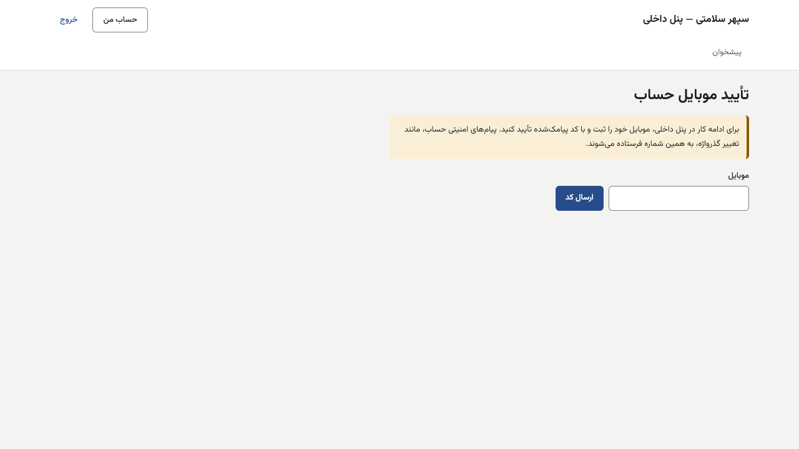
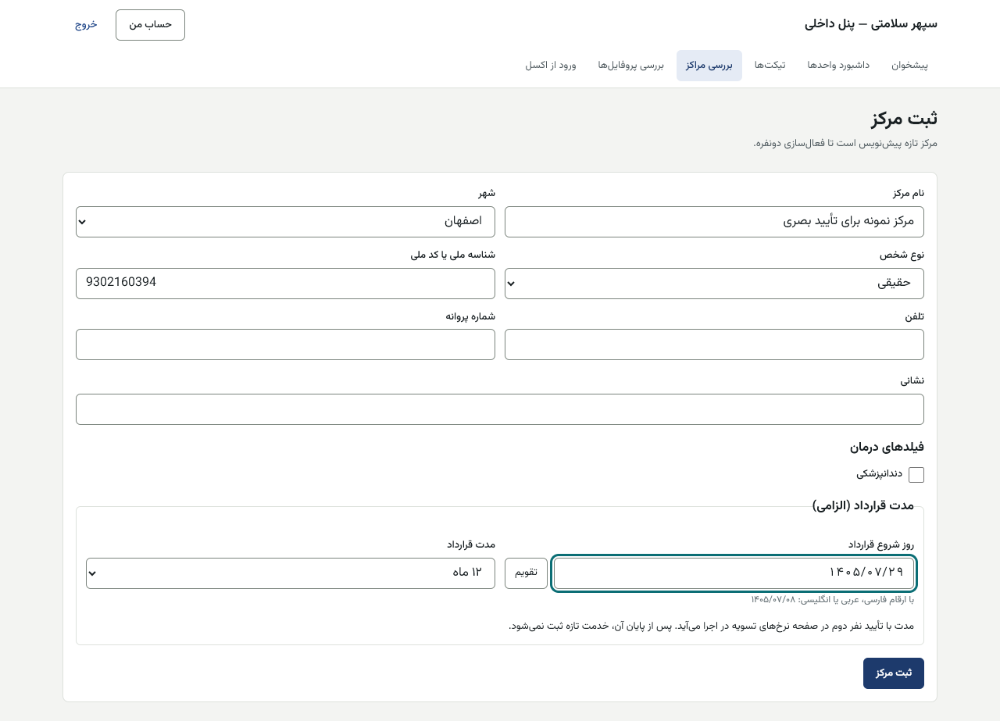
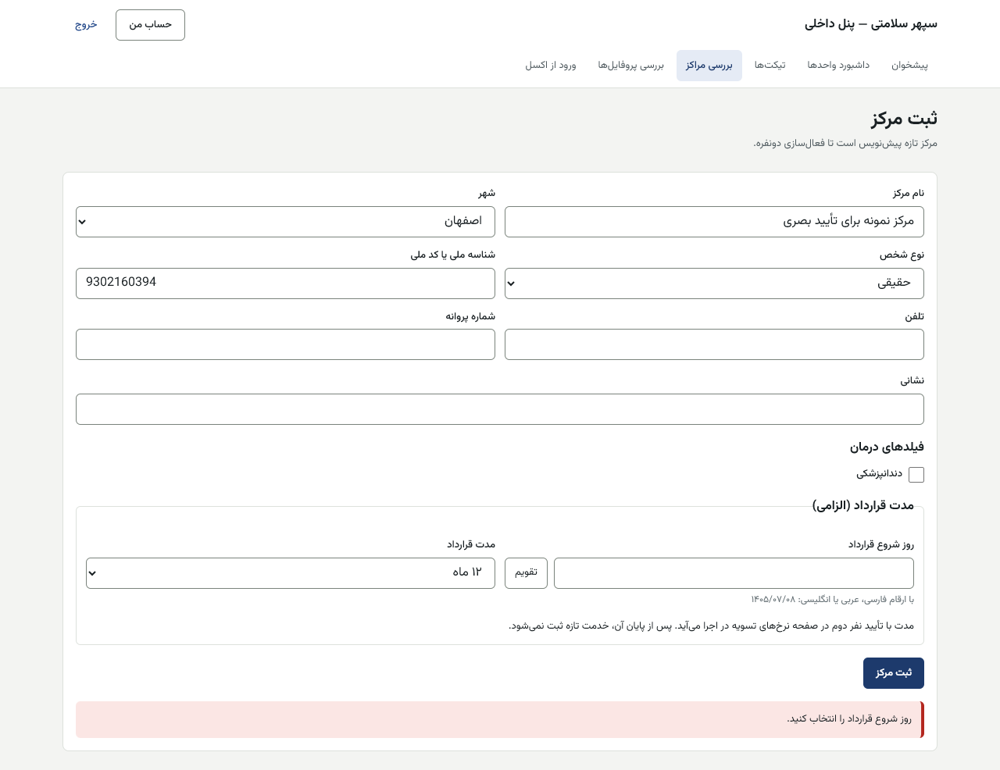
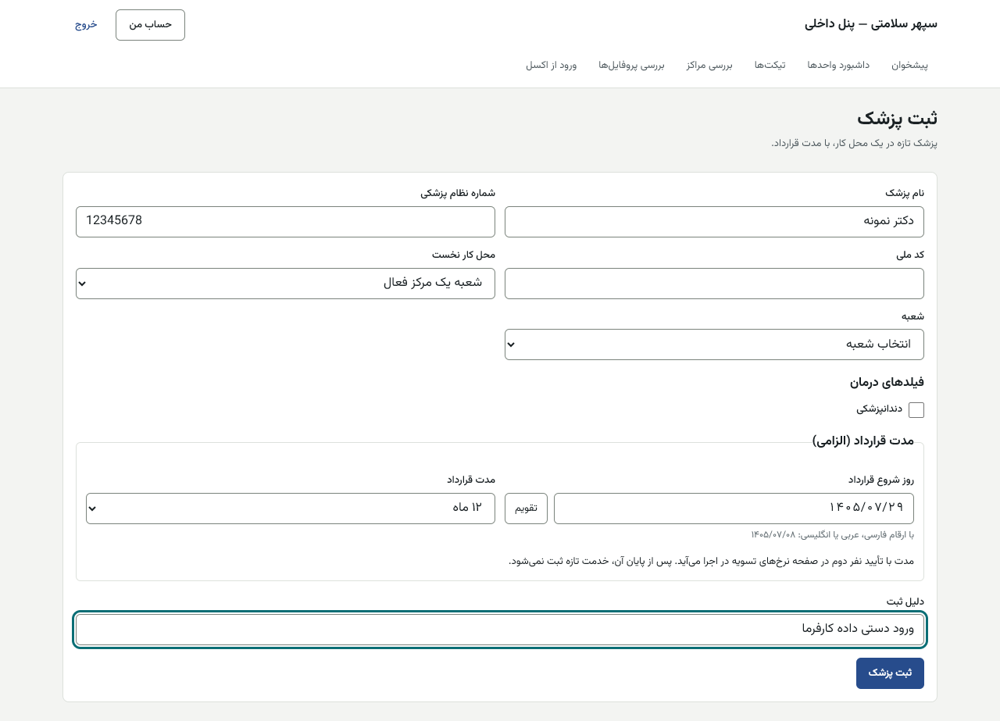
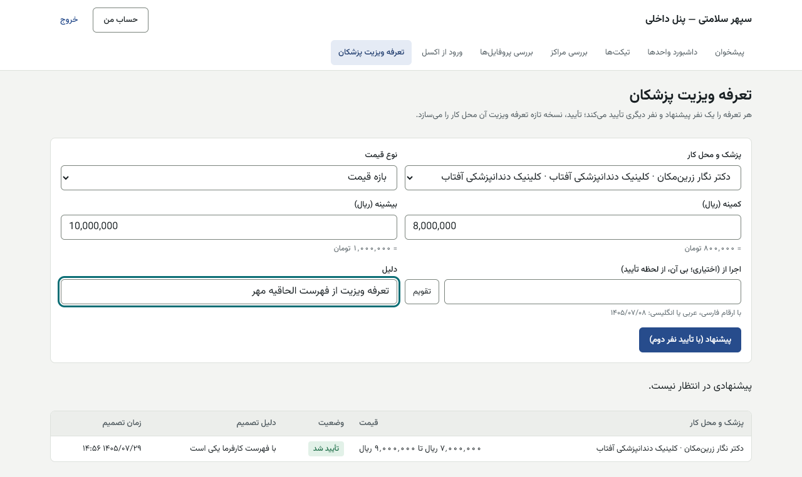

# راهنمای کارشناس شبکه درمان — پنل داخلی

[فهرست](../README.md) · [جریان پرونده](../case-flow.md) · [واژه‌نامه](../glossary.md)

## ۱. معرفی نقش

نقش `network_specialist`. کارشناس شبکه مراکز و پزشکان را ثبت و بررسی می‌کند، مدارک مرکز را می‌سنجد، فعال‌سازی را پیشنهاد می‌دهد، پروفایل پزشکان را منتشر می‌کند، تعرفه ویزیت را پیشنهاد می‌دهد و تقویم و نوبت هر پزشکی را در دامنه‌اش اداره می‌کند.

**مجوزهای اصلی:** ساختار و مراکز و پزشکان (ثبت و مدیریت)، بررسی مراکز و پروفایل‌ها، ورود گروهی، تعلیق مرکز، تعرفه ویزیت، پذیرش اعتبار سپهر در محل کار، تقویم هر پزشک، اعتراض عدم حضور، بررسی انحراف قیمت پیش‌فاکتور، تیکت.

**نمی‌تواند:** مرکز را خودش فعال کند (نفر دوم: مدیر شبکه)؛ پیشنهاد تعرفه ویزیت خودش را تأیید کند؛ شبای مرکز را تأیید کند (حسابداری)؛ نرخ کارمزد یا مدت قرارداد را تأیید کند.

## ۲. ورود و خروج

پنل داخلی، فقط از VPN. [برای همه کارکنان](../README.md#برای-همه-کارکنان-پنل-مرکز-و-پنل-داخلی).

## ۳. نقشه صفحه‌ها

| منو | کار |
|---|---|
| بررسی مراکز (`/centers`) | فهرست، «ثبت مرکز تازه»، «ثبت پزشک تازه»، پرونده هر مرکز |
| بررسی پروفایل‌ها (`/profiles`) | انتشار یا برگشت نسخه پروفایل؛ «نشانی پروفایل‌ها برای وردپرس» |
| ورود از اکسل (`/imports`) | **غیرفعال در پایلوت** |
| تعرفه ویزیت پزشکان (`/visit-tariffs`) | پیشنهاد و تصمیم (برای پیشنهاد دیگران) |
| تیکت‌ها، داشبورد واحدها | صف تیکت واحد شبکه |

## ۴. کارهای روزانه

### ۴.۱ ثبت مرکز تازه

1. «بررسی مراکز» ← «ثبت مرکز تازه».
2. فیلدها: «نام مرکز»، «شهر» («انتخاب شهر»)، «نوع شخص» («حقوقی» یا «حقیقی»)، «شناسه ملی یا کد ملی»، «تلفن»، «شماره پروانه»، «نشانی»، «فیلدهای درمان».
3. **«مدت قرارداد (الزامی)»:** «روز شروع قرارداد» و «مدت قرارداد» («۳ ماه»، «۶ ماه»، «۱۲ ماه»). «مدت با تأیید نفر دوم در صفحه نرخ‌های تسویه در اجرا می‌آید. پس از پایان آن، خدمت تازه ثبت نمی‌شود.»
4. «ثبت مرکز». مرکز تازه **پیش‌نویس** است تا فعال‌سازی دونفره.

| پیام | دلیل |
|---|---|
| «روز شروع قرارداد را انتخاب کنید.» | فیلد خالی |
| «اجازه ثبت مرکز را ندارید.» | نقش شما `catalog.manage_centers` ندارد |

### ۴.۲ ثبت پزشک تازه

1. «بررسی مراکز» ← «ثبت پزشک تازه».
2. «نام پزشک»، «شماره نظام پزشکی»، «کد ملی».
3. «محل کار نخست»: «شعبه یک مرکز فعال» (و «انتخاب شعبه») یا «مطب شخصی» (و «شهر مطب»).
4. مدت قرارداد، «دلیل ثبت»، «ثبت پزشک». پیام: «پزشک «…» ثبت شد. مدت قرارداد منتظر تأیید نفر دوم است.»

**فقط از API (صفحه ندارد):** افزودن محل کار دوم به پزشک؛ پیوند حساب کاربری پزشک؛ روشن کردن «پذیرش اعتبار سپهر» در محل کار. تا ساخت صفحه با تیم فنی.

### ۴.۳ بررسی مدارک و فعال‌سازی مرکز

1. پرونده مرکز («بررسی مراکز» ← مرکز). «مدارک»: وضعیت هر مدرک («ارسال‌نشده»، «دریافت‌شده»، «ناقص»، «تأییدشده»).
2. برای هر مدرک: «تأیید مدرک»، یا وضعیت «ناقص» با «یادداشت (اختیاری)».
3. «گام بعد»:
   - «بازگشت برای اصلاح» با «دلیل»: مرکز اصلاح می‌کند.
   - «پیشنهاد فعال‌سازی» با «دلیل»: «پیشنهاد ثبت شد؛ نفر دوم باید تأیید کند.»
   - «تعلیق» با دلیل: مرکز معلق می‌شود و مجوز خدمت تازه نمی‌گیرد.
   - «پایان همکاری» با دلیل.
4. «درخواست‌ها»: فعال‌سازی، فعال‌سازی دوباره و تغییر حساب بانکی، با وضعیت.

| پیام | دلیل |
|---|---|
| «همه مدارک باید پیش از فعال‌سازی تأیید شده باشند.» | مدرکی تأیید نشده |
| «این درخواست را باید شخص دیگری جز پیشنهاددهنده تأیید کند.» | تأیید پیشنهاد خودتان |

### ۴.۴ پروفایل پزشکان

1. «بررسی پروفایل‌ها»: «صف بررسی پروفایل‌ها» به ترتیب ارسال.
2. پروفایل را باز کنید: «نسخه ارسال‌شده» کنار «نسخه منتشرشده فعلی»: عنوان تخصص، درباره پزشک، سوابق، پیوندها، عکس و ویدئو.
3. «تصمیم»: «انتشار»، یا «برگشت برای اصلاح» با «دلیل».
4. «نشانی پروفایل‌ها برای وردپرس»: فهرست پروفایل‌های منتشرشده و «دریافت CSV» برای لینک‌دهی از سایت. پزشک بی محل کار فعال `noindex` است.

### ۴.۵ پیشنهاد تعرفه ویزیت

1. «تعرفه ویزیت پزشکان» ← «پیشنهاد تعرفه ویزیت».
2. «پزشک و محل کار» («انتخاب پزشک»)، «نوع قیمت» («بازه قیمت» یا «ویزیت رایگان»)، «کمینه» و «بیشینه» به ریال، «اجرا از (اختیاری؛ بی آن، از لحظه تأیید)»، «دلیل».
3. «پیشنهاد (با تأیید نفر دوم)». پیام: «پیشنهاد ثبت شد. نفر دوم باید آن را تأیید کند.»
4. برای پیشنهاد همکار: «تصمیم درباره تعرفه ویزیت» ← «دلیل تصمیم» ← «تأیید تعرفه» یا «رد».

| پیام | دلیل |
|---|---|
| «کمینه و بیشینه را به ریال وارد کنید؛ کمینه بیش از صفر و بیشینه دست‌کم برابر آن.» | — |
| «برای این محل کار پیشنهاد بازی در انتظار تأیید است.» | یک پیشنهاد باز کافی است |
| «زمان شروع این تعرفه گذشته است…» | پیشنهاد را رد و با زمان تازه ثبت کنید |

### ۴.۶ اعتراض عدم حضور و انحراف قیمت

- **اعتراض عدم حضور بیمار:** **رویه دستی در پایلوت** (تصمیم مالک ۱۴۰۵/۰۸/۰۱؛ صفحه پس از پایلوت). بیمار یا پشتیبانی تیکت با عنوان «اعتراض عدم حضور» و شماره نوبت ثبت می‌کند. شما در همان تیکت توضیح پزشک و بیمار را می‌گیرید، تصمیم و دلیل را در تیکت می‌نویسید و ثبتش در سامانه را از مدیر سیستم می‌خواهید (از API). تیکت پس از ثبت بسته می‌شود.
- **بررسی قیمت خارج از تعرفه پیش‌فاکتور:** **رویه دستی در پایلوت** (تصمیم مالک ۱۴۰۵/۰۸/۰۱؛ صفحه پس از پایلوت). هر روز صبح فهرست پیش‌فاکتورهای خارج از تعرفه را از مدیر سیستم بگیرید (از API)، هر مورد را با پزشک بسنجید و نتیجه را در یک تیکت داخلی ثبت کنید؛ ثبت تصمیم در سامانه را مدیر سیستم انجام می‌دهد.

### ۴.۷ نوع هزینه خدمت (دستمزد یا مواد)

نوع هر خدمت کاتالوگ («دستمزد» یا «مواد») برای طرح فقط‌دستمزد مهم است. **در دست ساخت:** صفحه پنل ندارد؛ با API (`PATCH /catalog/services/:code`) و مجوز `catalog.manage_catalog` (مدیر شبکه و مدیر سیستم) عوض می‌شود.

## ۵. قواعد مالی مرتبط

- **مدت قرارداد** مرکز یا پزشک: ۳، ۶ یا ۱۲ ماه، با تأیید نفر دوم در «نرخ‌های تسویه پزشک». پس از پایان، مجوز خدمت تازه رد می‌شود. ۳۰ روز پیش از پایان هشدار.
- **تعرفه ویزیت** دونفره، فقط روی نوبت‌های بعد.
- قیمت خارج از تعرفه در پیش‌فاکتور مجاز است ولی دلیل می‌خواهد.

## ۶. تأییدهای دونفره

| کار | نفر اول | نفر دوم | چرا |
|---|---|---|---|
| فعال‌سازی مرکز | کارشناس شبکه | مدیر شبکه | مرکز بی مدارک وارد نشود |
| تعرفه ویزیت | کارشناس شبکه | همکار دیگر با همان مجوز (کارشناس یا مدیر شبکه) | قیمت بی چشم دوم عوض نشود |
| مدت قرارداد | ثبت در فرم | نفر دوم در «نرخ‌های تسویه پزشک» | مدت از قرارداد واقعی |

## ۷. پرسش‌های متداول

- **مرکز را ثبت کردم ولی در جست‌وجو نیست.** پیش‌نویس است تا فعال‌سازی دونفره؛ پزشکانش هم باید پروفایل منتشرشده و محل کار فعال داشته باشند.
- **پزشک دو مطب دارد.** محل کار دوم فقط از API.

## ۸. چک‌لیست

**روزانه:** صف پروفایل‌ها؛ مدارک رسیده؛ پیشنهادهای ویزیت همکاران؛ تیکت‌های واحد. **هفتگی:** مراکز «ناقص»؛ هشدارهای پایان قرارداد.

## ۹. سناریوی نمونه (ساختگی)

کارشناس «کلینیک نمونه» را در اصفهان با قرارداد ۱۲ ماهه از ۱۴۰۵/۰۸/۰۱ ثبت می‌کند. پنج مدرک را تأیید می‌کند و «پیشنهاد فعال‌سازی» می‌زند. مدیر شبکه تأیید می‌کند. سپس «دکتر نمونه» را با «شعبه یک مرکز فعال» ثبت و برای ویزیتش بازه ۵٬۰۰۰٬۰۰۰ تا ۹٬۰۰۰٬۰۰۰ ریال پیشنهاد می‌دهد؛ مدیر شبکه تأیید می‌کند.

## ۱۰. ویژگی‌های غیرفعال یا منتظر ورودی

| ویژگی | وضعیت |
|---|---|
| ورود از اکسل | **غیرفعال در پایلوت** (کارفرما: ثبت دستی) |
| محل کار دوم، پیوند حساب پزشک، پذیرش اعتبار در محل کار | **فقط از API** |
| نوع هزینه خدمت | **در دست ساخت** (فقط از API) |
| اعتراض عدم حضور، انحراف قیمت | **رویه دستی در پایلوت**؛ صفحه پس از پایلوت |

## تصویرهای لازم

- [تصویر: پرونده مرکز با مدارک و «گام بعد»]
- [تصویر: بررسی پروفایل]
