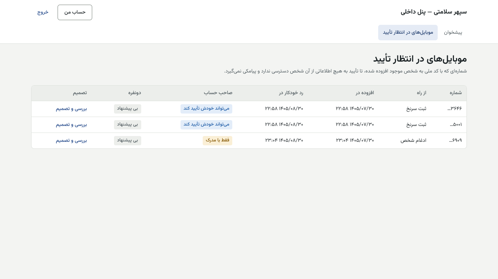
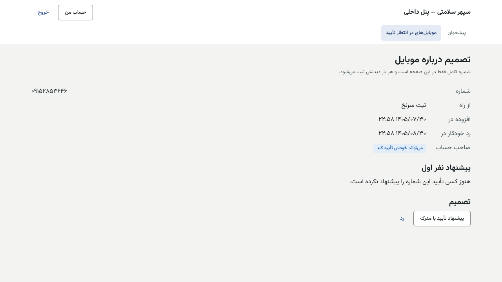
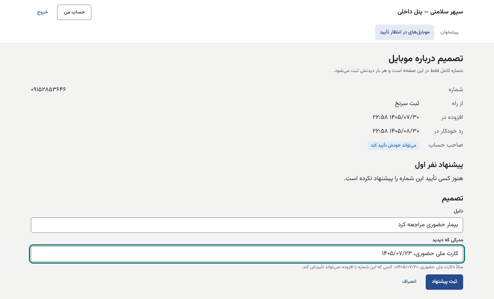
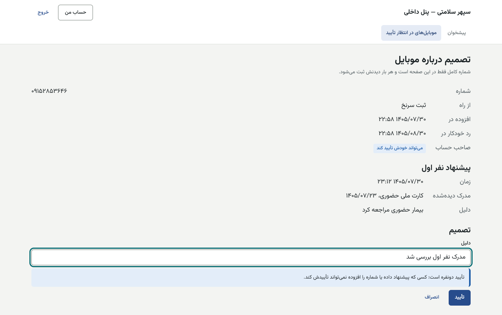

# راهنمای تأییدکننده موبایل افزوده — پنل داخلی

[فهرست](../README.md) · [جریان پرونده](../case-flow.md) · [واژه‌نامه](../glossary.md)

## ۱. معرفی نقش

**نقش سفارشی** با یک مجوز: `lead.approve_person_mobile` (م۷). روز راه‌اندازی مدیر سیستم آن را می‌سازد و به **۲ و بهتر ۳** نفر با دامنه «همه‌جا» می‌دهد.

**چرا لازم است؟** وقتی کارمند (مشاور، ورود سرنخ) با کد ملی یک شخص موجود، شماره تازه‌ای ثبت می‌کند، صاحب آن شماره ممکن است کس دیگری باشد. تا تأیید، آن شماره **به هیچ اطلاعاتی از آن شخص دسترسی ندارد و پیامکی نمی‌گیرد**. این تأیید یا با خود صاحب حساب است (در اپ)، یا با دو کارمند و مدرک.

**نمی‌تواند:** شماره‌ای را که خودش افزوده تأیید کند؛ پیشنهاد خودش را تأیید کند؛ هرگز این نقش به مشاور، پشتیبانی یا مدیر سیستم داده نمی‌شود.

## ۲. ورود و خروج

پنل داخلی، فقط از VPN. [برای همه کارکنان](../README.md#برای-همه-کارکنان-پنل-مرکز-و-پنل-داخلی).

## ۳. نقشه صفحه‌ها

«موبایل‌های در انتظار تأیید» (`/person-mobiles`) و صفحه تصمیم هر شماره.

## ۴. کار: تأیید دونفره با مدرک

1. صف: شماره (**فقط چهار رقم پایانی**)، «از راه»، «افزوده در»، «رد خودکار در» (۳۰ روز پس از افزودن)، «صاحب حساب» («می‌تواند خودش تأیید کند» یا «فقط با مدرک»)، «دونفره» («پیشنهادشده، منتظر نفر دوم» یا «بی پیشنهاد») ← «بررسی و تصمیم».
2. صفحه تصمیم: «شماره کامل فقط در این صفحه است و هر بار دیدنش ثبت می‌شود.»
3. **نفر اول:** شخص را حضوری یا با مدرک معتبر بسنجید ← «پیشنهاد تأیید با مدرک» ← «مدرکی که دیدید» (مثلاً «کارت ملی حضوری، ۱۴۰۵/۰۸/۰۱»)، «دلیل» ← «ثبت پیشنهاد».
4. **نفر دوم** (نه پیشنهاددهنده و نه افزاینده): «پیشنهاد نفر اول» را می‌بیند ← «تأیید نفر دوم» ← «تأیید».
5. رد: «رد» با «دلیل».

| پیام | دلیل |
|---|---|
| «کسی که این شماره را افزوده نمی‌تواند خودش آن را تأیید کند.» | — |
| «تأیید دونفره است: کسی که پیشنهاد داده نمی‌تواند خودش آن را تأیید کند.» | — |
| «تأیید دونفره است: اول یک نفر با مدرک پیشنهاد می‌دهد، سپس نفر دوم تأیید می‌کند.» | تأیید بی پیشنهاد |
| «برای این شماره پیش‌تر پیشنهاد ثبت شده است؛ نفر دوم تأیید یا رد می‌کند.» | — |
| «مهلت تأیید این شماره گذشته است.» | ۳۰ روز |

## ۵. قواعد مالی مرتبط

با تأیید، صاحب شماره همه نوبت‌ها، پرونده‌های اعتباری و **اقساط** آن شخص را می‌بیند. تأیید اشتباه یعنی افشای اطلاعات مالی. در شک، رد کنید.

## ۶. تأییدهای دونفره

نفر اول با مدرک، نفر دوم جدا؛ افزاینده هیچ‌کدام نیست. با یک دارنده کار می‌ایستد؛ پس دست‌کم ۲ و بهتر ۳ دارنده.

## ۷. پرسش‌های متداول

- **صاحب حساب «می‌تواند خودش تأیید کند»؛ صبر کنم؟** بله؛ او در اپ بنر تأیید را می‌بیند. تأیید کارمندی برای وقتی است که خودش نمی‌تواند.

## ۸. چک‌لیست روزانه

- [ ] شماره‌های نزدیک به «رد خودکار».
- [ ] پیشنهادهای منتظر نفر دوم.

## ۹. سناریوی نمونه (ساختگی)

مشاور با کد ملی «۰۰۰۰۰۰۰۰۰۱» شماره ۰۹۱۵۰۰۰۰۰۰۵ را به «زهرا نمونه» افزود. زهرا حضوری با کارت ملی می‌آید. کارمند «الف» پیشنهاد با مدرک «کارت ملی حضوری، ۱۴۰۵/۰۸/۰۲» ثبت می‌کند و کارمند «ب» تأیید می‌کند.

## ۱۰. ویژگی‌های غیرفعال یا منتظر ورودی

| ویژگی | وضعیت |
|---|---|
| نقش | باید روز راه‌اندازی ساخته شود؛ امروز هیچ دارنده‌ای ندارد (launch-check بند ۵ FAIL) |
