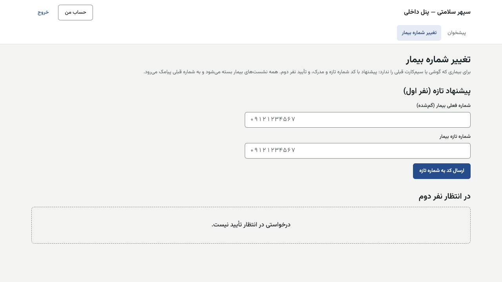
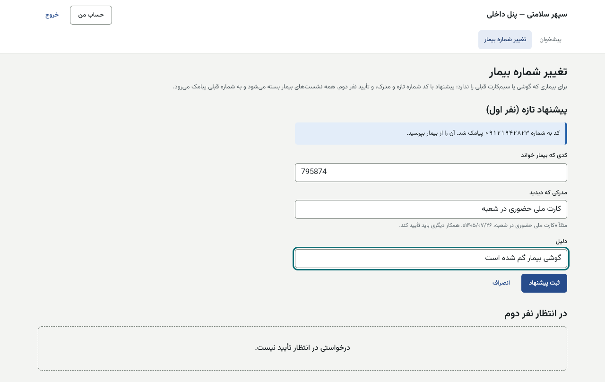
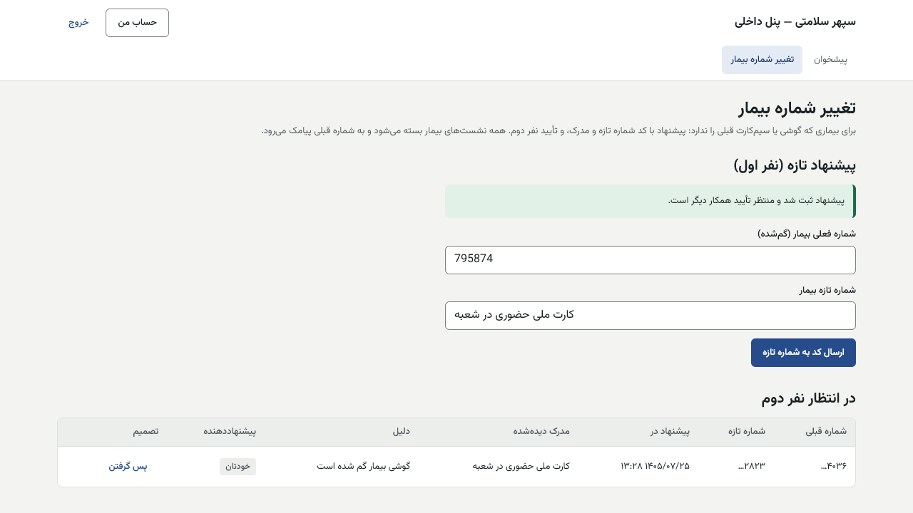
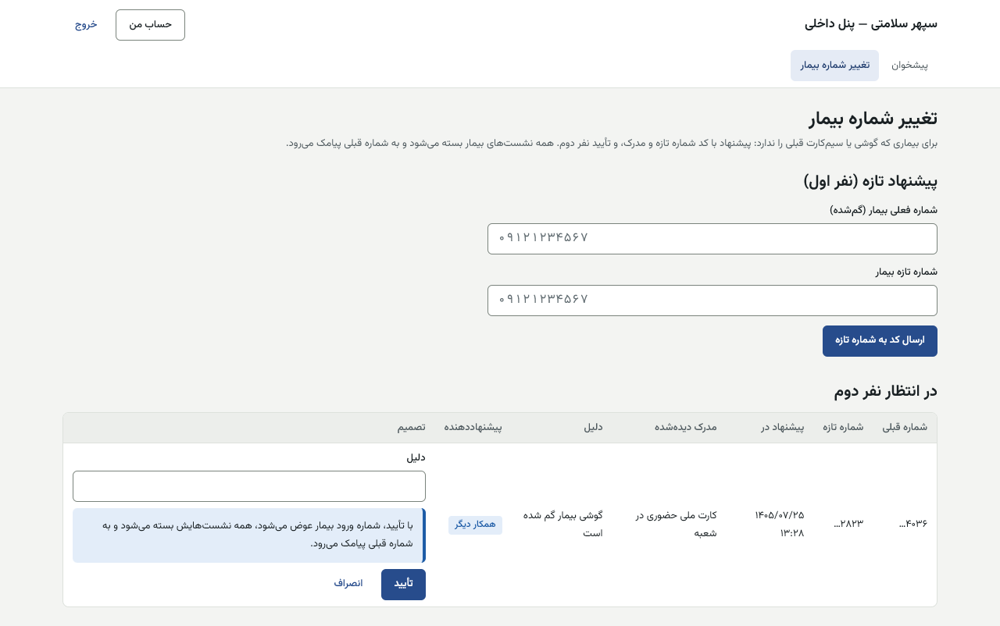

# راهنمای تغییر شماره بیمار — پنل داخلی

[فهرست](../README.md) · [جریان پرونده](../case-flow.md) · [واژه‌نامه](../glossary.md)

> **غیرفعال در پایلوت:** این مسیر پشت پرچم `identity.patient_mobile_change` است که خاموش است و فقط با دستور مالک (و **فقط از API**، دونفره) روشن می‌شود. launch-check بند ۱۳.

## ۱. معرفی نقش

**نقش سفارشی** با یک مجوز: `identity.change_patient_mobile` (ف۱۲ ب۲، تصمیم مالک ۱۴۰۵/۰۷/۲۶). به **۲ تا ۳ نفر نام‌دار** با دامنه «همه‌جا». **هرگز به مشاور یا پشتیبانی.**

برای بیماری که گوشی یا سیم‌کارت قبلی را ندارد: نفر اول با کد شماره تازه و مدرک پیشنهاد می‌دهد، نفر دوم تأیید می‌کند. همه نشست‌های بیمار بسته می‌شود و به شماره قبلی پیامک می‌رود.

**نمی‌تواند:** پیشنهاد خودش را تأیید کند؛ شماره را بی کد شماره تازه عوض کند.

## ۲. ورود و خروج

پنل داخلی، فقط از VPN. [برای همه کارکنان](../README.md#برای-همه-کارکنان-پنل-مرکز-و-پنل-داخلی). پیشنهاد و تأیید کار حساس است (بازاحراز اگر روشن).

## ۳. نقشه صفحه‌ها

«تغییر شماره بیمار» (`/patient-mobile-changes`).

## ۴. کار

### ۴.۱ نفر اول: پیشنهاد

1. «پیشنهاد تازه (نفر اول)»: «شماره فعلی بیمار (گم‌شده)»، «شماره تازه بیمار» ← «ارسال کد به شماره تازه».
2. «کد به شماره … پیامک شد. آن را از بیمار بپرسید.» ← «کدی که بیمار خواند».
3. «مدرکی که دیدید» (مثلاً «کارت ملی حضوری در شعبه، ۱۴۰۵/۰۸/۰۲»)، «دلیل» ← «ثبت پیشنهاد». «پیشنهاد ثبت شد و منتظر تأیید همکار دیگر است.»

### ۴.۲ نفر دوم: تأیید

«درخواست‌های تغییر شماره در انتظار تأیید»: شماره قبلی، شماره تازه، پیشنهاد در، مدرک دیده‌شده، دلیل، پیشنهاددهنده («خودتان» یا «همکار دیگر») ← «تأیید نفر دوم» ← «تأیید». «با تأیید، شماره ورود بیمار عوض می‌شود، همه نشست‌هایش بسته می‌شود و به شماره قبلی پیامک می‌رود.» یا «رد» با دلیل. پیشنهاددهنده می‌تواند «پس گرفتن».

| پیام | دلیل |
|---|---|
| «هیچ حساب بیمار فعالی با این شماره نیست.» | شماره قبلی اشتباه |
| «این شماره به حساب دیگری وصل است…» | شماره تازه مال کس دیگری است |
| «شماره بیمار پس از این پیشنهاد عوض شده است. این درخواست را رد کنید…» | — |
| «مهلت این درخواست گذشته است…» | پیش‌فرض ۷ روز |
| «درباره این درخواست پیش‌تر تصمیم گرفته شده است.» | — |

## ۵. قواعد مالی مرتبط

شماره ورود کلید دیدن اقساط و کیف است. تغییر اشتباه یعنی دادن حساب مالی به دیگری. رضایت پیامک تبلیغاتی به شماره تازه منتقل نمی‌شود.

## ۶. تأییدهای دونفره

نفر اول با کد و مدرک، نفر دوم جدا.

## ۷. پرسش‌های متداول

- **بیمار شماره قبلی را دارد.** خودش از اپ («شماره موبایل») عوض کند، وقتی پرچم روشن شد.

## ۸. چک‌لیست

- [ ] درخواست‌های منتظر نفر دوم پیش از پایان ۷ روز.

## ۹. سناریوی نمونه (ساختگی)

«حسین نمونه» گوشی‌اش را گم کرده و با کارت ملی به دفتر می‌آید. کارمند «الف» شماره قبلی ۰۹۱۲۰۰۰۰۰۰۶ و تازه ۰۹۱۳۰۰۰۰۰۰۶ را وارد، کد را از حسین می‌پرسد و پیشنهاد را ثبت می‌کند. کارمند «ب» تأیید می‌کند.

## ۱۰. ویژگی‌های غیرفعال یا منتظر ورودی

| ویژگی | وضعیت |
|---|---|
| کل مسیر | **غیرفعال در پایلوت** (پرچم خاموش، روشن کردن **فقط از API**) |
| نقش | روز راه‌اندازی ساخته می‌شود |
