# راهنمای بیمار، وام‌گیرنده و ضامن (اپ بیمار)

[فهرست](../README.md) · [جریان پرونده](../case-flow.md) · [واژه‌نامه](../glossary.md)

این راهنما برای کارکنانی است که به بیمار کمک می‌کنند (مشاور، پشتیبانی، تکمیل پرونده) و برای آموزش خود بیمار.

## ۱. این نقش کیست و چه می‌تواند

- **بیمار** کسی است که درمان می‌گیرد. **وام‌گیرنده** کسی است که وام به نام اوست؛ می‌تواند خود بیمار یا شخص دیگری باشد. **ضامن** پرداخت را تضمین می‌کند.
- هر سه با یک حساب در اپ بیمار کار می‌کنند. حساب با **شماره موبایل** شناخته می‌شود و رمز ندارد.
- بیمار فقط اطلاعات خودش را می‌بیند: نوبت‌ها، پیش‌فاکتورها، درخواست‌های اعتبار، قراردادها، اقساط، ضمانت‌ها و تیکت‌های خودش.
- **نمی‌تواند:** دلیل رد درخواست اعتبار، امتیاز یا رتبه خود را ببیند؛ مبلغ پیش‌فاکتور را تغییر دهد؛ پول نقد از کیف اعتبار بگیرد؛ اعتبار را به پزشک دیگری ببرد (این کار دونفره با کارکنان است).
- ضامن جزئیات درمان بیمار را نمی‌بیند؛ فقط مبلغ تعهد خودش را.

## ۲. ورود و خروج

1. در صفحه اصلی «ورود» را بزنید. صفحه «ورود به سپهر سلامتی» می‌آید: «با شماره موبایل خود وارد شوید؛ رمز لازم نیست.»
2. «شماره موبایل» را مثل ۰۹۱۲۱۲۳۴۵۶۷ بنویسید (رقم فارسی، عربی یا انگلیسی فرقی نمی‌کند) و «دریافت کد ورود» را بزنید.
3. پیام «کد ورود به شماره … پیامک شد.» می‌آید. کد ۶ رقمی را در «کد ورود» بنویسید و «ورود» را بزنید.
4. اگر کد نرسید: پس از پایان شمارش «ارسال دوباره تا … ثانیه دیگر»، «ارسال دوباره کد» را بزنید. فاصله پیش‌فرض ۶۰ ثانیه است و کد ۳ دقیقه اعتبار دارد.
5. شماره را اشتباه زدید؟ «تغییر شماره».
6. خروج: «خروج» در بالای صفحه.

| پیام | دلیل | چه کنم |
|---|---|---|
| «شماره موبایل درست نیست؛ مثل ۰۹۱۲۱۲۳۴۵۶۷ بنویسید.» | قالب شماره | شماره ۱۱ رقمی با ۰۹ |
| «کد واردشده درست نیست یا منقضی شده است.» | کد اشتباه یا بیش از ۳ دقیقه | کد تازه بگیرید |
| «کد قبلی هنوز معتبر است؛ کمی صبر کنید.» | ارسال دوباره زودتر از مهلت | تا پایان شمارش صبر کنید |
| «تعداد درخواست‌ها زیاد بود؛ کمی بعد دوباره تلاش کنید.» | سقف ارسال کد (پیش‌فرض ۸ بار در ساعت برای هر شماره) | یک ساعت بعد |
| «به دلیل تلاش‌های نادرست، ورود موقتاً بسته است.» | ۶ کد اشتباه | ۱۵ دقیقه صبر کنید |

**احراز دومرحله‌ای:** بیمار ندارد. امنیت حساب بیمار همان کد پیامکی است.

## ۳. نقشه صفحه‌ها

منوی بالای اپ: «نوبت‌های من»، «پیش‌فاکتورها»، «اقساط من»، «اعتبار من»، «قراردادها»، «پشتیبانی»، «شماره موبایل»، «ورود/خروج».

| صفحه | نشانی | کار |
|---|---|---|
| صفحه اصلی | `/` | «جست‌وجوی پزشک» |
| جست‌وجو | `/search` | پیدا کردن پزشک با شهر، تخصص، خدمت و زمان آزاد |
| پروفایل پزشک | `/doctors/<نام>` | درباره پزشک، محل‌های کار، «انتخاب زمان و نوبت» |
| نوبت گرفتن | `/book/<محل کار>` | روز و ساعت، «ثبت درخواست نوبت» |
| نوبت‌های من | `/me/appointments` | فهرست، کد پذیرش، لغو، اعتراض به عدم حضور |
| پیش‌فاکتورها | `/me/proformas` | دیدن، تأیید یا اعتراض، انتخاب طرح اعتباری |
| اعتبار من | `/me/credit` | درخواست‌های اعتبار، رضایت، مدارک، ضامن، فیش‌ها، کیف |
| ضمانت‌های من | `/me/guarantees` | برای ضامن: رضایت، مدارک، قرارداد، چک |
| قراردادها | `/me/contracts` | دیدن PDF و پذیرش با کد |
| اقساط من | `/me/repayment` | سررسیدها، مانده، ارسال فیش قسط |
| پشتیبانی | `/me/tickets` | تیکت تازه، گفتگو |
| شماره موبایل | `/me/mobile` | تغییر شماره (**غیرفعال در پایلوت**، پایین) |

## ۴. کارها، گام‌به‌گام

### ۴.۱ پیدا کردن پزشک و گرفتن نوبت

> **غیرفعال در پایلوت:** جست‌وجوی عمومی پشت پرچم `catalog.search_enabled` است که پیش‌فرض خاموش است. تا روشن شدن، صفحه جست‌وجو می‌گوید «جست‌وجو هنوز فعال نشده است». بیمار از پیوند پروفایل پزشک (مثلاً از سایت وردپرس) یا با کمک مشاور نوبت می‌گیرد. تصمیم مالک ۱۴۰۵/۰۸/۰۱: در پایلوت **خاموش** می‌ماند.

1. در «جست‌وجوی پزشک و نوبت»، فیلترها را پر کنید: «نام پزشک، مرکز یا خدمت»، «شهر»، «تخصص»، «خدمت»، «زمان آزاد تا»، و اگر می‌خواهید وام بگیرید، تیک «فقط پرداخت با اعتبار سپهر». «جست‌وجو» را بزنید.
2. ترتیب نتیجه‌ها ثابت است: نزدیک‌ترین زمان آزاد، و با نوشتن نام، میزان شباهت.
3. روی «انتخاب زمان و نوبت» بزنید.
4. روز و ساعت را از تقویم شمسی انتخاب کنید («روز و ساعت نوبت»).
5. صفحه «بررسی و ثبت نوبت»: پزشک، خدمت، زمان و هزینه را ببینید. این زمان **۱۰ دقیقه** برای شما نگه داشته می‌شود.
6. «ثبت درخواست نوبت» را بزنید.
   - اگر حالت تأیید مرکز «خودکار» است: «نوبت شما تأیید شد» و پیامک تأیید با کد پذیرش.
   - اگر «دستی» است: «درخواست نوبت ثبت شد. مرکز درخواست را بررسی می‌کند و نتیجه را پیامک می‌کنیم.»

| پیام | دلیل | چه کنم |
|---|---|---|
| «مهلت نگه‌داشتن این زمان تمام شد. زمان را دوباره انتخاب کنید.» | بیش از ۱۰ دقیقه گذشت | «انتخاب زمان دیگر» |
| «این زمان همین حالا گرفته شد. لطفاً زمان دیگری انتخاب کنید.» | کس دیگری زودتر گرفت | زمان دیگر |
| «نوبت‌دهی این پزشک فعلاً ممکن نیست.» | پزشک یا مرکز نوبت اینترنتی ندارد یا معلق است | با پشتیبانی تماس |
| «نوبت فقط با حساب بیمار گرفته می‌شود» | با حساب کارکنان وارد شده‌اید | از حساب بیمار وارد شوید |

### ۴.۲ نوبت‌های من: کد پذیرش، لغو، اعتراض

1. «نوبت‌های من»: زبانه‌های «پیش رو»، «گذشته»، «همه» و فیلتر «وضعیت» و «بازه روزها».
2. **کد پذیرش در مرکز** کنار هر نوبت تأییدشده است. هنگام ورود به مطب آن را به پذیرش بگویید.
3. **لغو:** «لغو نوبت»، «دلیل لغو»، تأیید. فقط تا **۱۲۰ دقیقه** پیش از نوبت (پیش‌فرض). پس از آن: «مهلت تغییر یا لغو این نوبت گذشته است.»
4. **اعتراض به عدم حضور:** اگر مرکز «عدم حضور» ثبت کرده و شما رفته بودید: «اعتراض به عدم حضور»، «شرح اعتراض»، «ثبت اعتراض». کارشناس شبکه بررسی می‌کند.
5. یادآوری پیامکی: پیش‌فرض ۲۴ ساعت و ۲ ساعت پیش از نوبت.

### ۴.۳ پیش‌فاکتور: دیدن، تأیید، اعتراض

پیش‌فاکتور فقط **پس از معاینه** در همان نوبت صادر می‌شود.

1. «پیش‌فاکتورها» ← «مشاهده و پاسخ».
2. جدول «خدمات پیش‌فاکتور»: خدمت، دندان یا محل، تعداد، قیمت واحد، جمع. بالای صفحه «معتبر تا» (پیش‌فرض ۳۰ روز پس از صدور).
3. اگر درست است: «تأیید پیش‌فاکتور».
4. اگر نه: «اعتراض دارم»، «شرح اعتراض»، «ثبت اعتراض». پیام: «اعتراض شما ثبت شد؛ پزشک می‌تواند نسخه تازه صادر کند.» نسخه تازه در همین فهرست می‌آید.

### ۴.۴ انتخاب طرح اعتباری و درخواست وام

پس از تأیید پیش‌فاکتور، در همان صفحه بخش «انتخاب طرح اعتباری» می‌آید.

1. طرح‌ها با تعداد قسط نشان داده می‌شوند. هر کدام: «هر قسط تقریبی» و «پیش‌نمایش تقریبی»:
   - «پیش‌پرداخت»، «مبلغ وام»، «پرداخت نقدی نزد پزشک»؛
   - در طرح فقط‌دستمزد: «از آن، هزینه مواد (وام فقط دستمزد)»؛
   - «هزینه تشکیل پرونده»، «کارمزد طرح (در اقساط)» یا «کارمزد طرح (هنگام تکمیل)»؛
   - «جمع اقساط»، «جمع همه پرداخت‌ها» و «جدول اقساط (تقریبی)».
2. «این مبالغ تقریبی‌اند.» مبالغ قطعی پس از ثبت و پیش از ارسال در صفحه درخواست می‌آید. سررسیدها از روز فرضی واریز امروز حساب شده‌اند و پس از شارژ واقعی دوباره تنظیم می‌شوند.
3. اگر وام به نام شخص دیگری است (مثلاً پدر)، «موبایل وام‌گیرنده (اختیاری)» را بنویسید. خالی یعنی خودتان.
4. «درخواست اعتبار با این طرح».

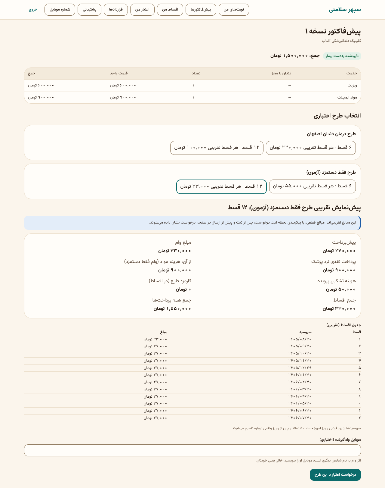

**پیام‌های این بخش:**

| پیام | یعنی |
|---|---|
| «برای این درمان فعلاً طرح اعتباری وجود ندارد.» | هیچ طرحی با شهر، رشته و پزشک جور نیست |
| «این طرح برای این پیش‌فاکتور قابل ارائه نیست؛ با کارشناس تماس بگیرید.» | طرح جور است ولی برای این پیش‌فاکتور نه (مثلاً در طرح فقط‌دستمزد پیش‌پرداخت به دستمزد می‌رسد). عدد و دلیل عمداً گفته نمی‌شود. |
| «این طرح فقط برای اعضای باشگاه مشتریان است.» | بیمار عضو باشگاه نیست |
| «برای این پیش‌فاکتور درخواست اعتبار دارید.» | درخواست قبلی هست؛ «پیگیری درخواست» |

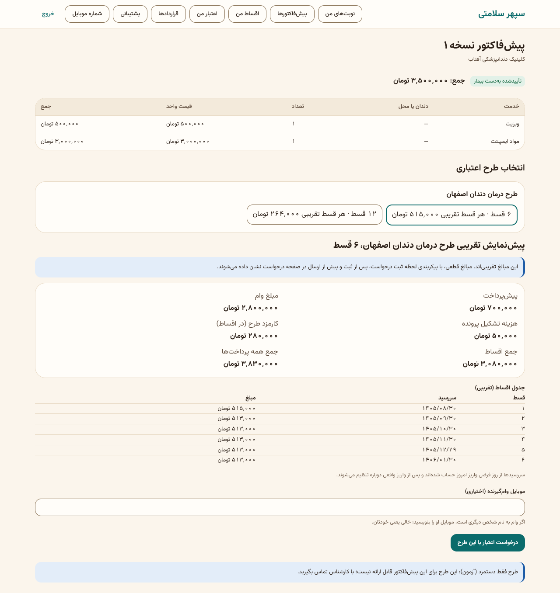

### ۴.۵ تکمیل درخواست اعتبار: رضایت، مدارک، ضامن، ارسال

«اعتبار من» ← «پیگیری و تکمیل».

1. **مبالغ قطعی این درخواست:** «این مبالغ با پیکربندی لحظه ثبت درخواست قفل شده‌اند و با ارسال، همین‌ها را می‌پذیرید.» جدول اقساط با «سررسید (تقریبی)».
2. **رضایت به بررسی اطلاعات اعتباری:** «ارسال کد تأیید به موبایل من»، «کد پیامک‌شده»، «موافقم و رضایت می‌دهم». پیام: «رضایت شما ثبت شد.»
3. **مدارک:** برای هر مدرک «فایل» را انتخاب کنید و «بارگذاری». مدارک پیش‌فرض (هر کدام PDF، JPEG یا PNG، تا ۱۰ مگابایت):
   - تصویر کارت ملی؛
   - مدرک شغل (حکم، قرارداد یا جواز کسب)؛
   - گردش حساب سه ماه اخیر؛
   - سابقه بیمه.

   وضعیت هر مدرک: «در انتظار بررسی»، «پذیرفته شد»، «رد شد» با «دلیل:». مدرک ردشده را دوباره بارگذاری کنید؛ پیامک رد هم می‌آید.
4. **ضامن** (اگر لازم شد؛ «ضامن پس از بررسی رتبه وام‌گیرنده و در صورت نیاز معرفی می‌شود»): «موبایل ضامن»، «معرفی ضامن». به ضامن پیامکی با مبلغ تعهدش می‌رود؛ جزئیات درمان گفته نمی‌شود.
5. «ارسال درخواست برای بررسی».

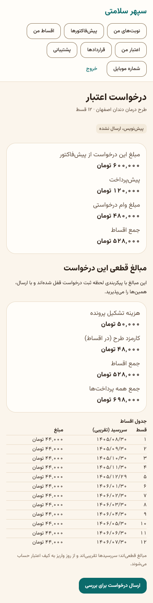

| پیام | دلیل | چه کنم |
|---|---|---|
| «فقط فایل PDF، JPEG یا PNG پذیرفته می‌شود.» | نوع فایل | عکس یا PDF |
| «فایل آلوده تشخیص داده شد و پذیرفته نشد.» | اسکن ضدویروس | فایل را دوباره بسازید |
| «هر پرونده حداکثر سه ضامن دارد.» | ضامن چهارم | — |
| «ضامن سوم ثبت می‌شود ولی امتیاز نمی‌گیرد…» | فقط دو ضامن اول امتیاز می‌گیرند | — |

**نتیجه تصمیم** با پیامک می‌آید: تأیید، تأیید شرطی، رد، یا «ضامن بیشتر لازم است». در رد: «درخواست شما تأیید نشد. برای اطلاعات بیشتر با پشتیبانی تماس بگیرید.» دلیل و امتیاز به بیمار گفته نمی‌شود.

**مهلت:** درخواست ناقص پس از ۳۰ روز منقضی می‌شود (پیش‌فرض).

### ۴.۶ پس از تأیید: قرارداد، مدارک فیزیکی، فیش‌ها

در صفحه درخواست، بخش «قرارداد و تکمیل پرونده» فهرست «تا تکمیل پرونده مانده است» را نشان می‌دهد.

1. **قرارداد:** «مشاهده و پذیرش قرارداد» ← «مشاهده متن قرارداد (PDF)» ← «ارسال کد پذیرش به موبایل من» ← «کد پیامک‌شده» ← «قرارداد را می‌پذیرم».
   - پذیرش با زمان و نسخه همین متن ثبت می‌شود. **نسخه امضاشده کاغذی هم لازم است.**
   - تا تأیید مشاور حقوقی، روی قرارداد برچسب «پیش‌نویس» و «در انتظار تأیید حقوقی» است. **با این برچسب راه‌اندازی برای بیمار انجام نمی‌شود** (بند ۱۴ launch-check).
2. **مدارک فیزیکی:** وقتی کارشناس فهرست را ثبت کرد، «روش ارسال»، «کد رهگیری (اختیاری)» و «اعلام ارسال مدارک».
3. **فیش‌های پرداخت:** «مبالغ زیر را به حساب شرکت آرامش ثروت واریز کنید و فیش هر کدام را جدا بفرستید.» برای هر فیش (هزینه تشکیل پرونده، کارمزد طرح هنگام تکمیل، پیش‌پرداخت):
   - «مبلغ»: **دقیقاً** همان مبلغ خواسته‌شده، به ریال و بدون اعشار. «فقط مبلغ دقیق پذیرفته می‌شود.»
   - «روز پرداخت»، «شماره پیگیری بانک»، «فایل فیش»، «ارسال فیش».
   - وضعیت: در انتظار، «پرداخت تأیید شد»، یا رد با «دلیل:».
4. **مابه‌التفاوت:** «مابه‌التفاوت را هنگام درمان نقدی به پزشک می‌پردازید.»
5. **وام برای مابقی:** اگر «مبلغ مصوب کمتر از هزینه درمان است»، «تعداد اقساط وام دوم» و «درخواست وام برای مابقی».

| پیام | دلیل |
|---|---|
| «فیش دیگری از همین نوع در انتظار بررسی است.» | فیش قبلی هنوز بررسی نشده |
| «این پرونده چنین پرداختی بدهکار نیست.» | نوع فیش اشتباه |
| «قرارداد هنوز آماده پذیرش نیست…» | قرارداد ساخته نشده یا متن آماده نیست |
| «این قرارداد را پیش‌تر پذیرفته‌اید.» | — |

### ۴.۷ کیف اعتبار و دریافت خدمت

1. پس از شارژ پیامک می‌آید: مبلغ، تعداد اقساط، قسط اول و سررسید آن.
2. «اعتبار من» ← بخش کیف: «قابل استفاده»، «وام و پیش‌پرداخت»، «شارژ»، «تاریخچه مصرف».
3. نزد پزشک: پزشک «مجوز خدمت» صادر می‌کند و کد ۶ رقمی برای شما پیامک می‌شود: «کد تأیید خدمت شما در … به مبلغ …». **فقط پس از گرفتن خدمت** کد را به پزشک بگویید. کد ۱۰ دقیقه اعتبار دارد.
4. هزینه مواد (در طرح فقط‌دستمزد) و مابه‌التفاوت را نقد به پزشک می‌دهید؛ از کیف کم نمی‌شود.

### ۴.۸ اقساط و ارسال فیش قسط

1. «اقساط من»: برای هر وام «کل بدهی»، «پرداخت‌شده»، «مانده بدهی» و جدول اقساط با «سررسید»، «مبلغ»، «مانده»، «وضعیت».
   - وضعیت‌ها: «آینده»، «سررسید امروز»، «گذشته از سررسید»، «بخشی پرداخت‌شده»، «پرداخت‌شده»، «لغوشده».
2. پس از واریز به حساب آرامش ثروت: «ارسال فیش قسط»:
   - «مبلغ واریزی، مطابق فیش»، «روز واریز»، «شماره پیگیری بانک»، «نام واریزکننده»، «فایل فیش»، «ارسال فیش».
3. پیام: «فیش ثبت شد و پس از تأیید مالی به قدیمی‌ترین قسط شما می‌نشیند.» یا اگر شبیه فیش قبلی است: «فیشی مشابه آن پیش‌تر رسیده است؛ مالی هر دو را بررسی می‌کند.»
4. یادآوری پیامکی: ۳ روز پیش از سررسید و روز سررسید؛ اطلاع معوق ۱، ۷ و ۱۵ روز پس از آن (پیش‌فرض).
5. **سررسید به خاطر تعطیلی جابه‌جا نمی‌شود** (پرچم `repayment.shift_due_to_next_working_day` خاموش است و به تصمیم کارفرما خاموش می‌ماند).

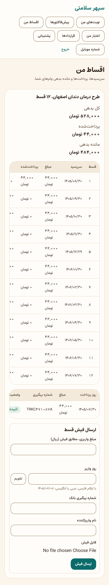
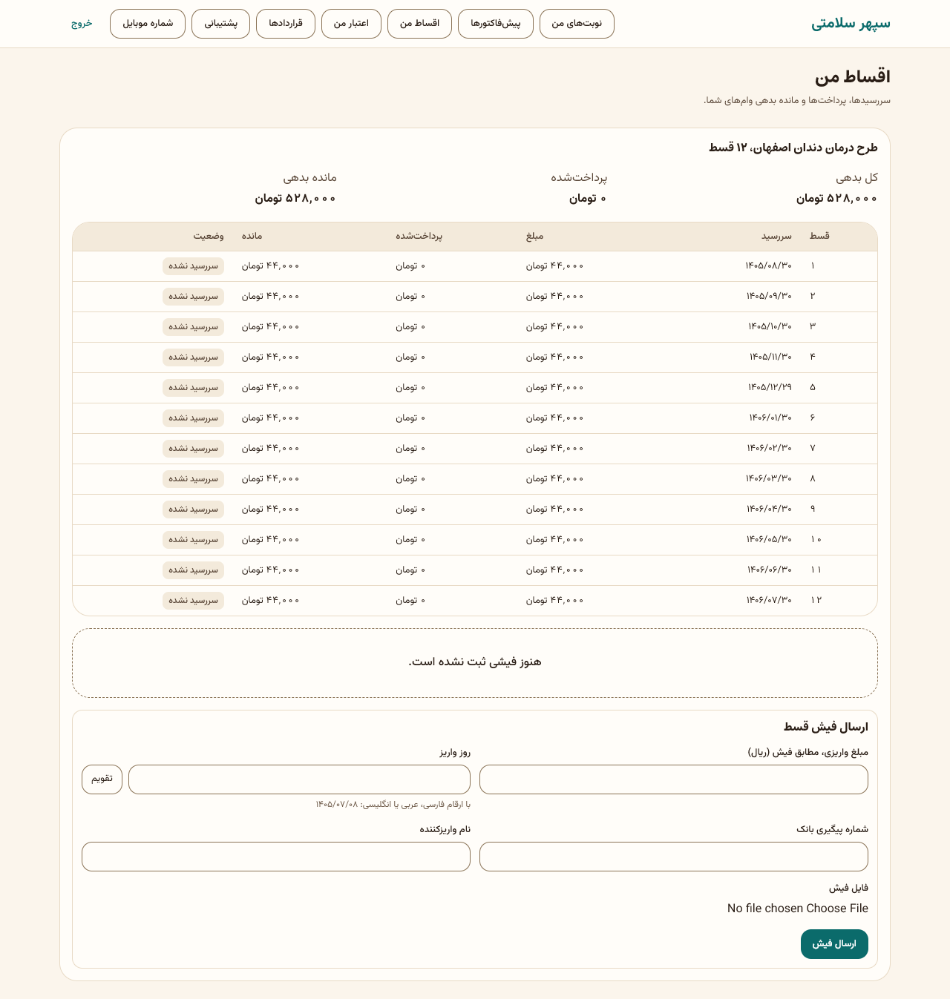
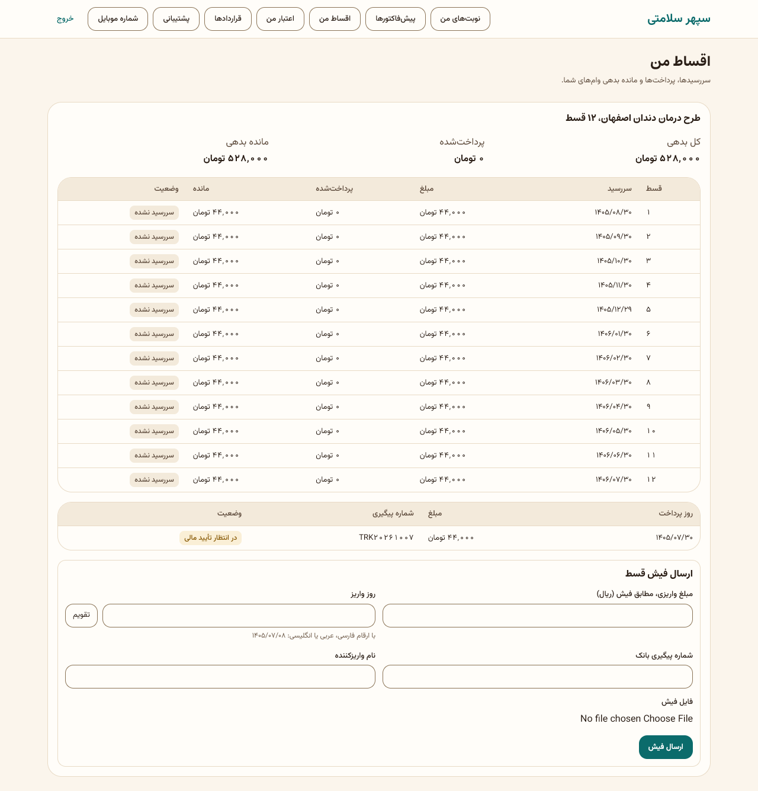

### ۴.۹ برای ضامن

1. پیامک دعوت: «شما به‌عنوان ضامن یک پرونده اعتباری با تعهد … در سپهر سلامتی معرفی شده‌اید…».
2. با همان شماره وارد شوید ← «ضمانت‌های من» ← «رضایت و مدارک».
3. «تعهد شما»، وضعیت («در انتظار رضایت شما» یا «رضایت داده‌اید»)، مدارک خودتان، و «مشاهده و پذیرش قرارداد» به‌عنوان ضامن.
4. «چک و سفته شما»: چک‌هایی که به نام شما نزد سپهر است، با شماره پایانی. ضمانت «تا پایان بازپرداخت وام برقرار است».

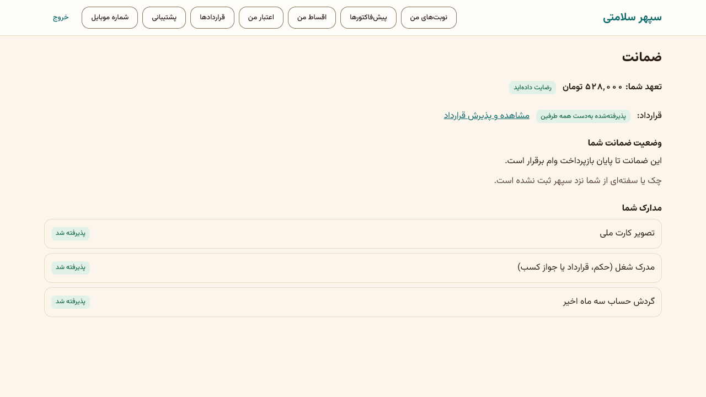

### ۴.۱۰ پشتیبانی و شکایت

1. «پشتیبانی» ← «تیکت تازه».
2. موضوع را انتخاب کنید (مثل «پرسش عمومی»، «نوبت»)، «عنوان»، «شرح»، «پیوست (اختیاری)» تا ۱۰ مگابایت، «ثبت».
3. اگر شکایت درباره نوبت یا پیش‌فاکتور است، «مربوط به» را انتخاب کنید. پاسخ پزشک هم در همین گفتگو می‌آید.
4. پس از حل: «بستن تیکت»، یا «مشکل حل نشده است» با «چرا مشکل حل نشده است؟» (بازگشایی در مهلت پیکربندی).

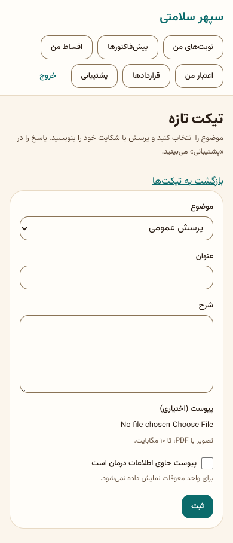
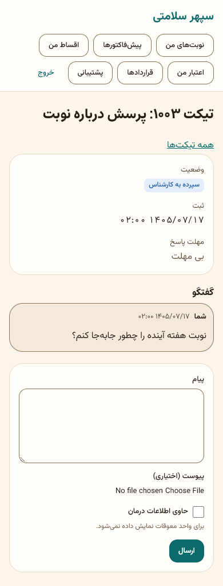

### ۴.۱۱ شماره‌ای که به حساب شما افزوده شده

اگر کارکنان با کد ملی شما شماره تازه‌ای به پرونده‌تان افزوده باشند، بنری می‌آید: «درخواست افزودن شماره تازه به حساب شما». «تأیید» فقط اگر شماره را می‌شناسید؛ وگرنه «رد می‌کنم». بی تصمیم، پس از ۳۰ روز خودکار رد می‌شود.

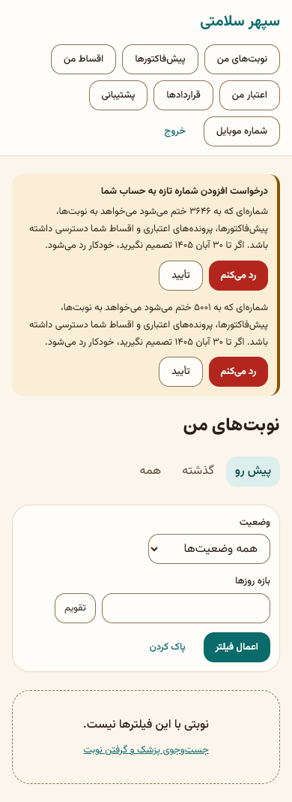
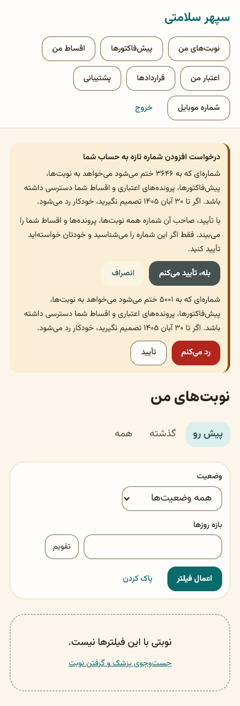

### ۴.۱۲ تغییر شماره موبایل

> **غیرفعال در پایلوت:** پشت پرچم `identity.patient_mobile_change` که خاموش است. روشن کردنش فقط با دستور مالک.

وقتی روشن شود: «شماره موبایل» ← «شماره موبایل تازه» ← «دریافت کد تأیید» ← «کد تأیید» ← «تأیید و تغییر شماره». به شماره قبلی پیامک می‌رود و ورود در دستگاه‌های دیگر بسته می‌شود. گوشی قبلی را ندارید؟ با پشتیبانی تماس بگیرید (دو کارشناس با مدرک).

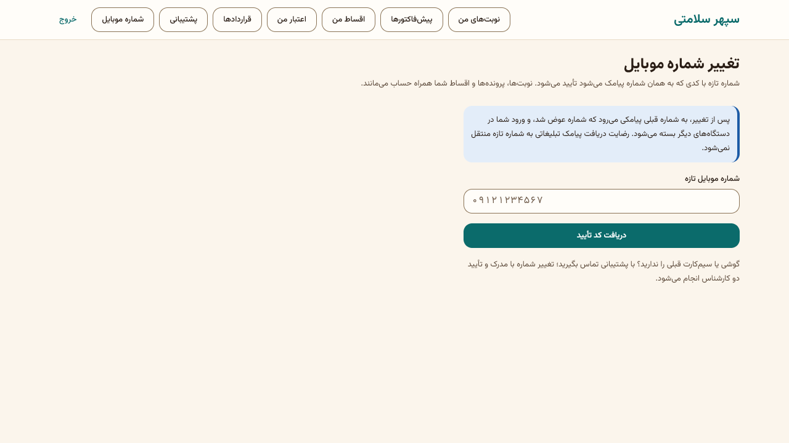
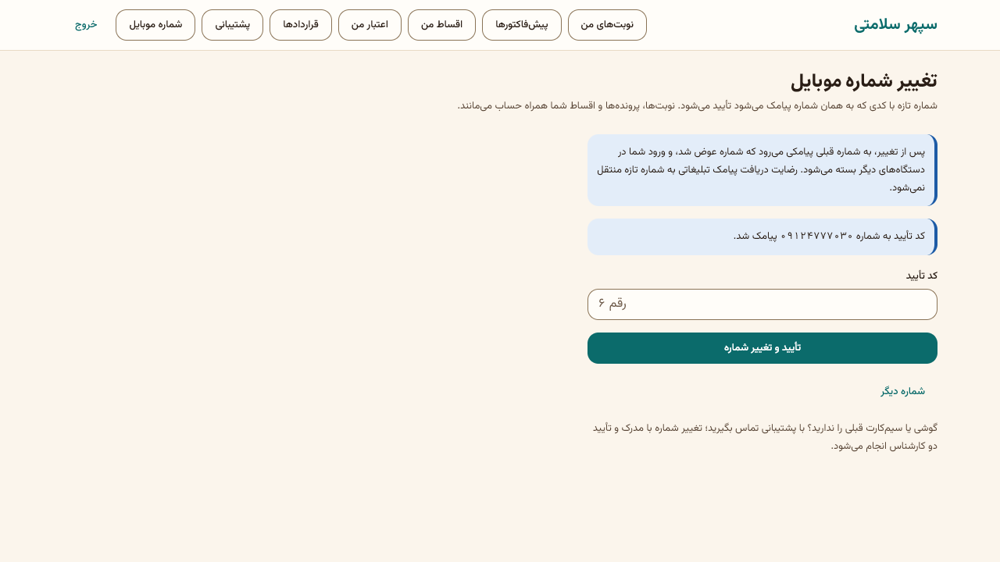

## ۵. قواعد مالی که بیمار باید بداند

همه مبالغ به ریال است. اعداد واقعی هر طرح در پنل تعریف و روی درخواست قفل می‌شوند.

- **پیش‌پرداخت** به حساب آرامش ثروت، با فیش. درصدش در طرح.
- **هزینه تشکیل پرونده:** در طرح‌های الحاقیه ۳٪ **کل صورت‌حساب**. با دست‌کم ۵ چک قسط بررسی‌شده ۲٪ بخشیده می‌شود (نه در طرح‌های ۶ ماهه). مسئول تکمیل یا باشگاه می‌تواند تا ۱٪ تخفیف دهد. جمع بخشودگی و تخفیف حداکثر ۳٪ و هزینه هیچ‌وقت منفی نمی‌شود. مبلغ هنگام بارگذاری فیش قفل می‌شود.
- **کارمزد طرح:** یا در اقساط پخش می‌شود، یا هنگام تکمیل با فیش.
- **طرح فقط‌دستمزد:** پیش‌پرداخت ۱۸٪ از کل؛ وام = دستمزد − پیش‌پرداخت؛ مواد نقد به پزشک.
- **سقف مانده:** جمع بدهی همه وام‌های باز هر نفر سقف دارد (عدد پیشنهادی ۱٬۵۰۰٬۰۰۰٬۰۰۰ ریال؛ تا تنظیم دونفره خاموش).
- **انصراف پیش از شارژ:** همه فیش‌های تأییدشده بدون خسارت برمی‌گردند.
- **انصراف پس از شارژ:** مانده مصرف‌نشده باطل، کارمزد اقساط سررسیدنشده بخشوده، بخش کسب‌نشده کارمزد نقدی برگشت، و **خسارت انصراف** (پیش‌فرض ۱۸٪ مبلغ مصوب وام) یکجا با سررسید ۳۰ روز.
- **بیعانه تشکیل:** پس از شارژ کیف برنمی‌گردد.
- **کیف اعتبار پول نقد نیست** و فقط نزد پزشک معرفی‌شده مصرف می‌شود.

## ۶. تأییدهای دونفره (پشت صحنه)

بیمار امضای دوم نمی‌زند، ولی باید بداند چرا کار کمی طول می‌کشد: تأیید فیش، شارژ کیف، تغییر پزشک، انصراف و تغییر شماره هر کدام دو کارمند جدا می‌خواهند.

## ۷. پرسش‌های متداول

- **چرا دلیل رد درخواستم را نمی‌بینم؟** طبق قاعده، دلیل و امتیاز به بیمار گفته نمی‌شود. با پشتیبانی تماس بگیرید.
- **مبلغ پیش‌نمایش با صفحه درخواست فرق دارد.** پیش‌نمایش تقریبی است؛ مبالغ قطعی با پیکربندی لحظه ثبت قفل می‌شوند.
- **فیشم رد شد.** دلیل زیر فیش آمده است؛ معمولاً مبلغ دقیق نبوده. فیش درست را دوباره بفرستید.
- **سررسید قسط تعطیل است.** سررسید جابه‌جا نمی‌شود؛ پیش از تعطیلی واریز کنید.
- **می‌توانم با اعتبار نزد پزشک دیگری بروم؟** فقط با درخواست «تغییر پزشک» از کارکنان، دونفره، و فقط پزشکی از همان رشته و شهر.

## ۸. چک‌لیست بیمار

- [ ] پیش از سررسید هر قسط، واریز و فیش.
- [ ] پیامک کد خدمت را فقط پس از دریافت خدمت به پزشک بگویید.
- [ ] کد پیامکی را به هیچ‌کس جز پزشک (برای خدمت) نگویید؛ کارکنان سپهر کد ورود شما را هرگز نمی‌خواهند.

## ۹. سناریوی نمونه (ساختگی)

سارا نمونه (۰۹۱۲۰۰۰۰۰۰۱) برای ایمپلنت نزد «دکتر نمونه» نوبت می‌گیرد. پس از معاینه، پیش‌فاکتور ۱۲۰٬۰۰۰٬۰۰۰ ریال صادر می‌شود. سارا تأیید می‌کند و طرح ۱۲ قسطی را برمی‌گزیند: پیش‌پرداخت ۲۴٬۰۰۰٬۰۰۰، وام ۹۶٬۰۰۰٬۰۰۰، کارمزد در اقساط ۹٬۶۰۰٬۰۰۰، هر قسط حدود ۸٬۸۰۰٬۰۰۰. رضایت می‌دهد، چهار مدرک را بارگذاری می‌کند و «ارسال درخواست برای بررسی» را می‌زند. پس از تأیید، قرارداد را با کد می‌پذیرد، مدارک کاغذی و ۱۲ چک را با پست می‌فرستد و دو فیش (هزینه تشکیل ۱٬۲۰۰٬۰۰۰ پس از بخشودگی ۵ چک، پیش‌پرداخت ۲۴٬۰۰۰٬۰۰۰) را بارگذاری می‌کند. پس از شارژ، پیامک «اعتبار درمان شما … آماده استفاده است» می‌رسد. پس از هر جلسه درمان، کد خدمت را به پزشک می‌گوید و هر ماه فیش قسط را می‌فرستد.

## ۱۰. ویژگی‌های غیرفعال یا منتظر ورودی

| ویژگی | وضعیت |
|---|---|
| جست‌وجوی عمومی پزشک | **غیرفعال در پایلوت** (پرچم `catalog.search_enabled`، تصمیم مالک ۱۴۰۵/۰۸/۰۱) |
| تغییر شماره موبایل توسط خود بیمار | **غیرفعال در پایلوت** (`identity.patient_mobile_change`) |
| سفته | **غیرفعال در پایلوت** (`instrument.promissory_enabled`) |
| انتقال اعتبار به گیرنده مجاز | **غیرفعال در پایلوت** (`wallet.credit_transfer_enabled`) |
| جابه‌جایی سررسید به روز کاری بعد | خاموش به تصمیم کارفرما |
| کاهش مبلغ وام توسط بیمار | خاموش (`credit.allow_patient_amount_reduction`) |
| متن قطعی قرارداد و رضایت‌نامه | در انتظار مشاور حقوقی؛ برچسب «پیش‌نویس» |
| پرداخت آنلاین | ساخته نشده؛ فقط فیش بانکی |

## تصویرهای لازم که هنوز نیست

- [تصویر: صفحه ورود و کد]
- [تصویر: صفحه نوبت گرفتن و «بررسی و ثبت نوبت»]
- [تصویر: پیش‌فاکتور با دکمه‌های تأیید و اعتراض]
- [تصویر: صفحه قرارداد با برچسب پیش‌نویس]
- [تصویر: کیف اعتبار و تاریخچه مصرف]
