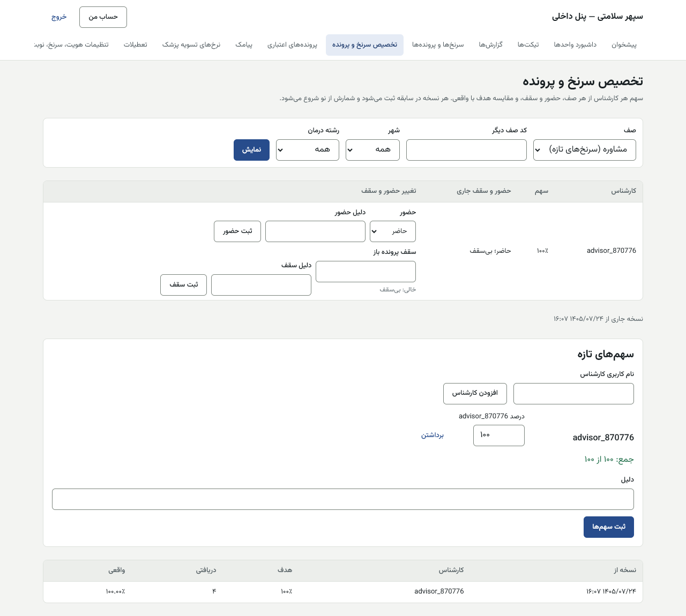
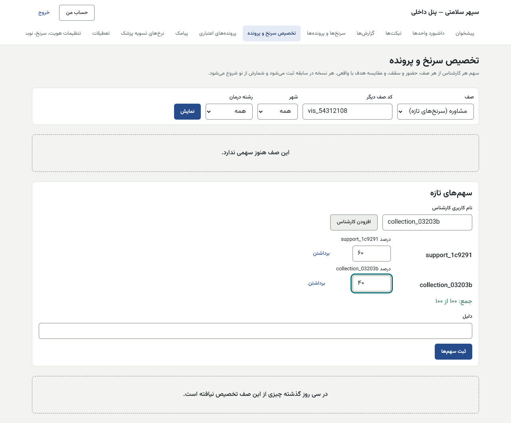
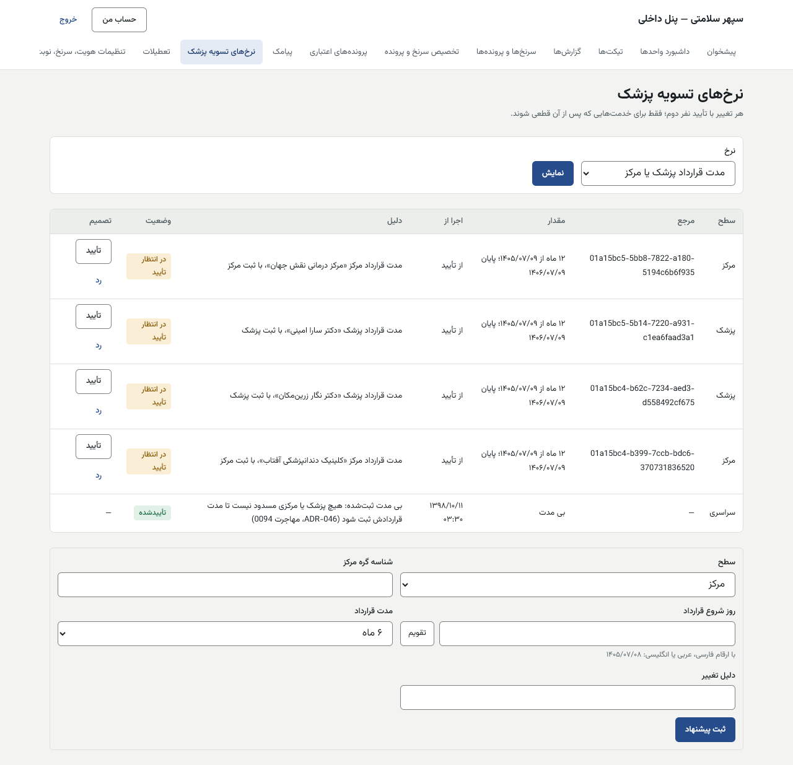
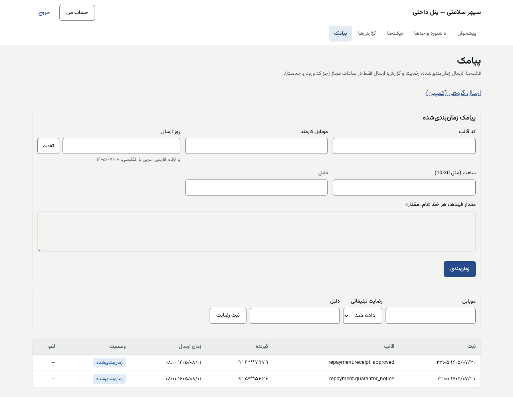
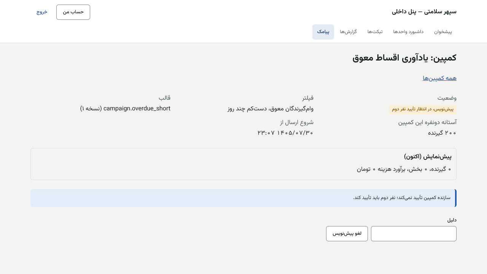
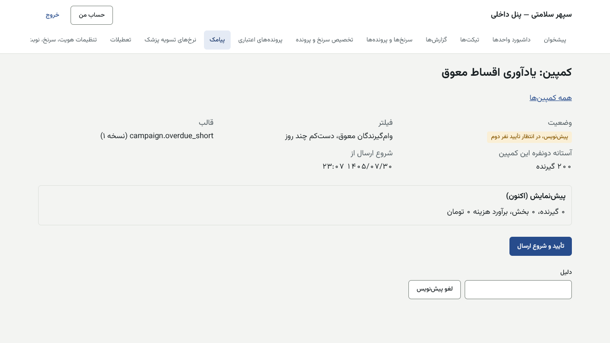

# راهنمای مدیر استراتژی — پنل داخلی

[فهرست](../README.md) · [جریان پرونده](../case-flow.md) · [واژه‌نامه](../glossary.md)

## ۱. معرفی نقش

نقش `strategy_manager`. مدیر استراتژی تقسیم سرنخ و پرونده بین کارشناسان، انتقال پرونده، علت‌های بستن، مسدودی و ادغام شخص، قالب‌ها و ارسال گروهی پیامک، و **همه تنظیمات کسب‌وکار** (طرح‌های وام، سقف مانده، نرخ‌های تسویه، مدت قرارداد پزشک، کلیدهای سرنخ و نوبت و پیامک) را با تأیید دونفره اداره می‌کند.

**مجوزهای اصلی:** پیکربندی کسب‌وکار (`config.manage_business`)؛ تخصیص و انتقال سرنخ و پرونده اعتباری و معوقات؛ علت‌ها؛ مسدودی و ادغام شخص؛ قالب، کمپین و تأیید کمپین پیامک؛ دیدن امتیاز و دلایل؛ تصمیم خارج از ماتریس؛ گزارش‌ها؛ عضو «واحد استراتژی» کمیته.

**نمی‌تواند:** پیشنهاد پیکربندی خودش را تأیید کند؛ کمپینی را که خودش ساخته تأیید کند؛ کار مالی (فیش، شارژ، پرداخت) کند؛ تنظیمات فنی (`config.manage_technical`) را تأیید کند.

## ۲. ورود و خروج

پنل داخلی، فقط از VPN. [برای همه کارکنان](../README.md#برای-همه-کارکنان-پنل-مرکز-و-پنل-داخلی). پیشنهاد و تأیید تنظیمات کار حساس است و اگر پرچم بازاحراز روشن باشد، کد شش‌رقمی را دوباره می‌خواهد.

## ۳. نقشه صفحه‌ها

| منو | کار |
|---|---|
| سرنخ‌ها و پرونده‌ها، علت‌های بستن (`/leads/reasons`) | انتقال، مسدودی، ادغام؛ علت‌ها |
| تخصیص سرنخ و پرونده (`/assignment`) | سهم‌ها، حضور و سقف، هدف و واقعی |
| پرونده‌های اعتباری ← طرح‌ها و قواعد (`/credit/rules`) | طرح‌ها، قواعد امتیاز، دلایل رد، کمیته، کسری کم، **سقف مانده**، قالب قرارداد |
| نرخ‌های تسویه پزشک (`/settlement-rates`) | کارمزد خدمت، دوره تسویه، **مدت قرارداد پزشک یا مرکز** |
| تنظیمات هویت، سرنخ، نوبت و پیامک (`/settings`) | کلیدهای کسب‌وکار سرنخ، نوبت و پیامک |
| پیامک (`/sms`)، ارسال گروهی | قالب‌ها، کمپین، تأیید کمپین |
| گزارش‌ها، تیکت‌ها | — |

## ۴. کارهای روزانه

### ۴.۱ تخصیص

1. «تخصیص سرنخ و پرونده» ← «انتخاب صف» (مشاوره، مشتریان فعلی، تکمیل پرونده، کارشناسی اعتبار، کمیته، وصول، تیکت پشتیبانی) و در صورت نیاز «شهر» و «رشته درمان» ← «نمایش».
2. «سهم‌های جاری صف»: کارشناس و سهم.
3. «سهم‌های تازه»: «نام کاربری کارشناس» ← «افزودن کارشناس»، درصد هر نفر، «جمع: … از ۱۰۰» ← «دلیل» ← «ثبت سهم‌ها». «جمع سهم‌ها باید ۱۰۰ باشد.» هر نسخه در سابقه ثبت می‌شود و شمارش از نو شروع می‌شود.
4. «حضور و سقف جاری»: «حضور» («حاضر»، «مرخصی»، «غایب») با «دلیل حضور» ← «ثبت حضور»؛ «سقف پرونده باز» (خالی: بی‌سقف) با «دلیل سقف» ← «ثبت سقف».
5. «هدف و واقعی، سی روز گذشته»: هدف، دریافتی، واقعی.




### ۴.۲ انتقال، مسدودی، ادغام

در صفحه پرونده سرنخ:
- **انتقال:** «انتقال به کارشناس دیگر» ← «نام کاربری کارشناس» ← «دلیل» ← «انتقال». «صف پرونده عوض نمی‌شود، فقط مسئول آن؛ گزارش هدف و واقعی صف مقصد این انتقال را نمی‌شمارد.» مشاور قبلی دیگر پرونده را نمی‌بیند.
- **مسدودی:** «مسدود کردن شخص» ← «نوع» («دیگر تماس نگیرید»، «سوءاستفاده یا مزاحمت») ← دلیل. «رفع مسدودی» برعکس.
- **ادغام:** «ادغام شخص تکراری» ← «نشانی یا شناسه پرونده تکراری» ← «دلیل ادغام» ← «ادغام در همین شخص». «دو کد ملی متفاوت یا دو پرونده باز ادغام نمی‌شوند.» برگشت: «ادغام‌های این شخص» ← «برگشت ادغام».

| پیام | دلیل |
|---|---|
| «کد ملی این دو شخص فرق دارد؛ دو نفرند و ادغام نمی‌شوند.» | — |
| «هر دو شخص پرونده باز دارند؛ اول یکی را ببندید.» | — |
| «کارشناسی با این نام کاربری پیدا نشد.» | — |

### ۴.۳ علت‌های بستن پرونده

«علت‌های بستن پرونده»: «افزودن علت» («کد (لاتین)»، «عنوان»، «ترتیب»، «دلیل»)؛ «ویرایش علت»؛ «کنار گذاشتن علت». کد هرگز دوباره به کار نمی‌رود. «پرداخت نقدی» کنار گذاشته نمی‌شود.

### ۴.۴ تنظیمات کسب‌وکار (دونفره)

قاعده همه صفحه‌های تنظیم: **یک مدیر استراتژی پیشنهاد می‌دهد، مدیر استراتژی دیگری تأیید می‌کند.** هر نسخه «ثبت»، «اجرا از»، «از تأیید»، «دلیل» و وضعیت («پیشنهاد، در انتظار نفر دوم»، «تأییدشده»، «ردشده»، «منقضی»، «جاری») دارد. تغییر فقط روی رکوردهای بعدی اثر دارد.

**الف) طرح‌ها و قواعد** (`/credit/rules`): «انتخاب پیکربندی» ← «نمایش» ← «مقدار تازه (JSON)» ← «دلیل تغییر» ← «ثبت پیشنهاد». نفر دوم «تأیید» یا «رد».
- **سقف مانده فعال هر وام‌گیرنده:** مقدار برای پایلوت:
  ```json
  {"capRial": "1500000000", "basis": "obligation", "includeApprovedUnfunded": true}
  ```
  `capRial` رشته ریالی است: یک میلیارد و پانصد میلیون ریال، **۱۰ رقم**. «۰» یعنی خاموش. `basis`: `obligation` (آنچه هنوز بدهکار است، پیشنهادی) یا `loan` (مبلغ مصوب، محتاطانه‌تر).
- **طرح‌های وام:** هر طرح تازه باید `percentRoundingRial: "10"` داشته باشد. فیلدهای الحاقیه: `originationFee: {basis: "percent", bps: 300, base: "proforma"}`، `originationChequeWaiver: {minCheques: 5, bps: 200}` (نه برای ۶ ماهه‌ها)، `originationOfficerDiscountBps: 100`، `requiresClubMembership`، و برای طرح فقط‌دستمزد `financeableBasis: "wage"`.
- «مقدار JSON درست نیست.»: نحو JSON را بسنجید.

**ب) نرخ‌های تسویه پزشک** (`/settlement-rates`): «انتخاب نرخ» («کارمزد خدمت اعتباری»، «کارمزد خدمت نقدی»، «دوره تسویه (ماه)»، «مدت قرارداد پزشک یا مرکز»، «هشدار پیش از پایان قرارداد (روز)») ← «پیشنهاد نرخ تازه»:
- «سطح»: «سراسری»، «فیلد درمان» («کد فیلد درمان»)، «مرکز» («شناسه گره مرکز»)، «پزشک» («شناسه گره پزشک»).
- «نوع نرخ»: «درصد از مبلغ خدمت» («درصد» ۰ تا ۱۰۰ با حداکثر دو رقم اعشار؛ «گرد به پایین تا ریال.») یا «مبلغ ثابت برای هر خدمت» («مبلغ (ریال)»).
- مدت قرارداد: «روز شروع قرارداد»، «مدت قرارداد» (۳، ۶، ۱۲ ماه، یا «بی مدت (مسدود نمی‌شود)»).
- «دلیل تغییر» ← «ثبت پیشنهاد». نفر دوم در جدول «تصمیم».
- «هر تغییر با تأیید نفر دوم؛ فقط برای خدمت‌هایی که پس از آن قطعی شوند.»



**ج) تنظیمات سرنخ، نوبت و پیامک** (`/settings`): «انتخاب تنظیم» ← «نمایش» ← «مقدار جاری» ← «پیشنهاد روشن یا خاموش» یا «مقدار تازه» ← «دلیل تغییر» ← «ثبت پیشنهاد». کلیدهای کسب‌وکار: پنجره تکراری، بازگشتی به مشاور قبلی، مهلت تأیید موبایل افزوده، ورود سرنخ از اکسل، حالت پیش‌فرض تأیید نوبت، افق نوبت، نگه‌داشتن زمان، یادآوری‌ها، مهلت لغو بیمار، مهلت پاسخ مرکز، متن پیامک‌های نوبت، پیامک تبلیغاتی گروهی، ساعت‌های مجاز، آستانه دونفره گروهی، سرعت ارسال، هزینه هر پیامک.

**د) «تنظیمات راه‌اندازی» (`/launch-settings`، از ۱۴۰۵/۰۸/۰۲):** سقف مانده هر وام‌گیرنده (ریال)، قاعده چک (تعداد چک وام‌گیرنده و درصد ضمانت هر ضامن)، بیعانه تشکیل (ریال)، پرچم تعرفه ویزیت و جست‌وجوی عمومی. «تنظیم» را انتخاب کنید ← «نمایش». کارت بالا «مقدار جاری»، «مقدار مصوب» و اثر تغییر روی پرونده‌های در جریان را می‌گوید. در «پیشنهاد مقدار تازه» عدد را با هر رقمی بنویسید (مثلاً «۱٬۵۰۰٬۰۰۰٬۰۰۰»)؛ زیرش «یعنی: …» به ریال و تومان می‌آید. اعشار ریال پذیرفته نیست («مبلغ را به ریال و بی اعشار بنویسید.»). درصد ضمانت را به درصد بنویسید (۱۱۰ یعنی ۱۱۰٪). «دلیل تغییر» ← «ثبت پیشنهاد». مدیر استراتژی دیگر در همان صفحه «تأیید» یا «رد» می‌زند. جست‌وجوی عمومی کلید فنی است و فقط مدیر سیستم پیشنهاد می‌دهد.

| پیام | دلیل |
|---|---|
| «این درخواست را باید شخص دیگری جز پیشنهاددهنده تأیید کند.» | پیشنهاد خودتان |
| «برای این سطح، مرجع آن را وارد کنید.» | سطح مرکز یا پزشک بی شناسه |
| «درصد را بین ۰ تا ۱۰۰ و با حداکثر دو رقم اعشار وارد کنید.» | — |

### ۴.۵ پیامک و کمپین

1. «پیامک»: قالب‌ها (آخرین نسخه هر کد) و «قالب تازه یا نسخه تازه»: «کد (مثل repayment.notice)»، «گیرنده»، «دسته» («خدماتی و اطلاع‌رسانی»، «تبلیغاتی (نیازمند رضایت)»، «فوری (کد ورود و خدمت)»)، «متن» با فیلدهای `{نام}`، «دلیل تغییر»، «ذخیره قالب».
2. «ارسال گروهی»: «کمپین تازه» ← «ساخت پیش‌نویس و پیش‌نمایش». پیش‌نمایش: تعداد گیرنده، بخش، برآورد هزینه، حذف‌شده‌ها.
3. **تأیید:** «سازنده کمپین تأیید نمی‌کند؛ نفر دوم باید تأیید کند.» بالای **۲۰۰ گیرنده**: «فقط مدیر استراتژی (نه سازنده) تأیید می‌کند.» ← «تأیید و شروع ارسال». کنترل: «توقف موقت»، «ادامه ارسال»، «توقف کامل». ارسال تدریجی ۱۰۰ در دقیقه، فقط ۸ تا ۲۱.





| پیام | دلیل |
|---|---|
| «ارسال گروهی تبلیغاتی فعلاً خاموش است.» | **غیرفعال در پایلوت** |
| «قالب فوری برای ارسال گروهی مجاز نیست.» | — |
| «این کمپین هیچ گیرنده‌ای ندارد.» | — |

## ۵. قواعد مالی مرتبط

- **قاعده ثابت مالک:** هر نرخ، کارمزد، سقف و مهلت در پنل، نسخه‌دار، دونفره، با مقدار اولیه ۰ یا خاموش، و قفل روی هر رکورد در لحظه ثبت. تغییر امروز روی پرونده‌های قبلی اثر ندارد.
- اعداد الحاقیه (همه به ریال یا واحد پایه): هزینه تشکیل ۳۰۰ واحد پایه (۳٪) با مبنای کل صورت‌حساب؛ بخشودگی ۲۰۰ با ۵ چک؛ تخفیف مسئول ۱۰۰؛ سقف مانده ۱٬۵۰۰٬۰۰۰٬۰۰۰؛ پیش‌پرداخت طرح فقط‌دستمزد ۱۸٪ از کل.
- مدت قرارداد پزشک یا مرکز پس از پایان خدمت تازه را مسدود می‌کند.

## ۶. تأییدهای دونفره

| کار | نفر اول | نفر دوم |
|---|---|---|
| هر کلید کسب‌وکار | مدیر استراتژی | مدیر استراتژی دیگر |
| کمپین | سازنده (پشتیبانی یا شما) | کارمند دیگر؛ بالای ۲۰۰ فقط مدیر استراتژی غیرسازنده |

**نتیجه عملی:** روز راه‌اندازی **دست‌کم دو مدیر استراتژی** لازم است.

## ۷. پرسش‌های متداول

- **پیشنهاد را زدم ولی اثر ندارد.** تا تأیید نفر دوم «پیشنهاد» است.
- **عدد اشتباه تأیید شد.** نسخه تازه با عدد درست پیشنهاد و تأیید کنید. نسخه قبلی فقط روی رکوردهایی که در زمانش ثبت شدند می‌ماند.

## ۸. چک‌لیست

**روزانه:** پیشنهادهای منتظر نفر دوم؛ کمپین‌های منتظر. **هفتگی:** هدف و واقعی تخصیص؛ حضور کارشناسان. **پیش از راه‌اندازی:** سقف مانده، طرح‌ها، نرخ‌ها، مدت قراردادها، بیعانه و قاعده چک ([فهرست پیش از راه‌اندازی](../../ops/pre-launch-checklist.md)).

## ۹. سناریوی نمونه (ساختگی)

مدیر استراتژی «الف» در «طرح‌ها و قواعد» ← «سقف مانده فعال هر وام‌گیرنده» مقدار بالا را با دلیل «ماده ۲ الحاقیه» پیشنهاد می‌دهد. مدیر استراتژی «ب» همان صفحه را باز و «تأیید» می‌کند. از این لحظه، هر تأیید و شارژ تازه سقف را می‌سنجد؛ پرونده‌های شارژشده قبلی بازسنجی نمی‌شوند.

## ۱۰. ویژگی‌های غیرفعال یا منتظر ورودی

| ویژگی | وضعیت |
|---|---|
| ورود سرنخ از اکسل | خاموش |
| کمپین تبلیغاتی | **غیرفعال در پایلوت** |
| بیعانه، قاعده چک، پرچم ویزیت، جست‌وجو، سقف مانده | صفحه «تنظیمات راه‌اندازی» (۱۴۰۵/۰۸/۰۲)؛ دونفره |
| طرح‌ها و قواعد امتیاز واقعی | منتظر کارفرما |

## تصویرهای لازم

- [تصویر: طرح‌ها و قواعد با نسخه‌ها]
- [تصویر: نرخ‌های تسویه پزشک]
