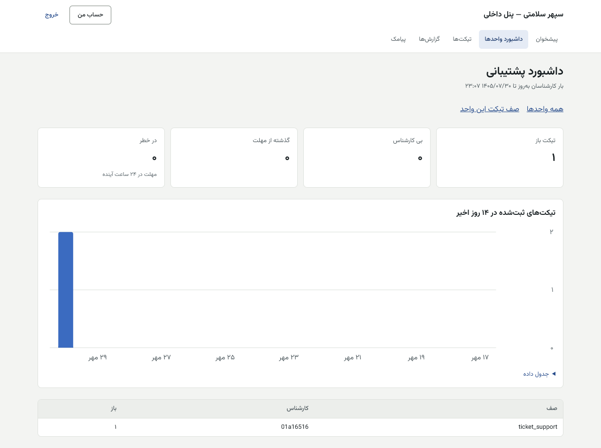
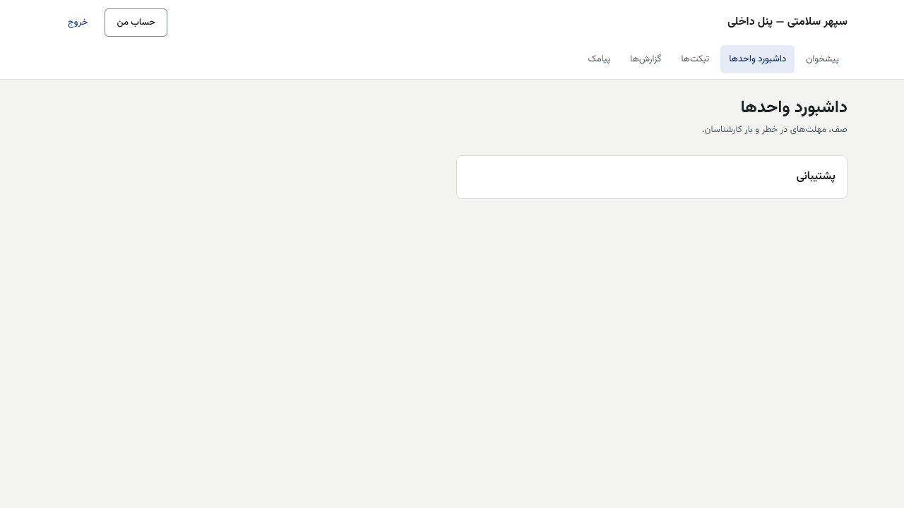
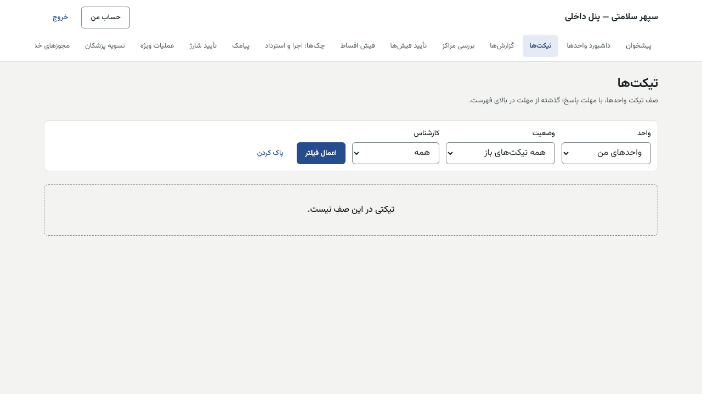
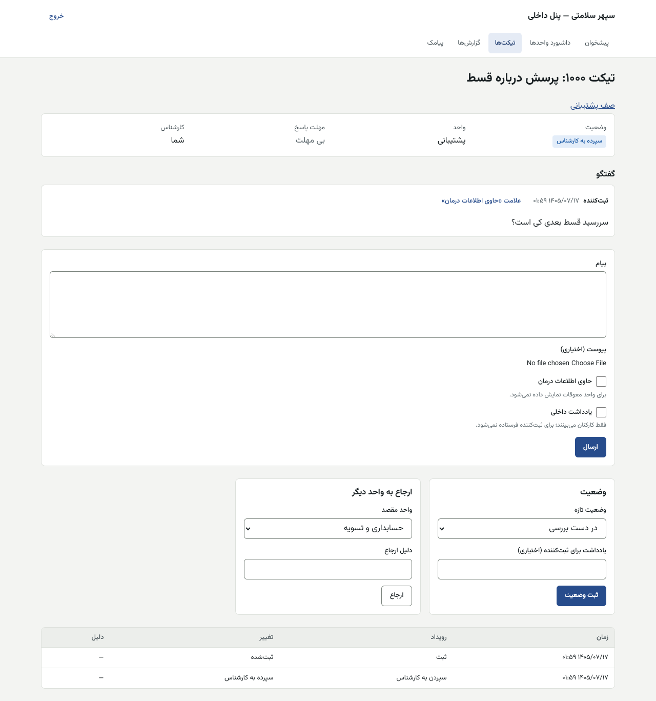
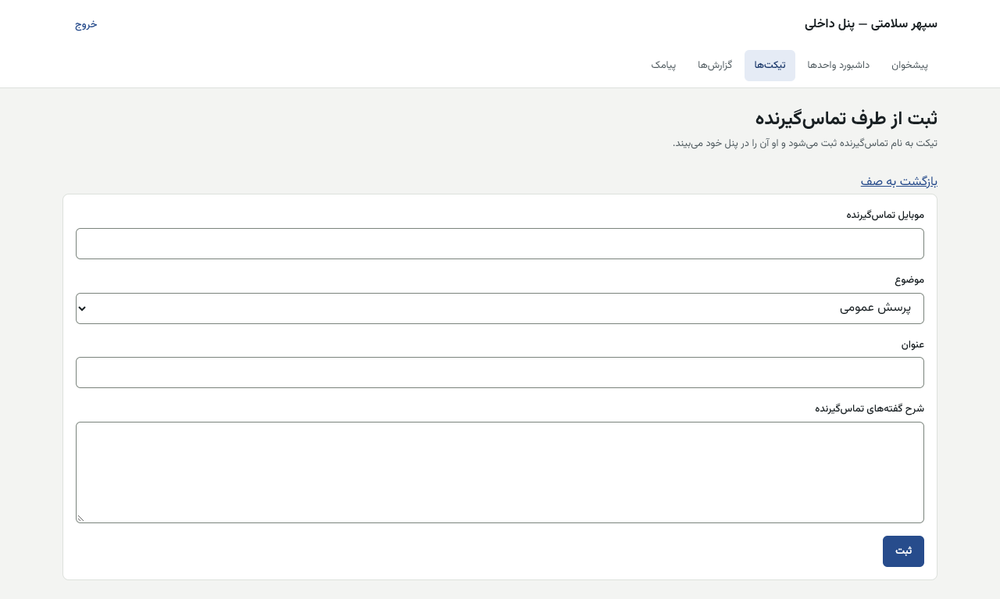

# راهنمای پشتیبانی — پنل داخلی

[فهرست](../README.md) · [جریان پرونده](../case-flow.md) · [واژه‌نامه](../glossary.md)

## ۱. معرفی نقش

نقش `support`. پشتیبانی تیکت‌های بیماران و مراکز را پاسخ می‌دهد، از طرف تماس‌گیرنده تیکت ثبت می‌کند، رضایت پیامک تبلیغاتی را ثبت یا لغو می‌کند و پیامک زمان‌بندی‌شده و پیش‌نویس ارسال گروهی می‌سازد.

**مجوزها:** کار روی تیکت و ثبت از طرف تماس‌گیرنده؛ گزارش‌ها؛ ساخت کمپین پیامک (نه تأییدش)؛ رضایت پیامک؛ دیدن پیامک‌های فرستاده؛ زمان‌بندی پیامک؛ ثبت اعتراض تسویه از طرف مرکز.

**نمی‌تواند:** کمپینی را که خودش ساخته تأیید کند؛ اطلاعات اعتباری یا مالی بیمار را ببیند؛ نوبت یا پرونده را عوض کند؛ شماره بیمار را تغییر دهد (نقش جدا، [patient-mobile-changer.md](patient-mobile-changer.md))؛ هرگز نقش «تغییر شماره بیمار» یا «تأیید موبایل» را نگیرد.

## ۲. ورود و خروج

پنل داخلی، فقط از VPN، با رمز و کد شش‌رقمی. [برای همه کارکنان](../README.md#برای-همه-کارکنان-پنل-مرکز-و-پنل-داخلی).

## ۳. نقشه صفحه‌ها

| منو | کار |
|---|---|
| داشبورد واحدها | صف تیکت واحد، مهلت‌های در خطر، بار کارشناسان |
| تیکت‌ها | صف، گفتگو، ارجاع، تعیین وضعیت؛ «ثبت از طرف تماس‌گیرنده» |
| گزارش‌ها | گزارش‌های مجاز نقش، خروجی CSV و PDF |
| پیامک | قالب‌ها (دیدن)، پیامک زمان‌بندی‌شده، رضایت، پیامک‌های اخیر، ارسال گروهی |

## ۴. کارهای روزانه

### ۴.۱ صف تیکت

1. «تیکت‌ها»: «فیلتر تیکت‌ها» با «واحد» («واحدهای من»)، «وضعیت» («همه تیکت‌های باز»)، «کارشناس» («همه» یا «فقط سپرده به من»). تیکت‌های گذشته از مهلت بالای فهرست‌اند.
2. تیکت را باز کنید. بالا: صف، وضعیت، واحد، «مهلت پاسخ»، کارشناس.
3. «به من اختصاص بده» تا تیکت مال شما شود.
4. پاسخ: در «پیام» بنویسید و «ارسال». برای یادداشتی که ثبت‌کننده نبیند، تیک «یادداشت داخلی». اگر پیام اطلاعات درمان دارد، «حاوی اطلاعات درمان».
5. «تغییر وضعیت» ← «وضعیت تازه» ← «یادداشت برای ثبت‌کننده (اختیاری)» ← «ثبت وضعیت».
6. اگر کار واحد دیگری است: «ارجاع به واحد دیگر» ← «واحد مقصد» ← «دلیل ارجاع» ← «ارجاع».
7. «سابقه» پایین صفحه همه رویدادها را دارد.

| پیام | دلیل |
|---|---|
| «این کارشناس در واحد این تیکت کار نمی‌کند.» | سپردن به کسی بیرون از واحد |
| «تیکت همین حالا در همین واحد است.» | ارجاع به همان واحد |
| «شکایت مالی فقط با تعیین تکلیف اختلاف حل‌شده می‌شود.» | شکایت مالی را حسابداری می‌بندد |
| «این صف مال واحد شما نیست.» | — |

### ۴.۲ ثبت از طرف تماس‌گیرنده

«تیکت‌ها» ← «ثبت از طرف تماس‌گیرنده»: «موبایل تماس‌گیرنده»، «موضوع»، «عنوان»، «شرح گفته‌های تماس‌گیرنده»، «ثبت». تماس‌گیرنده تیکت را در اپ خود می‌بیند.

### ۴.۳ رضایت پیامک تبلیغاتی

«پیامک» ← «رضایت پیامک تبلیغاتی»: «موبایل»، «رضایت تبلیغاتی» («داده شد» یا «لغو شد»)، «ثبت رضایت». فقط به درخواست خود شخص.

### ۴.۴ پیامک زمان‌بندی‌شده

«پیامک» ← «پیامک زمان‌بندی‌شده»: «کد قالب»، «موبایل کارمند» (یا گیرنده)، «روز ارسال»، «ساعت (مثل 10:30)»، «دلیل»، «مقدار فیلدها، هر خط «نام=مقدار»»، «زمان‌بندی». ارسال فقط در ساعت ۸ تا ۲۱ تهران (جز کد ورود و خدمت). لغو: «لغو» در «پیامک‌های اخیر».

### ۴.۵ پیش‌نویس ارسال گروهی

«پیامک» ← «ارسال گروهی (کمپین)» ← «کمپین تازه»: «نام کمپین»، «فیلتر» (مثل «دست‌کم چند روز معوق»)، «کد قالب (خدماتی)»، «ساخت پیش‌نویس و پیش‌نمایش». تأیید و شروع ارسال با نفر دوم است. **کمپین تبلیغاتی غیرفعال در پایلوت.**

### ۴.۶ اعتراض تسویه از طرف مرکز

**رویه دستی در پایلوت (تصمیم مالک ۱۴۰۵/۰۸/۰۱؛ صفحه پس از پایلوت):** پشتیبانی مجوز `settlement.open_dispute` دارد ولی صفحه‌اش در پنل داخلی نیست. اگر مرکز خودش می‌تواند، از پنل مرکز «تیکت‌ها» با موضوع «شکایت مالی» ثبت کند. اگر نمی‌تواند، «ثبت از طرف تماس‌گیرنده» با موبایل مدیر مرکز، موضوع «شکایت مالی» و شماره صورت‌وضعیت و قلم را بنویسید و به واحد مالی ارجاع دهید.

## ۵. قواعد مالی مرتبط

پشتیبانی ثبت مالی ندارد. به بیمار عدد اعتباری، دلیل رد یا امتیاز نگویید. برای شکایت مالی پزشک، فقط ثبت و ارجاع به حسابداری.

## ۶. تأییدهای دونفره

| کار | نفر اول | نفر دوم |
|---|---|---|
| کمپین پیامک | سازنده (شما) | کارمند دیگری با مجوز تأیید؛ بالای ۲۰۰ گیرنده فقط مدیر استراتژی |

## ۷. پرسش‌های متداول

- **بیمار می‌گوید کد ورود نمی‌رسد.** شماره را در «پیامک‌های اخیر» بسنجید. ارسال کد ورود سقف ساعتی دارد.
- **بیمار گوشی‌اش را گم کرده.** فقط کارمندان نقش «تغییر شماره بیمار» (دونفره با مدرک). شما تیکت ثبت کنید.
- **چرا تیکت شکایت مالی را نمی‌توانم ببندم؟** فقط با تصمیم حسابداری بسته می‌شود.

## ۸. چک‌لیست روزانه

- [ ] تیکت‌های «در خطر» و «گذشته از مهلت» در داشبورد واحد.
- [ ] تیکت‌های بی کارشناس.
- [ ] پیامک‌های ناموفق در «پیامک‌های اخیر».

## ۹. سناریوی نمونه (ساختگی)

«مریم نمونه» زنگ می‌زند که فیشش رد شده است. پشتیبانی «ثبت از طرف تماس‌گیرنده» با موضوع «پرسش عمومی» و شرح «فیش قسط آبان رد شد؛ علت را می‌خواهد» را ثبت و به واحد مالی ارجاع می‌دهد. حسابداری در همان تیکت پاسخ می‌دهد که مبلغ فیش با مبلغ واریزی نمی‌خواند.

## ۱۰. ویژگی‌های غیرفعال یا منتظر ورودی

| ویژگی | وضعیت |
|---|---|
| کمپین تبلیغاتی | **غیرفعال در پایلوت** (`notification.promotional_campaigns_enabled`) |
| ثبت اعتراض تسویه از طرف مرکز در پنل داخلی | **رویه دستی در پایلوت**؛ صفحه پس از پایلوت |
| مهلت پاسخ هر موضوع تیکت | پیش‌فرض ۰ (بی مهلت) تا تنظیم |

## تصویرهای لازم

- [تصویر: رضایت پیامک]
