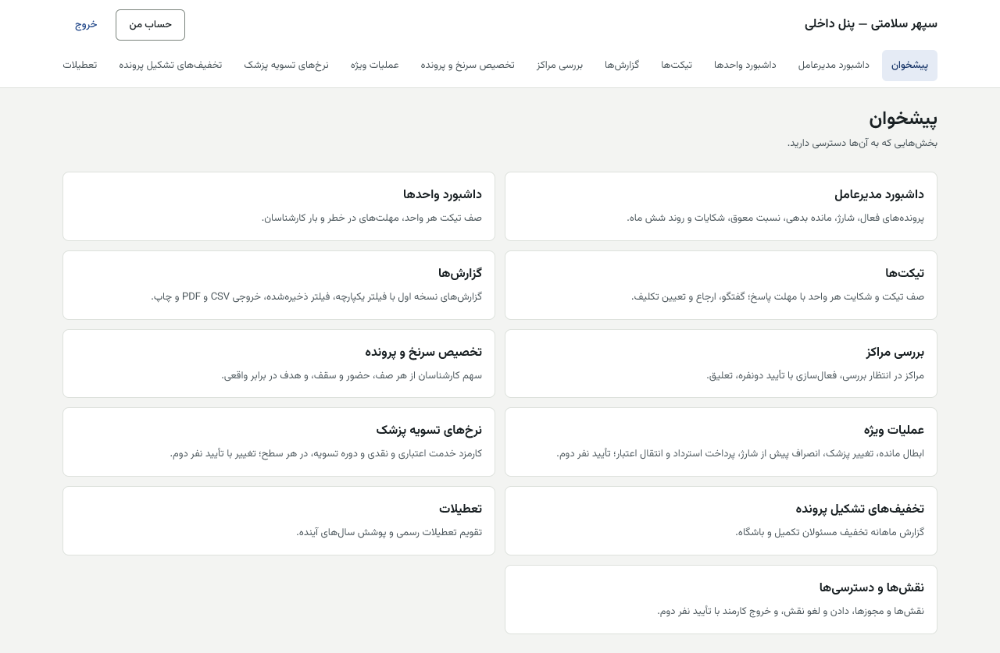
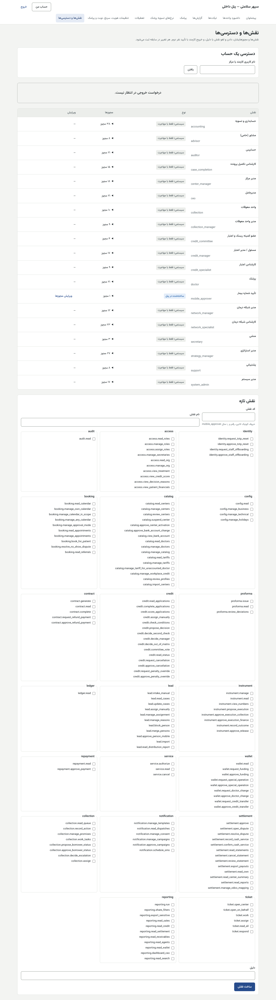
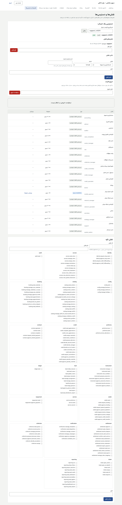
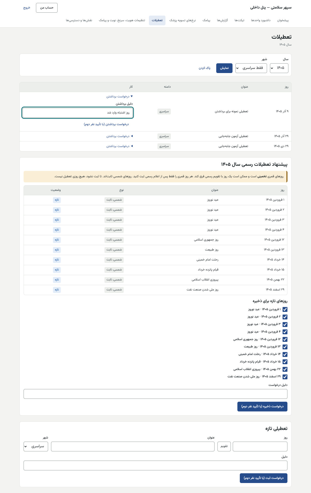
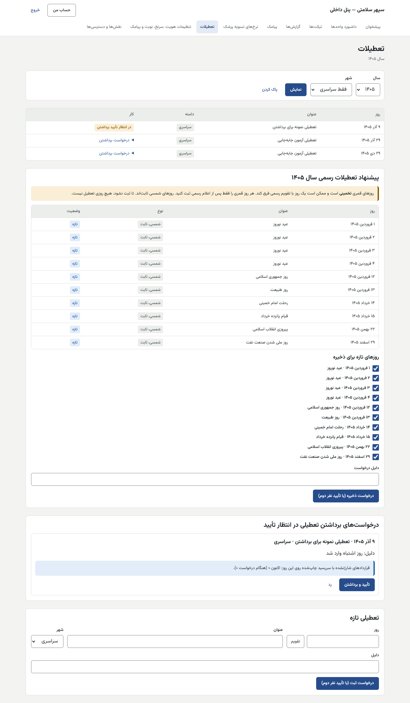
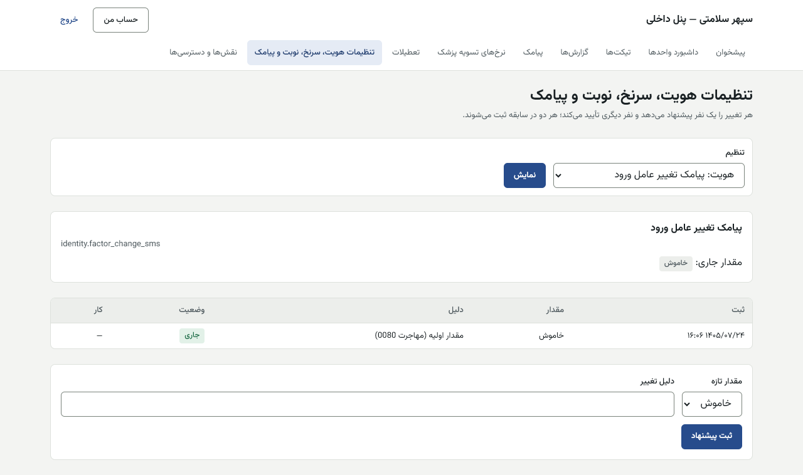
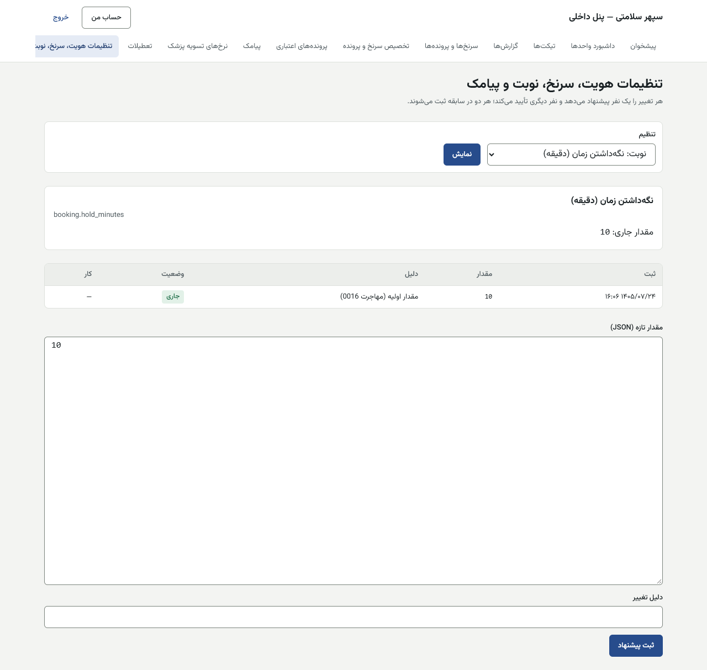
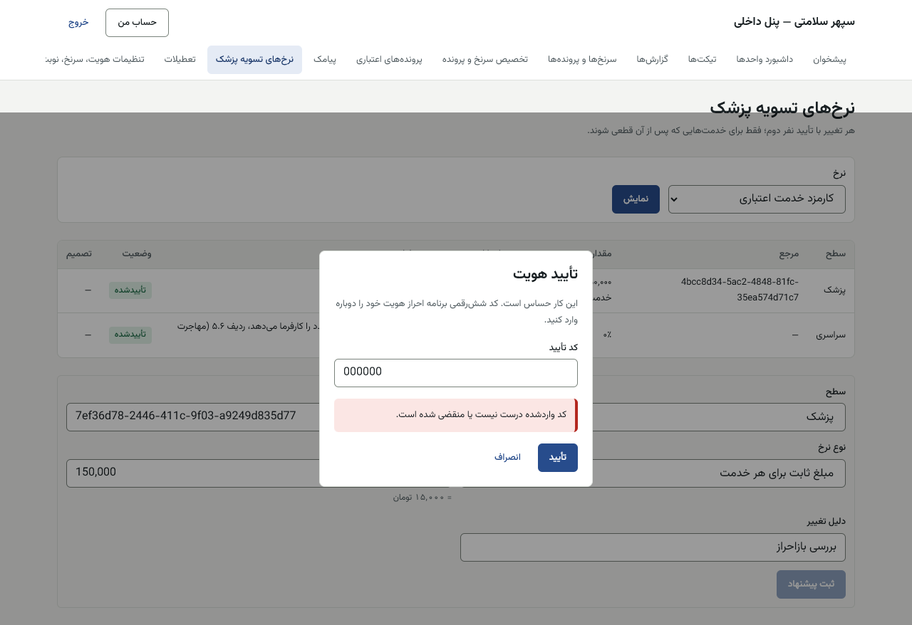

# راهنمای مدیر سیستم — پنل داخلی

[فهرست](../README.md) · [جریان پرونده](../case-flow.md) · [واژه‌نامه](../glossary.md)

## ۱. معرفی نقش

نقش `system_admin`. مدیر سیستم حساب‌ها و نقش‌ها را اداره می‌کند، نقش سفارشی می‌سازد، پرچم‌های هویت و تنظیمات فنی را با نفر دوم عوض می‌کند، تعطیلات را ثبت می‌کند، خروج کارمند و بازنشانی ورود دومرحله‌ای را انجام می‌دهد و بررسی پیش از راه‌اندازی را اجرا می‌کند.

**مجوزها:** دادن نقش؛ ساخت و ویرایش نقش؛ دیدن ساختار و نقش‌ها؛ کاتالوگ؛ تعطیلات؛ پیکربندی فنی و دیدن پیکربندی؛ درخواست و تأیید خروج کارمند؛ درخواست و تأیید بازنشانی TOTP؛ قالب‌های پیامک؛ دیدن پیامک‌های فرستاده؛ گزارش جست‌وجو؛ گزارش‌ها؛ سپردن تیکت.

**نمی‌تواند:** پیشنهاد یا درخواست خودش را تأیید کند؛ پیکربندی **کسب‌وکار** (طرح‌ها، نرخ‌ها، سقف‌ها) را تأیید کند؛ کار مالی یا اعتباری کند؛ داده بیمار را ببیند.

**قاعده طلایی:** دسترسی پیش‌فرض ممنوع است. هر کس فقط نقشی را می‌گیرد که فهرست مالک می‌گوید، با دامنه درست و دلیل.

## ۲. ورود و خروج

پنل داخلی، فقط از VPN. [برای همه کارکنان](../README.md#برای-همه-کارکنان-پنل-مرکز-و-پنل-داخلی). اولین مدیر سیستم پیش از وجود پنل با فرمان سرور ساخته می‌شود (§۴.۱).



## ۳. نقشه صفحه‌ها

| منو | کار |
|---|---|
| نقش‌ها و دسترسی‌ها (`/access`) | نقش‌ها و مجوزها، نقش تازه، دادن و لغو نقش، خروج کارمند |
| تنظیمات هویت، سرنخ، نوبت و پیامک (`/settings`) | پرچم‌های هویت و کلیدهای فنی |
| تعطیلات (`/holidays`) | تقویم تعطیلات، پیشنهاد سال، درخواست دسته‌ای و برداشتن |
| پیامک (`/sms`) | قالب‌ها، پیامک‌های اخیر |
| گزارش‌ها، تیکت‌ها، داشبورد واحدها | — |

## ۴. کارها

### ۴.۱ ساخت حساب کارمند یا مرکز (فقط از سرور)

**صفحه پنل ندارد.** روی سرور:

```
ACCOUNT_KIND=staff ACCOUNT_USERNAME=<نام-کاربری> ACCOUNT_PASSWORD=<رمز-موقت> pnpm account:create
```

- `ACCOUNT_KIND` برای کارکنان مرکز `center` است.
- رمز از متغیر محیطی خوانده می‌شود، نه از خط فرمان. رمز موقت را حضوری بدهید. ورود دومرحله‌ای در اولین ورود فعال می‌شود.
- پیوند حساب پزشک به پرونده پزشک در کاتالوگ: **فقط از API** (`POST /api/v1/catalog/doctors/<شناسه>/account`).
- اولین مدیر سیستم: پس از ساخت حساب، `ACCOUNT_ID=<شناسه> ROLE_CODE=system_admin GRANT_REASON="..." pnpm access:grant` (در سابقه با بازیگر `cli`).

### ۴.۲ دادن و لغو نقش

1. «نقش‌ها و دسترسی‌ها» ← «دسترسی یک حساب» ← «نام کاربری کارمند یا مرکز» ← «یافتن». نوع («کارمند» یا «مرکز») و وضعیت («فعال» یا «غیرفعال»)؛ «نقش‌های فعلی».
2. «دادن نقش»: «نقش»، «دامنه»، «کد یا شناسه دامنه» (برای «همه‌جا» و «فقط رکوردهای خودش» خالی بماند)، «دلیل» ← ثبت. «نقش داده شد.»
3. لغو: «دلیل لغو» ← «لغو نقش». سابقه می‌ماند.

| دامنه در فرم | یعنی | برای |
|---|---|---|
| همه‌جا | همه رکوردها | مدیران، حسابرس، مالی، اعتبار |
| **فقط رکوردهای خودش** | فقط پرونده‌هایی که الان به او سپرده شده | **مشاور (همیشه)** |
| یک شهر (کد شهر) | همه پرونده‌های آن شهر | سرپرست شهری |
| یک صف کار (کد صف) | همه پرونده‌های آن صف | سرپرست صف |
| یک مرکز / یک شعبه / یک پزشک (شناسه گره) | آن گره و زیرمجموعه‌اش | مدیر مرکز، پزشک، منشی |

مشاور با دامنه دیگری پذیرفته نمی‌شود.




### ۴.۳ نقش تازه (سفارشی)

1. «نقش تازه»: «کد نقش» (حروف کوچک لاتین، رقم و `_`؛ مثل `mobile_approver`)، «نام نقش»، مجوزها، «دلیل» ← «ساخت نقش».
2. ویرایش مجوزهای نقش ساخته‌شده در پنل: «ویرایش» ← «ویرایش مجوزها» ← «ذخیره مجوزها». نقش‌های «سیستمی؛ فقط با مهاجرت» از پنل ویرایش نمی‌شوند.

**دو نقش لازم روز راه‌اندازی:**

| نام پیشنهادی | کد پیشنهادی | فقط این مجوز | دارندگان | راهنما |
|---|---|---|---|---|
| تأییدکننده موبایل افزوده | `person_mobile_approver` | `lead.approve_person_mobile` | ۲ و بهتر ۳، «همه‌جا» | [patient-mobile-approver.md](patient-mobile-approver.md) |
| تغییر شماره بیمار | `patient_mobile_changer` | `identity.change_patient_mobile` | ۲ تا ۳ نام‌دار، «همه‌جا»؛ **هرگز مشاور یا پشتیبانی** | [patient-mobile-changer.md](patient-mobile-changer.md) |

و نقش آماده `club_officer` را به مسئول باشگاه بدهید.

### ۴.۴ تعطیلات

> **از ۱۴۰۵/۰۸/۰۲ (مهاجرت 0105): مدیر سیستم مجوز تعطیلات ندارد.** گام‌های زیر برای مدیرعامل (پیشنهاد و تأیید) و **«قائم‌مقام مدیرعامل (فقط تعطیلات)»** (فقط تأیید یا رد) است. کار مدیر سیستم فقط دادن این دو نقش است: روز راه‌اندازی نقش `ceo` به مدیرعامل و نقش `holiday_deputy` به قائم‌مقام، در «نقش‌ها و دسترسی‌ها». بی هر دو، `launch-check` بند ۱۰ FAIL است.

1. «تعطیلات» ← «فیلتر تعطیلات» («سال»، «شهر» یا «فقط سراسری») ← «نمایش».
2. **پیشنهاد سال:** «پیشنهاد تعطیلات سال»: روزهای «شمسی، ثابت» و «قمری، تخمینی». «روزهای قمری … تخمینی است و ممکن است یک روز با تقویم رسمی فرق کند. هر روز قمری را فقط پس از اعلام رسمی ثبت کنید.» «تا ثبت نشود، هیچ روزی تعطیل نیست.»
3. «روزهای تازه برای ذخیره» را تیک بزنید ← «دلیل درخواست» ← «درخواست ذخیره (با تأیید نفر دوم)».
4. نفر دوم: «درخواست‌های ذخیره دسته‌ای در انتظار تأیید» ← «تأیید و ذخیره همه» یا «رد». هشدار: «قراردادهای شارژنشده با سررسید چاپ‌شده روی این روزها: …».
5. **تعطیلی تک:** «تعطیلی تازه» ← «روز»، «عنوان»، «شهر» یا «سراسری»، «دلیل» ← «درخواست ثبت (با تأیید نفر دوم)».
6. **برداشتن:** کنار روز ← «درخواست برداشتن» ← «دلیل برداشتن» ← «درخواست برداشتن (با تأیید نفر دوم)»؛ نفر دوم «تأیید و برداشتن».
7. **روزهای قمری ۱۴۰۵ و ۱۴۰۶ پیش از ۱ بهمن ۱۴۰۵** و فقط پس از اعلام رسمی.




| پیام | دلیل |
|---|---|
| «دست‌کم یک روز را انتخاب کنید.» | — |
| «درخواست شما؛ نفر دیگری باید تأیید کند» | — |

سررسید قسط به خاطر تعطیلی جابه‌جا نمی‌شود (پرچم خاموش به تصمیم کارفرما).

### ۴.۵ پرچم‌های هویت و تنظیمات فنی

«تنظیمات هویت، سرنخ، نوبت و پیامک» ← «انتخاب تنظیم» ← «نمایش» ← «پیشنهاد روشن یا خاموش» (یا «مقدار تازه») ← «دلیل تغییر» ← «ثبت پیشنهاد». نفر دوم در جدول نسخه‌ها «تأیید». ستون وضعیت «جاری» می‌شود.

| کلید | نام در صفحه | روز راه‌اندازی |
|---|---|---|
| `identity.reauth` | بازاحراز TOTP پیش از کار حساس | **روشن** |
| `identity.factor_change_sms` | پیامک تغییر عامل ورود | **روشن** |
| `identity.staff_mobile_required` | موبایل تأییدشده برای کارکنان | **روشن، آخر از همه** (پس از تأیید موبایل همه کارکنان) |
| `identity.session`، `identity.otp`، `identity.staff_login`، `identity.lockout`، `identity.public_rate_limit` | عمر نشست، کد یک‌بارمصرف، ورود کارکنان، قفل، محدودیت نرخ | پیش‌فرض |




**فقط از API (در صفحه نیست):** `identity.patient_mobile_change` (تغییر شماره بیمار؛ **غیرفعال در پایلوت** تا دستور مالک)، `access.internal_panel_ip_allowlist`، `catalog.search_enabled`، `catalog.visit_tariff_internal_only`، `wallet.credit_transfer_enabled` (**غیرفعال در پایلوت**). پیشنهاد: `POST /api/v1/config/proposals` با `{key, scope: {level: "global"}, value, reason}`؛ تأیید نفر دوم: `POST /api/v1/config/proposals/<شناسه>/approve`.

### ۴.۶ خروج کارمند

«نقش‌ها و دسترسی‌ها» ← حساب ← «خروج کارمند» ← «دلیل خروج» ← «درخواست خروج». «درخواست‌های خروج در انتظار نفر دوم» ← نفر دوم «تأیید خروج» یا «رد». «با تأیید نفر دوم، حساب غیرفعال، همه نقش‌ها لغو و همه نشست‌ها بسته می‌شوند. حساب حذف نمی‌شود.» درخواست‌دهنده و تأییدکننده دو نفرند و هیچ‌کدام خود کارمند نیست. حساب VPN را هم‌زمان ببندید.

### ۴.۷ بازنشانی ورود دومرحله‌ای

**فقط از API، دونفره:** `POST /api/v1/identity/totp-resets` (درخواست، مهلت پیش‌فرض ۶ ساعت) و `POST /api/v1/identity/totp-resets/<شناسه>/approve` با نفر دوم. همه نشست‌های کارمند بسته می‌شود و در ورود بعد دوباره فعال‌سازی می‌کند. هویت کارمند را حضوری بسنجید.

### ۴.۸ قالب‌های پیامک

«پیامک» ← «قالب تازه یا نسخه تازه» (همان [strategy-manager.md §۴.۵](strategy-manager.md)). متن قالب‌های مالی و حقوقی منتظر تأیید حقوقی است.

### ۴.۹ بررسی پیش از راه‌اندازی

روی سرور: `pnpm ops:launch-check`. هر FAIL مانع است. فهرست کامل بندها و نتیجه امروز: [pre-launch-checklist.md](../../ops/pre-launch-checklist.md). معنی هر PASS، WARN و FAIL و کار لازم برای هر کدام: [راهنمای استقرار، فصل ۶](../../ops/deployment/06-initial-setup.md#۶۵-pnpm-opslaunch-check). ساخت اولین مدیر سیستم از خط فرمان سرور: [همان فصل §۶.۱](../../ops/deployment/06-initial-setup.md#۶۱-اولین-مدیر-سیستم).

## ۵. قواعد مالی مرتبط

مدیر سیستم عدد مالی تنظیم نمی‌کند (کسب‌وکار با مدیر استراتژی). ولی نقش‌های مالی را با دقت بدهید: هر تأیید دونفره دست‌کم **دو دارنده** همان مجوز می‌خواهد (حسابداری ۲، مدیر استراتژی ۲، بازبین تفکیک ۲، تأییدکننده موبایل ۲ تا ۳).

## ۶. تأییدهای دونفره

| کار | نفر اول | نفر دوم |
|---|---|---|
| کلید فنی و پرچم هویت | مدیر سیستم | مدیر سیستم دیگر |
| تعطیلات | مدیرعامل | جانشین مدیرعامل در تعطیلات |
| خروج کارمند | مدیر سیستم یا مدیرعامل | دیگری |
| بازنشانی TOTP | مدیر سیستم | مدیر سیستم دیگر |

**نتیجه:** دست‌کم **دو مدیر سیستم** لازم است.

## ۷. پرسش‌های متداول

- **کارمند می‌گوید منو خالی است.** «هنوز دسترسی‌ای به شما داده نشده است.»: نقش ندارد.
- **پیام «ورود به پنل از این شبکه مجاز نیست.»**: از VPN وصل نیست، یا فهرست مجاز IP درست نیست.
- **نقش اشتباه دادم.** «لغو نقش» با دلیل.

## ۸. چک‌لیست

**روز راه‌اندازی:** حساب‌ها و نقش‌ها طبق فهرست مالک؛ دو نقش سفارشی؛ `club_officer`؛ سه پرچم هویت؛ launch-check. **هفتگی:** حساب‌های بی‌استفاده؛ خروج کارمندان رفته. **سالانه:** یادآوری تعطیلات سال بعد به مدیرعامل.

## ۹. سناریوی نمونه (ساختگی)

مدیر سیستم «الف» حساب `advisor.sample` را با فرمان سرور می‌سازد، در پنل نقش «مشاور (حامی)» با دامنه «فقط رکوردهای خودش» و دلیل «استخدام ۱۴۰۵/۰۸/۰۱» می‌دهد. سپس «بازاحراز TOTP پیش از کار حساس» را با دلیل «راه‌اندازی» پیشنهاد می‌دهد؛ «ب» تأیید می‌کند.



## ۱۰. ویژگی‌های غیرفعال یا منتظر ورودی

| ویژگی | وضعیت |
|---|---|
| ساخت حساب از پنل | **فقط از سرور** |
| بازنشانی TOTP | **فقط از API** |
| تغییر شماره بیمار | **غیرفعال در پایلوت**؛ پرچم **فقط از API** |
| انتقال اعتبار | **غیرفعال در پایلوت** |
| بازاحراز روی تأییدهای مالی | **در دست ساخت** (م۳) |
| برداشتن مجوز تعطیلات از نقش مدیر سیستم | **انجام شد** (۱۴۰۵/۰۸/۰۲، مهاجرت 0105) |

## تصویرهای لازم

- [تصویر: نقش تازه]
- [تصویر: خروج کارمند]
- [تصویر: پیشنهاد تعطیلات سال]
